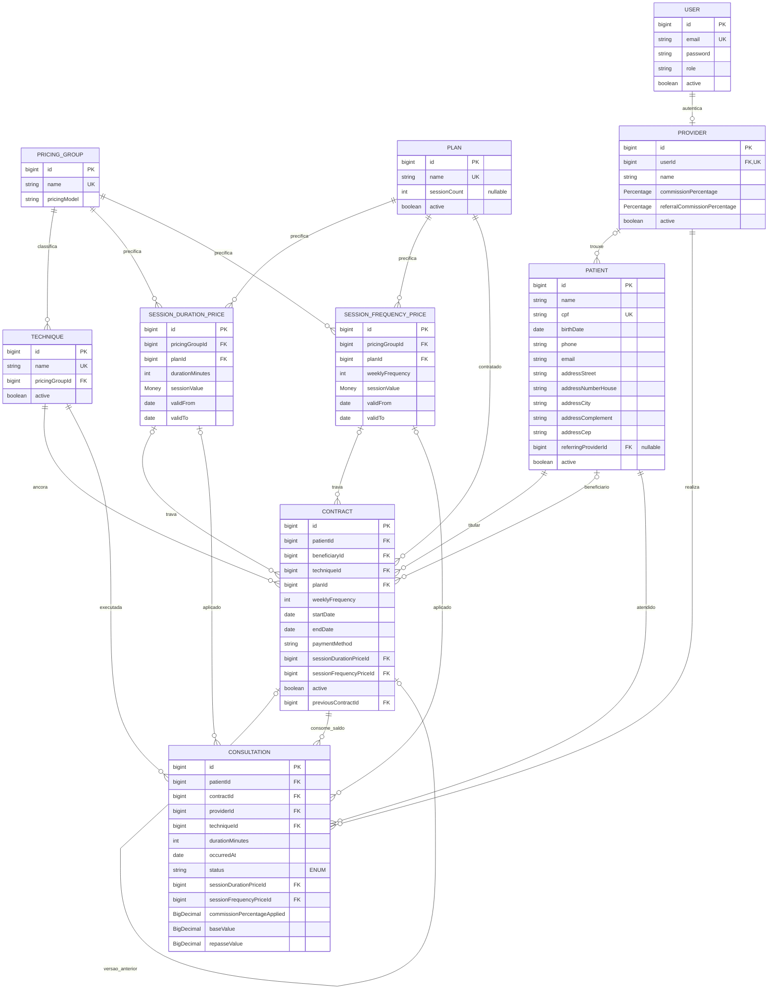

# Modelo de domínio — referência completa

> Consulte este arquivo antes de propor qualquer mudança de schema ou entidade.
> Ele documenta não só a estrutura final, mas o raciocínio por trás de cada
> decisão — várias delas já foram tentadas de outra forma e revertidas por um
> motivo específico, registrado abaixo.

## Diagrama entidade-relacionamento

Legenda: `addressStreet`/`addressNumberHouse`/`addressCity`/`addressComplement`/
`addressCep` em `Patient` são um Value Object embutido (`@Embeddable`), não uma
tabela própria (`cep`, não `zipCode` — é um conceito específico do endereçamento
brasileiro, não uma tradução literal de "zip code"). `pricingModel`, `role`,
`paymentMethod` e `status` são ENUMs. `sessionDurationPriceId`/`sessionFrequencyPriceId`
(em `Contract` e `Consultation`) são nullable, em padrão "exclusive arc": sempre um
preenchido, nunca os dois. `Money` e `Percentage` são Value Objects persistidos como
`DECIMAL` por `AttributeConverter` (ver `SessionDurationPrice` e `Provider`). `UK` =
coluna `unique`. Os valores de `Consultation` ainda são `BigDecimal`: passam a
`Money`/`Percentage` no redesenho do módulo.

**Soft delete:** `Patient`, `Technique`, `Contract`, `User` e `Provider` nunca são
removidos do banco; o `DELETE` só inativa (`active = false`). Inativar um registro
que **já está inativo** é rejeitado com 409 — a regra fica no `deactivate()` da
própria entidade, que conhece o próprio estado.

**Unicidade de nome e CPF:** nome de `PricingGroup`, `Technique` e `Plan`, CPF de
`Patient` e e-mail de `User` são únicos. A garantia real é o `unique` da coluna; o
service checa antes (`existsBy...`) só para devolver um 409 com mensagem clara. A
collation padrão do MySQL ignora maiúsculas e acentos na comparação, então
"Essencial" e "essencial" contam como o mesmo nome.

---

## `Patient`

| Atributo | Tipo | Observação |
|---|---|---|
| `id` | Long | auto-increment |
| `name` | string | obrigatório |
| `cpf` | string, unique | obrigatório; só os 11 dígitos, sem pontuação |
| `birthDate` | date | obrigatório; não pode ser futura |
| `phone` | string, nullable | opcional |
| `email` | string, nullable | opcional; formato validado quando informado |
| `address` | VO embutido (street, numberHouse, city, complement, cep), nullable | `@Embeddable`/`@Embedded`, imutável (sem setter); opcional |
| `referringProviderId` | FK → Provider, nullable | origem: prestador que trouxe o paciente; `null` = paciente da clínica |
| `active` | boolean | soft delete |

**Origem do paciente (`referringProviderId`):** define o percentual de repasse dos
atendimentos (ver `Provider` e `Consultation`).
- **`null`** → paciente da clínica (já estava na clínica, ou chegou por ela).
- **preenchido** → paciente trazido por aquele prestador (veio pela influência dele).
- Por que `null` e não um "id da clínica": um valor especial exigiria um prestador
  fictício na tabela, ou um número que não aponta para nada. O nulo diz "não foi
  trazido por ninguém", e a FK garante que, quando preenchido, o prestador existe.
- **Pode ser alterada** (ex: corrigir um cadastro errado). Os atendimentos já
  lançados não mudam: o percentual aplicado é snapshot no `Consultation`.
- Ao **atribuir** um prestador (novo ou diferente do atual), ele precisa existir
  (404) e estar ativo (400). Manter o mesmo prestador, mesmo que ele tenha sido
  inativado depois, é permitido — mesma ideia do aditivo de contrato: o que é novo
  precisa ser válido.

**Por que endereço é Value Object, não entidade própria:** não existe caso de uso
em que precisamos rastrear a identidade de um endereço ao longo do tempo — trocar
de endereço é substituição de valor, não edição de um registro com vida própria.

**Regras do endereço:** o endereço como um todo é opcional, mas quando informado
precisa estar completo — `street`, `numberHouse`, `city` e `cep` obrigatórios;
só `complement` é opcional. `cep` com exatamente 8 dígitos, sem hífen (mesmo
formato do CPF: só dígitos). `numberHouse` é texto livre para aceitar "S/N". A
regra fica no construtor do próprio `Address` (vale para qualquer caminho) e é
repetida no `AddressDTO` para os erros saírem junto com os demais campos.

**Atualização (`PUT`):** dados pessoais e de contato são substituídos pelo que vier
no request (`phone`/`email` nulos apagam o valor). O endereço é a exceção: `address`
nulo **mantém** o endereço atual; preenchido, substitui o atual por inteiro (é um
Value Object — não dá para mandar só o `cep`). *Consequência aceita: não existe
caminho para remover um endereço depois de cadastrado.* `referringProviderId`
segue a regra geral: nulo no `PUT` torna o paciente **da clínica** — o frontend
deve sempre reenviar a origem atual (formulário preenchido).

**Por que `Patient` não referencia `Contract`:** o relacionamento é sempre
unidirecional `Contract → Patient`. Se `Patient` tivesse uma coleção de contratos,
o módulo `patient` passaria a depender do módulo `contract`, criando ciclo (já que
o inverso é verdadeiro por natureza).

**Por que a origem fica no `Patient` (e não no `Contract`):** a origem é do
**paciente**, não de um contrato — no contrato, ela teria que ser preenchida de novo
a cada renovação, e um esquecimento pagaria o percentual errado. O custo: o módulo
`patient` passa a depender de `provider` (deixa de ser módulo de base). Continua
unidirecional — `provider` nunca referencia `patient` — então não há ciclo.

---

## `Technique`

| Atributo | Tipo | Observação |
|---|---|---|
| `id` | Long | auto-increment |
| `name` | string, unique | |
| `pricingGroupId` | FK → PricingGroup | fixo após a criação |
| `active` | boolean | soft delete |

**Técnica não muda de grupo:** o grupo define a tabela de preço da técnica, e
contratos e atendimentos já foram fechados com base nele. Reclassificar uma
técnica é cadastrar uma técnica nova no grupo certo e inativar a antiga — os
registros antigos continuam apontando para a técnica com o grupo de então.

**Por que sem preço nem duração:** técnicas do mesmo grupo de precificação (ex:
Miofascial, RPG, Massoterapia, Pilates Individual — mesmo grau de complexidade
COFFITO) compartilham exatamente o mesmo valor. Guardar preço na técnica geraria
duplicação replicada em cada reajuste, com risco de divergência silenciosa.

---

## `Plan`

| Atributo | Tipo | Observação |
|---|---|---|
| `id` | Long | auto-increment |
| `name` | string, unique | |
| `sessionCount` | int, nullable | quantidade de sessões do pacote; `null` nos planos do Pilates em Grupo |
| `termWeeks` | int, nullable | prazo do plano em semanas; só nos planos do Pilates em Grupo, `null` nos demais |
| `active` | boolean | |

**Planos atuais da clínica:**

| Plano | `sessionCount` | `termWeeks` | Usado em |
|---|---|---|---|
| Avulso | 1 | `null` | grupos `DURATION_BASED` — **só em atendimento sem contrato** |
| Essencial | 4 | `null` | grupos `DURATION_BASED` |
| Evolução | 12 | `null` | grupos `DURATION_BASED` |
| Evolução Familiar | 12 | `null` | grupos `DURATION_BASED` (preço cadastrado hoje só no Individual Padrão; os demais grupos serão cadastrados) |
| Transformação / Transformação Familiar | 26 | `null` | grupos `DURATION_BASED` |
| Vitalidade / Vitalidade Familiar | 52 | `null` | grupos `DURATION_BASED` |
| Mensal | `null` | 4 | Em Grupo (`FREQUENCY_BASED`) |
| Trimestral | `null` | 13 | Em Grupo (`FREQUENCY_BASED`) |
| Semestral / Semestral Familiar | `null` | 26 | Em Grupo (`FREQUENCY_BASED`) |
| Anual / Anual Familiar | `null` | 52 | Em Grupo (`FREQUENCY_BASED`) |

**Por que `sessionCount` é nullable:** no Pilates em Grupo o plano não é um
pacote de sessões, e sim um valor mensal definido pelo plano e pela frequência
semanal (ex: Mensal 1x/semana = 4 aulas no mês, 3x/semana = 12). Gravar um número
fixo seria um dado enganoso, que uma tela ou relatório poderia usar errado. O
plano não sabe em qual grupo é usado (a ligação é a linha de preço), então a regra
"preço por duração exige plano com `sessionCount`" é validada na criação da linha
de preço por duração (que recebe o plano), não no próprio plano.

**Prazo dos planos do Grupo (`termWeeks`):** num contrato só com Pilates em
Grupo não há sessões para calcular a vigência (ver "Vigência e frequência" em
`Contract`), então o prazo vem do plano: Mensal 4, Trimestral 13, Semestral 26,
Anual 52 semanas (Familiares iguais ao plano base). Também é usado para limitar a
escolha do plano do item do Grupo num contrato misto (ver "Plano do item do
Grupo" em `Contract`).
- **Em semanas**, como o prazo dos itens por duração — mesma unidade para
  comparar. Mensal = 4 bate com "Mensal 1x/semana = 4 aulas"; Trimestral = 13
  (não 12) mantém a proporção interna do Grupo (13 × 2 = 26, 13 × 4 = 52).
- Nos planos por duração fica `null`: o prazo deles sai do cálculo sessões ÷
  frequência, no contrato.
- *Descartados:* prazo em meses (comparar meses com as semanas dos itens gera
  diferença de dias — 52 semanas = 364 dias, contra 365 de 12 meses) e derivar o prazo
  pelo de-para (Trimestral = prazo do Evolução semanal): o prazo do Grupo viraria
  consequência das sessões de outro plano — se o Evolução mudar de sessões, o
  Trimestral mudaria junto sem ninguém mexer nele.

**Por que o Grupo mantém planos com nomes próprios:** é outro conceito de plano
(mensalidade por frequência, não pacote de sessões), por isso não compartilha os
planos dos grupos por duração.

**Equivalência de planos (de-para):** liga os planos dos grupos por duração aos
do Pilates em Grupo, **independente da frequência**:

| Plano por duração | Plano do Grupo |
|---|---|
| Essencial | Mensal |
| Evolução | Trimestral |
| Evolução Familiar | Trimestral (só nesse sentido: o Trimestral volta para o Evolução) |
| Transformação | Semestral |
| Transformação Familiar | Semestral Familiar |
| Vitalidade | Anual |
| Vitalidade Familiar | Anual Familiar |
| Avulso | sem equivalente — o Grupo exige contrato |

Vale nos dois sentidos, exceto a linha do Evolução Familiar. Usado em:
- **Contrato misto:** sugere o plano do item do Grupo a partir do plano do
  contrato (o usuário pode trocar — ver "Plano do item do Grupo" em `Contract`).
- **Atendimento fora do grupo contratado:** define o plano cujo preço atual é
  cobrado (caso 2 da "Lógica de resolução de preço" em `Consultation`).

*Onde guardar fica para a implementação (sugestão: `Plan.equivalentPlanId`).*

**Avulso:** é só o preço de quem é atendido sem contrato — nunca entra em
contrato (ver `Contract`). *Como o sistema reconhece o Avulso sem depender do
nome do plano fica para a implementação.*

**Por que sem frequência nem desconto (e, nos planos por duração, sem prazo):** a
mesma quantidade de sessões pode ser consumida em ritmos diferentes — um
Vitalidade (52 sessões) a 2x/semana dura 26 semanas; a 1x/semana, 52. A
frequência é negociação e vive no item do contrato; o prazo é calculado a partir
dela (ver "Vigência e frequência" em `Contract`). A exceção é o Grupo, cujo prazo
é parte do produto (`termWeeks`). Desconto é sempre calculado em tempo de leitura
(ver seção de preço abaixo), nunca armazenado.

---

## `PricingGroup`

| Atributo | Tipo | Observação |
|---|---|---|
| `id` | Long | auto-increment |
| `name` | string, unique | |
| `pricingModel` | ENUM: `DURATION_BASED` \| `FREQUENCY_BASED` | discriminador; fixo após a criação |

**Por que existe:** técnicas de mesmo grau de complexidade COFFITO compartilham
uma única tabela de preço. O grupo é quem carrega o preço; a técnica só aponta
para o grupo. Reajustar o valor do grupo atualiza automaticamente todas as
técnicas associadas, sem precisar editar cada uma.

**Grupos atuais da clínica:**

| Grupo | Técnicas | `pricingModel` | Tabela de preço |
|---|---|---|---|
| Individual Padrão | Liberação Miofascial, RPG, Massoterapia, Pilates Individual | `DURATION_BASED` | `SessionDurationPrice` |
| Individual Especializado | Quiropraxia, Reabilitação Vestibular | `DURATION_BASED` | `SessionDurationPrice` |
| Em Dupla | Pilates em Dupla | `DURATION_BASED` | `SessionDurationPrice` |
| Em Grupo | Pilates em Grupo | `FREQUENCY_BASED` | `SessionFrequencyPrice` |

**Por que esses nomes:** o grupo representa um conjunto de técnicas com o mesmo
preço, então o nome diz *por que* elas custam igual, e não repete o nome de uma
técnica (o que confundia grupo e técnica em telas e relatórios — ex: "Quiropraxia"
era tanto o grupo quanto uma de suas técnicas). Dois fatores definem o preço: o
**formato do atendimento** (individual, dupla, grupo) e, no individual, o **nível
de especialização** (padrão × especializado, ligado ao grau de complexidade
COFFITO). Uma técnica nova com o mesmo preço entra no grupo correspondente (ex:
um futuro "RPG em dupla" com o preço da dupla entraria em "Em Dupla").

Grupos com uma única técnica (Em Dupla, Em Grupo) são válidos: o grupo existe
porque carrega uma tabela de preço própria. Note que "Pilates" aparece em três
grupos diferentes — Pilates Individual é precificado no Individual Padrão, e só o
Pilates em Grupo é por frequência.

**Por que o discriminador `pricingModel`:** a maioria dos grupos precifica por
`duração da sessão × plano` (`DURATION_BASED`). O Pilates em Grupo precifica por
`frequência semanal × plano` (`FREQUENCY_BASED`) — o preço por sessão não é uma
multiplicação simples do valor unitário, é uma tabela de desconto por volume
publicada à parte (embute cálculo de feriados). As duas estratégias não cabem na
mesma tabela sem colunas nulas para a maioria das linhas, por isso duas tabelas
de preço separadas (abaixo).

**`pricingModel` nunca muda:** as linhas de preço do grupo já estão na tabela
correspondente a ele. Trocar o discriminador deixaria essas linhas (e os contratos
que as travaram) na tabela errada. Um grupo com outro modelo de preço é um grupo
novo.

---

## `SessionDurationPrice` (grupos `DURATION_BASED`)

| Atributo | Tipo | Observação |
|---|---|---|
| `id` | Long | auto-increment |
| `pricingGroupId` | FK → PricingGroup | |
| `planId` | FK → Plan | |
| `durationMinutes` | int | eixo de duração |
| `sessionValue` | `Money` (VO) | coluna `DECIMAL(10,2)` via `MoneyConverter` |
| `validFrom` | date | |
| `validTo` | date, nullable | `null` = vigente; **exclusivo** (ver convenção abaixo) |

## `SessionFrequencyPrice` (grupos `FREQUENCY_BASED`)

| Atributo | Tipo | Observação |
|---|---|---|
| `id` | Long | auto-increment |
| `pricingGroupId` | FK → PricingGroup | |
| `planId` | FK → Plan | |
| `weeklyFrequency` | int | eixo de frequência |
| `sessionValue` | `Money` (VO) | coluna `DECIMAL(10,2)` via `MoneyConverter` |
| `validFrom` | date | |
| `validTo` | date, nullable | `null` = vigente; **exclusivo** (ver convenção abaixo) |

**Valor em dinheiro (`Money`):** `sessionValue` é o Value Object `Money`
(módulo `pricing`), não um `BigDecimal` solto. Regras do próprio `Money`:
obrigatório, nunca negativo, no máximo 2 casas decimais e escala sempre
normalizada em 2 (`220` vira `220.00`). Valor com mais de 2 casas (ex: `220.555`)
é **rejeitado (400), nunca arredondado** — arredondar em silêncio esconderia um
valor digitado errado. Zero é um `Money` válido; "maior que zero" é regra da
linha de preço (`Money.isPositive()`), não do dinheiro em si. O modo de
arredondamento do cálculo de repasse ainda não foi decidido (entra com o
`Consultation`).

**Regra de unicidade:** só pode existir uma linha com `validTo IS NULL` por
combinação de `(pricingGroupId, durationMinutes, planId)` — ou
`(pricingGroupId, weeklyFrequency, planId)` na tabela de frequência.

**Reajuste nunca é `UPDATE`.** Sempre: fecha a linha vigente (`validTo` = hoje) e
insere uma nova com `validFrom` = hoje. Isso preserva o histórico completo de
preços — requisito de rastreabilidade do escopo original do projeto — e garante
que contratos antigos continuem apontando para o valor que estava vigente na
assinatura.

**Convenção de datas: `validTo` é exclusivo.** A vigência de uma linha de preço é
o intervalo semiaberto `[validFrom, validTo)`: a linha vale a partir de
`validFrom` (inclusive) até o dia **anterior** a `validTo`. Ex: `validFrom =
01/10`, `validTo = 15/10` → valeu de 01/10 a 14/10; em 15/10 já vale a linha nova.
- Por que: a linha antiga fecha e a nova abre na **mesma data**, sem a conta do
  "ontem" e sem dois preços valendo no mesmo dia.
- Dois reajustes no mesmo dia geram uma linha com intervalo vazio
  (`[15/10, 15/10)`): ela foi substituída no mesmo dia e não vale em nenhum dia.
  Não é um estado inválido — se um contrato a travou nesse meio-tempo, continua
  com ela, como em qualquer reajuste. Por isso não há bloqueio de reajuste no
  mesmo dia (corrigir um valor digitado errado é só cadastrar de novo).
- Consulta "preço vigente na data X": `validFrom <= X AND (validTo IS NULL OR
  validTo > X)` — **`>`, nunca `>=`**.
- ⚠️ **Diferente do `endDate` de `Contract`, que é inclusivo** (o último dia
  ainda conta). O `endDate` é o "último dia" combinado com o paciente; o
  `validTo` é o momento de troca de preço. Atenção ao comparar os dois.

**Cadastro de valor (novo preço ou reajuste):** um único fluxo cobre os dois
casos — para a clínica, ambos significam "a partir de hoje, essa combinação custa
X". A clínica informa grupo, plano, eixo (duração ou frequência) e valor:
- **sem linha vigente** para a combinação → cria a linha com `validFrom` = hoje;
- **com linha vigente** → fecha a atual (`validTo` = hoje) e cria a nova com
  `validFrom` = hoje.

`validFrom` é sempre hoje, nunca vem do request: como vigente = `validTo` nulo,
uma linha com início futuro já contaria como vigente antes da hora. Reajuste
agendado fica como melhoria futura.

Validações do cadastro: o `pricingModel` do grupo corresponde à tabela usada
(preço por duração só em grupo `DURATION_BASED`, por frequência só em
`FREQUENCY_BASED`); o plano está ativo; preço por duração exige plano com
`sessionCount` preenchido; valor maior que zero.

**Percentual de desconto nunca é persistido.** É sempre calculado em tempo de
leitura: `1 − (valorDoPlano / valorDeReferência)`, onde a referência é o Avulso da
mesma técnica/grupo quando existir, ou o Mensal quando não existir Avulso (caso do
grupo Em Grupo). Guardar os dois campos (valor absoluto e percentual) gera risco de
dessincronia a cada reajuste.

---

## `Contract` e `ContractItem`

> ⚠️ **Modelo decidido, ainda não implementado.** O código atual (`ContractEntity`)
> segue o modelo anterior: um contrato com uma única técnica-âncora e uma única
> linha de preço. Ele será refeito para este modelo (cabeçalho + itens) junto com
> o `Consultation`.

O contrato é um agregado em duas partes: o **cabeçalho** (`Contract`, raiz do
agregado), com o que vale para o contrato inteiro, e os **itens**
(`ContractItem`), um por grupo de preço contratado. Ex: um contrato Evolução com
RPG e Quiropraxia tem um item do Individual Padrão e um do Individual
Especializado.

### `Contract` (cabeçalho)

| Atributo | Tipo | Observação |
|---|---|---|
| `id` | Long | auto-increment |
| `patientId` | FK → Patient | titular, obrigatório; nunca muda (trocar o titular = contrato novo) |
| `beneficiaryId` | FK → Patient, nullable | Pilates em Dupla / plano Familiar |
| `planId` | FK → Plan | plano único do contrato (ex: Evolução); nunca o Avulso |
| `startDate` | date | informado |
| `endDate` | date | **calculado pelo sistema**, inclusivo (ver "Vigência e frequência") |
| `paymentMethod` | ENUM | única para o contrato inteiro |
| `active` | boolean | soft delete |
| `previousContractId` | FK → Contract, nullable, unique | versão anterior (aditivo); null na primeira versão |

### `ContractItem` (um por grupo de preço)

| Atributo | Tipo | Observação |
|---|---|---|
| `id` | Long | auto-increment |
| `contractId` | FK → Contract | |
| `sessionDurationPriceId` | FK → SessionDurationPrice, nullable | exclusive arc: linha de preço travada |
| `sessionFrequencyPriceId` | FK → SessionFrequencyPrice, nullable | exclusive arc: linha de preço travada |
| `techniqueId` | FK → Technique | só informativa (aparece no contrato impresso) |
| `frequency` | ENUM `SessionFrequency`, nullable | ritmo negociado; só em item de grupo por duração |

**Regras do item:**
- **Um item por grupo de preço** no mesmo contrato. O grupo não é coluna do item
  (vem da linha travada — derivável), então a regra é garantida pelo agregado
  (`Contract`), não por `unique` no banco.
- **Plano do item:** item de grupo por duração usa uma linha do **plano do
  contrato**. Item do Pilates em Grupo usa um plano do Grupo escolhido pela regra
  de "Plano do item do Grupo" (abaixo). Num contrato só com Grupo, o plano do
  contrato é o próprio plano do Grupo.
- **Técnica só informativa:** registra o que foi vendido (ex: "Liberação
  Miofascial e Quiropraxia" no contrato impresso), mas não restringe o
  atendimento — o paciente pode ser atendido em qualquer técnica do grupo do item.
  Precisa ser do grupo da linha de preço; técnica nova precisa estar ativa.
- **Frequência:** em item de grupo por duração é negociação (não afeta o preço) e
  define o prazo do item (ver "Vigência e frequência"). No item do Grupo fica
  nula: a frequência (1x/2x/3x por semana) é o eixo do preço e já está na linha
  travada.
- **Exclusive arc no item** (não mais no cabeçalho): `CHECK` garante que
  exatamente uma das duas FKs de preço esteja preenchida (*pendente: entra junto
  com as migrations do Flyway; até lá, garantida no código*).

**Preço travado:** o item trava, na assinatura, a linha de preço vigente naquele
instante — mesmo que o catálogo seja reajustado depois, o contrato mantém o valor
combinado até o fim da vigência. O preço travado vale para **qualquer técnica do
grupo do item, na mesma duração da linha**. Fora disso (outra duração, outro
grupo), o atendimento paga o preço atual (ver "Lógica de resolução de preço" em
`Consultation`). *Descartado:* uma "tabela de preço anual" no lugar das linhas
individuais com `validFrom`/`validTo`.

**A linha de preço é a fonte da verdade.** Tudo que a linha já contém é copiado
dela, nunca recebido do request: o grupo do item e, no Grupo, a frequência.
Receber esses dados separados criaria redundância — o request poderia mandar um
grupo ou frequência diferente do preço travado, e o item nasceria incoerente.
Pelo mesmo motivo, o sistema valida que a técnica pertence ao grupo da linha, que
o grupo usa a tabela de onde a linha veio (`pricingModel`) e que a linha é do
plano certo (ver "Plano do item").

**Saldo de sessões por item:** cada item de grupo por duração tem as
`sessionCount` do plano — contrato Evolução com RPG + Quiropraxia = 12 sessões do
Individual Padrão **e** 12 do Individual Especializado — somando os atendimentos
de toda a cadeia de versões. Item do Grupo não tem saldo de sessões. O cálculo
fica no módulo `consultation` (ver `Consultation`).

### Titular e beneficiário

**Sobre `beneficiaryId`:** cobre tanto o Pilates em Dupla (titular + acompanhante
compartilhando o mesmo saldo) quanto os planos Familiares (dois contratos
distintos, cada um com seu próprio titular e beneficiário — o grau de parentesco
entre os titulares é checado manualmente pela clínica na venda, o sistema não
guarda nem valida isso).

- **Beneficiário não é obrigatório, nem no Pilates em Dupla:** nada impede o
  paciente de contratar a dupla e usar sozinho. O sistema não exige nem proíbe
  beneficiário em nenhum plano.
- **Um paciente pode ser beneficiário e titular ao mesmo tempo:** ser beneficiário
  de um contrato não impede de ser titular de outro (nem beneficiário de mais de
  um). Só o titular está sujeito à regra de um contrato vigente. Decisão atual,
  revisável se surgir necessidade.

### Vigência e frequência

**O `endDate` é sempre calculado pelo sistema.** O usuário informa o início e, em
cada item, a linha de preço e a frequência; o sistema calcula o fim:
`endDate = startDate + prazo do contrato − 1 dia` (o `endDate` é inclusivo). Ex:
início 03/11/2026, prazo de 12 semanas → `endDate` = 25/01/2027.
- Por que calculado: o prazo é derivável do plano e da frequência — calculado,
  não há como digitar uma data errada (mesma lógica de "a linha de preço é a
  fonte da verdade").

**Frequência (`SessionFrequency`):** enum com os ritmos que a clínica oferece nos
grupos por duração. Substitui o antigo `weeklyFrequency` inteiro, que não
representava quinzenal nem mensal.

| Valor | Ritmo | Sessões por período |
|---|---|---|
| `MONTHLY` | 1x por mês | 1 a cada 4 semanas |
| `BIWEEKLY` | quinzenal | 1 a cada 2 semanas |
| `ONCE_A_WEEK` | 1x por semana | 1 por semana |
| `TWICE_A_WEEK` … `FIVE_TIMES_A_WEEK` | 2x a 5x por semana | 2 a 5 por semana |

- Por que enum: os ritmos são um cardápio fechado — uma combinação inválida não
  tem como existir — e o cálculo do prazo mora no próprio enum (princípio 6 do
  `architecture.md`). Ritmo novo (ex: 6x/semana) = um valor novo no enum.
- *Descartados:* manter o inteiro (não representa quinzenal/mensal) e um VO
  "N sessões por período" (aceitaria combinações que a clínica não vende, ex: 4x
  por mês).

**Prazo do item de grupo por duração = sessões do plano ÷ ritmo, em semanas**,
arredondado para cima, com **teto de 52 semanas** (❌ = passa do teto, não pode
ser vendido):

| Plano (sessões) | Mensal | Quinzenal | 1x/sem | 2x/sem | 3x/sem | 4x/sem | 5x/sem |
|---|---|---|---|---|---|---|---|
| Essencial (4) | 16 | 8 | 4 | 2 | 2 | 1 | 1 |
| Evolução (12) | 48 | 24 | 12 | 6 | 4 | 3 | 3 |
| Transformação (26) | ❌ 104 | 52 | 26 | 13 | 9 | 7 | 6 |
| Vitalidade (52) | ❌ 208 | ❌ 104 | 52 | 26 | 18 | 13 | 11 |

Os planos Familiares seguem o plano base (mesmo `sessionCount`).

- **Contado em semanas**, não em meses: uma unidade só para todas as comparações
  (prazos dos itens e prazo dos planos do Grupo). Consequência aceita: os prazos
  ficam um pouco menores que os "meses" da tabela comercial da clínica (Evolução
  quinzenal = 24 semanas, ~5,5 meses, não 6).
- **Semana quebrada arredonda para cima** (26 sessões a 3x/semana = 8,67 → 9
  semanas): o paciente nunca fica com menos tempo que o necessário.
- **Teto de 52 semanas:** reproduz as combinações que a tabela da clínica não
  vende (Transformação mensal, Vitalidade quinzenal e mensal) — pacote longo em
  ritmo lento não pode ser esticado.
- **Todas as combinações abaixo do teto são permitidas**, mesmo as que a clínica
  ainda não vendeu (ex: Essencial 5x/semana = 1 semana). Nos grupos por duração a
  frequência não afeta o preço, então ritmo rápido não dá vantagem financeira —
  só esgota o saldo antes; o risco real (esticar o pacote) o teto já barra. *Se a
  clínica um dia quiser bloquear alguma combinação, entra uma lista explícita de
  frequências permitidas por plano.*
- **Avulso não tem contrato:** é só o preço de quem é atendido sem contrato (ver
  `Consultation`). A criação de contrato recusa o plano Avulso.

**Vigência do contrato = o maior prazo entre os itens de grupo por duração.**
Itens mais rápidos só esgotam o saldo antes. Ex: Evolução com RPG semanal (12
semanas) e Quiropraxia quinzenal (24) → contrato de 24 semanas.
- **O item do Pilates em Grupo não entra no cálculo:** o Grupo é mensalidade,
  sem controle rigoroso de sessões realizadas (não dá para controlar a presença
  de cada um no grupo). Ele **acompanha** a vigência do contrato e termina junto.
  Ex: Evolução 2x/semana (6 semanas) + Grupo = contrato de 6 semanas; para
  continuar no Grupo depois disso, renovação ou aditivo.
- **Contrato só com Grupo:** a vigência vem do prazo do plano do Grupo
  (`Plan.termWeeks`: Mensal 4, Trimestral 13, Semestral 26, Anual 52 — ver
  `Plan`).
- *Descartados:* `endDate` digitado entre um mínimo (o cálculo) e um máximo (12
  meses) — contradiz o cálculo e permitiria esticar pacote (ex: Essencial semanal
  com 12 meses), o que a tabela da clínica proíbe; e o Grupo dentro do cálculo
  (vigência = maior entre **todos** os itens) — o Grupo não tem controle de
  sessões que justifique definir a vigência do contrato.

### Plano do item do Grupo

Num contrato misto, o plano do item do Grupo é **sugerido pelo de-para** a partir
do plano do contrato (ver `Plan`), e o usuário pode trocar por **qualquer plano do
Grupo até o primeiro cujo prazo cubra a vigência do contrato**.
- **Por que pode trocar:** a vigência pode passar do prazo do plano sugerido. Ex:
  Evolução quinzenal = 24 semanas, de-para Trimestral = 13. Sem troca, o paciente
  faria o Grupo por 24 semanas pagando a aula do Trimestral (R$ 73,36 em
  1x/semana) em vez da do Semestral (R$ 70,06).
- **Por que o limite para cima:** quanto mais longo o plano do Grupo, mais barata
  a aula. Sem limite, um Essencial semanal (contrato de 4 semanas) com Grupo Anual
  pagaria o preço de quem se compromete por um ano.
- **Sem limite para baixo:** plano mais curto é mais caro — favorece a clínica,
  fica a critério do admin.

| Contrato | Vigência (semanas) | Opções do Grupo | Sugestão (de-para) |
|---|---|---|---|
| Evolução quinzenal | 24 | Mensal, Trimestral, Semestral | Trimestral |
| Evolução semanal | 12 | Mensal, Trimestral | Trimestral |
| Evolução 2x/semana | 6 | Mensal, Trimestral | Trimestral |
| Essencial semanal | 4 | Mensal | Mensal |
| Essencial mensal | 16 | Mensal, Trimestral, Semestral | Mensal |

- **Familiares:** as opções ficam dentro da mesma família quando ela existir
  (Familiar com Familiar). Evolução Familiar (não existe Trimestral Familiar) cai
  nos planos comuns.
- **Risco residual aceito:** um desconto pequeno quando o plano escolhido cobre
  bem mais que a vigência (ex: Essencial mensal, 16 semanas, com Semestral, 26).
  É escolha deliberada do admin. *Alternativa descartada:* limitar ao maior plano
  que **cabe** na vigência — zeraria esse risco, mas o Evolução quinzenal (24)
  perderia o Semestral (26).
- A regra fica no backend: valida na criação e no aditivo e expõe as opções num
  endpoint de apoio (no estilo de `GET /api/techniques/{id}/prices`); o frontend
  não repete a regra.

### Vigente, vencimento e prorrogação

**"Ativo" × "vigente":** `active` é o soft delete; vigente é `active = true` **e**
`endDate >= hoje` (o último dia ainda conta — `endDate` é **inclusivo**,
diferente do `validTo` das linhas de preço, que é exclusivo). **Um paciente tem
apenas um contrato vigente como titular:** só um contrato vigente bloqueia a
criação de outro. Um contrato ativo porém vencido não bloqueia — por isso um
paciente pode ter, temporariamente, mais de um contrato ativo.

**Contrato vencido com sessões sobrando:** aguarda a decisão do administrador,
que escolhe entre:
- **prorrogar** — aditivo com novo `endDate` (abaixo);
- **encerrar** — o valor restante vira **saldo do paciente**, um valor em R$
  (módulo futuro — ver "Não modelado ainda").

**Prorrogação:** o admin informa o novo fim **livremente**, desde que depois do
fim atual. Prorrogação é exceção (paciente doente, viagem), e não há conta que
preveja quanto tempo ela precisa.

**Cadastros inativos:** paciente titular, beneficiário e técnica precisam estar
ativos para um contrato novo.

### Versionamento (aditivos)

O contrato nunca é editado no lugar. Cada
alteração gera uma **nova versão** — novo registro com `previousContractId`
apontando para a versão atual, que é inativada (`POST /api/contracts/{id}/amendments`).
Motivo: o contrato é um compromisso assinado; cada versão será impressa para nova
assinatura, e o histórico completo precisa ser preservado (mesma lógica da
historização de preços). Regras:
- O request traz o **estado completo** da nova versão (o frontend abre o
  formulário preenchido com a versão atual). Nova versão passa pelas mesmas
  regras da criação, exceto o fim (ver as regras de fim abaixo).
- O **titular nunca muda** (é copiado): trocar o titular é um contrato novo.
- **O que for igual à versão anterior é aceito como está; o que for novo precisa
  ser válido.** Manter a mesma linha de preço é permitido mesmo após um reajuste
  (o contrato mantém o valor combinado); trocar de linha exige uma linha vigente.
  O mesmo vale para técnica e beneficiário inativos.
- Só a versão **ativa** pode ser alterada. Ativa porém vencida pode — é assim
  que se prorroga (novo `endDate`).
- `previousContractId` é `unique`: cada versão tem no máximo uma sucessora
  (impede duas alterações simultâneas da mesma versão).
- O número da versão (1, 2, 3…) não é persistido: é derivável pela cadeia.

**O fim no aditivo:**
- **Por padrão o aditivo mantém o `endDate` atual.** O request traz um `endDate`
  **opcional**, só para estender (prorrogação, depois do fim atual).
- **Mudar a frequência não recalcula o fim.** Se precisar de mais prazo, o admin
  estende no mesmo aditivo. Motivos: recalcular do início original dá errado
  (Evolução quinzenal com 4 sessões usadas em 8 semanas passa a semanal → a conta
  refeita dá 12 semanas do início, e sobram 8 sessões para 4 semanas); e
  recalcular pelas sessões restantes exigiria o `contract` consultar o
  `consultation`, invertendo a dependência entre módulos. A tela do aditivo mostra
  o saldo de sessões (vindo do `consultation`) para o admin decidir.
- **Incluir um item de grupo por duração recalcula o fim:** novo fim = o maior
  entre o fim atual e (data do aditivo + prazo do item novo − 1 dia). O item novo
  começa a valer no aditivo, e o contrato nunca encolhe. Incluir um item do Grupo
  não muda o fim (o Grupo acompanha a vigência).

*Impacto no `Consultation`:* atendimentos de um mesmo acordo ficam distribuídos
entre as versões da cadeia; o saldo de sessões precisa considerar a cadeia
inteira, não só a versão ativa.

---

## `User`

| Atributo | Tipo | Observação |
|---|---|---|
| `id` | Long | auto-increment |
| `email` | string, unique | e-mail duplicado → 409 (na criação e na atualização) |
| `password` | string | nunca devolvida nas respostas (texto puro por enquanto — hash entra com a autenticação) |
| `role` | ENUM: `ADMIN` \| `PROVIDER` | |
| `active` | boolean | soft delete |

**Por que soft delete também no usuário:** o usuário pode estar vinculado a um
prestador com atendimentos lançados. Remover o registro quebraria esse histórico
(ou seria barrado pela FK do prestador), então a exclusão só inativa, como nos
demais cadastros.

**Por que separado de `Provider`:** autenticação é preocupação genérica; dado de
negócio (percentual de repasse) é específico da clínica. Misturar os dois
acoplaria o módulo de login a regras que não são dele.

---

## `Provider`

| Atributo | Tipo | Observação |
|---|---|---|
| `id` | Long | auto-increment |
| `userId` | FK → User, unique | fixo após a criação |
| `name` | string | |
| `commissionPercentage` | `Percentage` (VO) | padrão: pacientes da clínica ou de outros prestadores; default **40%**; coluna `DECIMAL(5,2)` via `PercentageConverter` |
| `referralCommissionPercentage` | `Percentage` (VO) | pacientes que **ele trouxe**; default **45%**; nunca menor que o `commissionPercentage` |
| `active` | boolean | soft delete |

**Dois percentuais, pela origem do paciente:** o repasse de um atendimento depende
de quem trouxe o **titular do contrato** (`Patient.referringProviderId`):
- titular trazido **pelo prestador que atendeu** → `referralCommissionPercentage`;
- titular da clínica (`null`) ou trazido por **outro** prestador →
  `commissionPercentage`.

Nenhum dos dois varia por técnica.

**Padrão da clínica com exceção caso a caso:** os dois campos são opcionais no
cadastro; se não informados, o prestador nasce com o padrão da clínica — 40% e 45%,
constantes no `ProviderEntity`. Informados, valem os informados (ex: estagiário ou
prestador em treinamento com 30% e 35%).
- Mudar o padrão da clínica exige alterar as constantes; prestadores já
  cadastrados mantêm o que foi combinado com eles.
- *Alternativas descartadas:* percentual fixo único no código (não permite
  exceção para estagiários) e dois campos obrigatórios (o admin digitaria 40/45
  em todo cadastro). *Evolução possível:* categorias de prestador (Padrão,
  Estagiário...) com o par de percentuais, se surgirem muitas faixas.

**Invariante:** `referralCommissionPercentage >= commissionPercentage` — quem
trouxe o paciente nunca recebe menos que o padrão dele. Validado na entidade
(400), na criação e na alteração.

**Mudança de percentual:** `UPDATE` simples — não precisa de historização própria,
porque cada `Consultation` grava o percentual aplicado no momento do lançamento
(`commissionPercentageApplied`).

**Percentual (`Percentage`):** Value Object do módulo `provider`, no mesmo desenho
do `Money` — formato 0–100 (`35.00` = 35%), obrigatório, no máximo 2 casas
decimais (mais casas são **rejeitadas, nunca arredondadas**) e escala normalizada
em 2. Fica no `provider` porque a comissão é conceito do prestador; o
`consultation`, que grava o snapshot, já depende do `provider`, então nenhuma
dependência nova entre módulos é criada. Aplicar o percentual a um valor (cálculo
do repasse) ainda não existe: entra com o `Consultation`, junto com a decisão do
modo de arredondamento.

**Sobre o `User` vinculado:** todo prestador tem exatamente um usuário (1:1, fixo
após a criação). O usuário pode ter `role` `PROVIDER` **ou `ADMIN`** — um
administrador da clínica que também atende é um prestador válido. Por ser fixo, a
alteração do prestador (`PUT`) nem recebe `userId` — mesma lógica do aditivo de
contrato, que não recebe o titular.

- **Usuário precisa estar ativo para criar o prestador** — usuário inativo (soft
  delete) existe, mas não pode entrar num cadastro novo (mesma regra do contrato
  com paciente e técnica inativos).
- **Inativar o usuário de um prestador ativo é permitido:** é assim que o
  administrador remove o acesso do prestador ao sistema. O prestador e seus
  atendimentos continuam no banco.

**Por que o usuário é obrigatório:** a principal função do prestador no sistema é
lançar os próprios atendimentos, o que exige login. Um prestador sem usuário não
teria como lançar, e o administrador não lança por ele. Por isso não existe
prestador sem usuário. Um prestador que não está atendendo é inativado, sem
desvincular o usuário. *(Alternativa discutida e descartada: usuário opcional, com
vínculo posterior.)*

---

## `Consultation`

| Atributo | Tipo | Observação |
|---|---|---|
| `id` | Long | auto-increment |
| `patientId` | FK → Patient | quem foi atendido (pode divergir do titular do contrato) |
| `contractId` | FK → Contract | de quem sai o saldo |
| `providerId` | FK → Provider | quem atendeu |
| `techniqueId` | FK → Technique | técnica clinicamente executada |
| `durationMinutes` | int | dado de agenda; só participa do cálculo se o grupo for `DURATION_BASED` |
| `occurredAt` | date | (não usar `date` como nome de campo — ambíguo com o tipo em alguns parsers) |
| `status` | ENUM: `ATTENDED` \| `NO_SHOW` \| `CANCELED_LATE` | por que a sessão foi cobrada (ver abaixo) |
| `sessionDurationPriceId` | FK → SessionDurationPrice, nullable | exclusive arc |
| `sessionFrequencyPriceId` | FK → SessionFrequencyPrice, nullable | exclusive arc |
| `commissionPercentageApplied` | BigDecimal | snapshot; `referralCommissionPercentage` do prestador se ele trouxe o titular do contrato, senão `commissionPercentage` |
| `baseValue` | BigDecimal | snapshot |
| `repasseValue` | BigDecimal | snapshot |

**Por que `patientId` e `contractId` são dois campos separados:** no Pilates em
Dupla, quando o titular não comparece, o prestador pode lançar o atendimento no
nome do acompanhante — quem foi atendido (`patientId`) e de quem sai o saldo
(`contractId`, e por ele, o titular) são pessoas diferentes.

**Por que `techniqueId` é campo próprio, mesmo já existindo a FK de preço:** a
linha de preço aponta para o *grupo*, não para a técnica específica. Sem esse
campo, perderíamos a granularidade necessária para relatórios como "atendimentos
de Quiropraxia este mês".

**Por que os três valores (`baseValue`, `commissionPercentageApplied`,
`repasseValue`) são sempre gravados, nunca só derivados:** eles representam uma
obrigação financeira já consumada, que entra direto nos honorários do prestador
assim que lançada (sem fluxo de aprovação). Um reajuste futuro no catálogo de
preço, ou uma mudança na comissão do prestador, nunca deve alterar
retroativamente o valor de um atendimento já lançado.

### Status: só o que é cobrado e gera repasse

| Status | Significado |
|---|---|
| `ATTENDED` | O atendimento aconteceu. |
| `NO_SHOW` | O paciente faltou sem nenhum aviso. |
| `CANCELED_LATE` | O paciente desmarcou **fora do prazo mínimo de 6h** de antecedência (ex: 3h, 15min antes). |

**Todo atendimento lançado é cobrado do paciente e gera repasse ao prestador** —
nos três status, com o mesmo cálculo (valor cheio × percentual do prestador).
"Cobrar o paciente" num plano de pacote significa consumir uma das sessões
contratadas.

**Por que só três status:** o sistema existe para controlar o repasse ao prestador
e o saldo do paciente. O prestador lança apenas o que vai receber. Os casos sem
cobrança — paciente que desmarcou **dentro** do prazo de 6h, ou atendimento
cancelado pela clínica / por fato externo — simplesmente **não são lançados**, então
não têm status. Consequências:
- não existe método de "conta para o repasse" no enum (seria sempre `true`) — o
  status diz **por que** a sessão foi cobrada, útil para relatórios (ex: "faltas
  sem aviso no mês");
- a regra das 6h é aplicada por quem lança (escolhe `CANCELED_LATE` ou não lança
  nada); o sistema não precisa da hora do atendimento nem da hora do aviso;
- taxa de desmarcação e histórico de cancelamentos sem cobrança ficam no software
  de agendamento que a clínica já usa. *(Alternativa descartada: manter
  `CANCELED_ON_TIME` e `CANCELED_BY_CLINIC` no enum — nunca seriam lançados.)*

**Nomes em inglês:** `NO_SHOW` e *late cancellation* são os termos usados nas
políticas de cancelamento de clínicas. Os nomes anteriores (`MISSED`,
`UNSCHEDULED_WITH_NOTICE/CHARGE`, `CANCELED`) foram trocados: *unscheduled* em
inglês significa "não agendado" (encaixe), o oposto de "desmarcado".

### Saldo depende do modelo de precificação

- **`DURATION_BASED`:** saldo de sessões = `sessionCount` do plano − atendimentos
  lançados (todos são cobrados, qualquer que seja o status), somando **toda a
  cadeia de versões** do contrato (`previousContract`).
- **`FREQUENCY_BASED` (Pilates em Grupo):** não há saldo de sessões — o plano é
  uma mensalidade, não um pacote (por isso `sessionCount` é `null`). O que importa
  é se o paciente está **em dia**: a parcela do mês foi paga. Isso depende do
  domínio `Payment` (Fase 2); na Fase 1 o Grupo não tem cálculo de saldo.

O repasse ao prestador vale igual nos dois modelos — é outra conta (honorário por
atendimento), independente do saldo do paciente.

### Lógica de resolução de preço no lançamento

1. Prestador seleciona paciente, duração, técnica e status.
2. Sistema compara `technique.pricingGroupId` do atendimento com o do contrato
   do paciente.
   - **Mesmo grupo:** usa o `planId` do próprio `Contract` automaticamente.
   - **Grupo diferente:** abre um modal para o prestador escolher manualmente o
     plano equivalente no grupo da nova técnica (ex: Avulso, Essencial,
     Evolução, para Quiropraxia). *Decisão atual: escolha livre do prestador, sem
     validação da clínica — trava/validação é melhoria futura.*
3. Busca o preço vigente na tabela correta (`SessionDurationPrice` se
   `DURATION_BASED`, `SessionFrequencyPrice` se `FREQUENCY_BASED`).
4. Grava o snapshot: `baseValue`, `commissionPercentageApplied`, `repasseValue`.

**Nota:** o preço travado em `Contract` é uma referência de cobrança, não
necessariamente o valor de toda sessão futura — se a duração real ou a técnica
divergirem do que o contrato ancora, o valor daquele atendimento específico é
resolvido de novo, seguindo o fluxo acima.

---

## Não modelado ainda (fora do escopo da Fase 1)

- **`Payment`** — controle financeiro/saldo do paciente (pagamentos realizados x
  valor consumido nos atendimentos lançados). Alimenta a visão da
  clínica na Fase 2. Também é a base do "em dia" do Pilates em Grupo (parcela do
  mês paga), que não usa saldo de sessões.
- App de consulta de saldo do paciente (Fase 3) — camada de consumo somente
  leitura sobre `consultation` e `payment`, sem entidades novas.
- **Agendamento** (sem fase definida) — hoje a clínica usa outro software para
  agenda, onde ficam também as desmarcações sem cobrança e a taxa de desmarcação.
  Se um dia for integrado ao sistema, os cancelamentos sem cobrança voltam a ter
  onde ser registrados (ver "Status" em `Consultation`).
