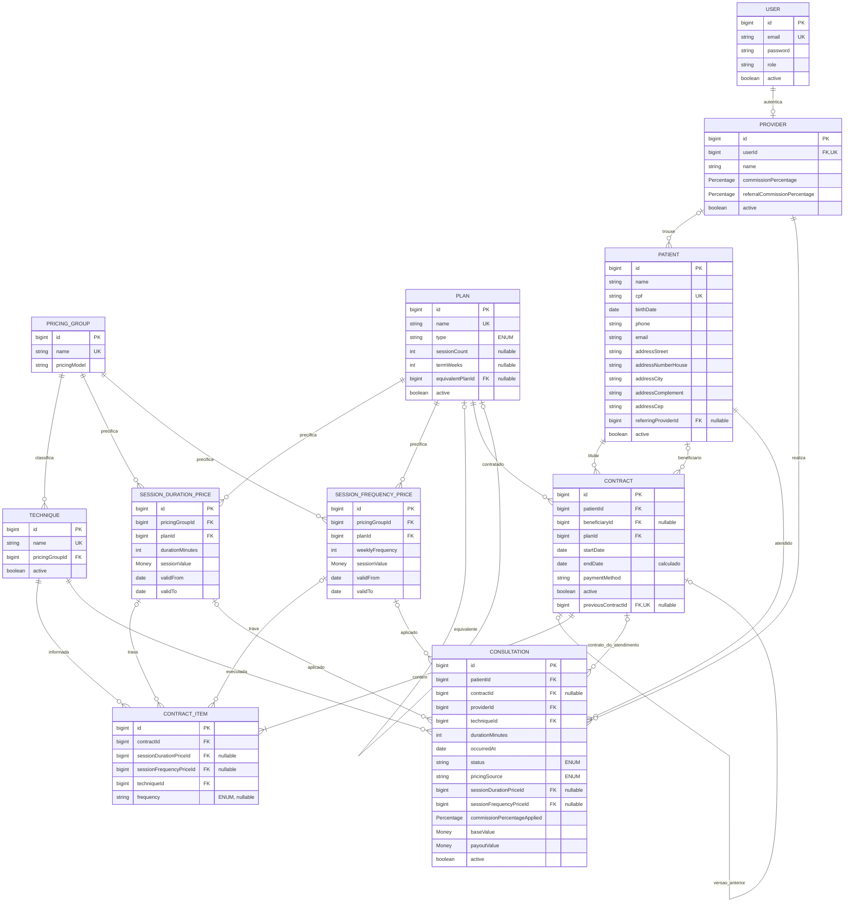

# Modelo de domínio

> Regras **vigentes**: o que está implementado no código. Consulte este arquivo
> antes de propor qualquer mudança de schema ou entidade.
>
> - O **porquê** das decisões principais (contexto e alternativas descartadas)
>   está nos [ADRs](adr/README.md), linkados em cada regra.
> - Feature em andamento, quando houver, fica em [`specs/`](specs/README.md).
> - O que ainda não existe (saldo do paciente, `Payment`, pagamento do repasse,
>   agendamento) está no [`roadmap.md`](roadmap.md).

## Diagrama entidade-relacionamento

Legenda: `addressStreet`/`addressNumberHouse`/`addressCity`/`addressComplement`/
`addressCep` em `Patient` são um Value Object embutido (`@Embeddable`), não uma
tabela própria (`cep`, não `zipCode` — é um conceito específico do endereçamento
brasileiro, não uma tradução literal de "zip code"). `pricingModel`, `type` (`Plan`),
`role`, `paymentMethod`, `frequency` (`ContractItem`), `status` e `pricingSource`
(`Consultation`) são ENUMs. `sessionDurationPriceId`/`sessionFrequencyPriceId` em
`ContractItem` e `Consultation` são nullable, em padrão "exclusive arc": sempre um
preenchido, nunca os dois. `Contract` +
`ContractItem` formam um agregado: o item só existe dentro do contrato (ver
`Contract e ContractItem`). `Money` e `Percentage` são Value Objects persistidos
como `DECIMAL` por `AttributeConverter` (ver `SessionDurationPrice` e `Provider`).
`UK` = coluna `unique`.

**Soft delete:** `Patient`, `Technique`, `Contract`, `User`, `Provider` e `Consultation` nunca são
removidos do banco; o `DELETE` só inativa (`active = false`). Inativar um registro
que **já está inativo** é rejeitado com 409 — a regra fica no `deactivate()` da
própria entidade, que conhece o próprio estado.

**Unicidade de nome e CPF:** nome de `PricingGroup`, `Technique` e `Plan`, CPF de
`Patient` e e-mail de `User` são únicos. A garantia real é o `unique` da coluna; o
service checa antes (`existsBy...`) só para devolver um 409 com mensagem clara. A
collation padrão do MySQL ignora maiúsculas e acentos na comparação, então
"Essencial" e "essencial" contam como o mesmo nome.

**Registro inativo não entra em cadastro novo:** paciente, técnica, plano, usuário
e prestador inativos continuam no banco, mas não podem ser usados num cadastro
novo. Numa alteração, o que é **mantido** do estado anterior é aceito mesmo
inativo; o que é **novo** precisa ser válido.

---

## `Patient`

| Atributo | Tipo | Observação |
|---|---|---|
| `id` | Long | auto-increment |
| `name` | string | obrigatório |
| `cpf` | string, unique | obrigatório; só os 11 dígitos, sem pontuação |
| `birthDate` | date | obrigatório; não pode ser futura |
| `phone` | string, nullable | opcional |
| `email` | string, nullable | opcional; formato validado quando informado |
| `address` | VO embutido (street, numberHouse, city, complement, cep), nullable | `@Embeddable`/`@Embedded`, imutável (sem setter); opcional |
| `referringProviderId` | FK → Provider, nullable | origem: prestador que trouxe o paciente; `null` = paciente da clínica |
| `active` | boolean | soft delete |

**Origem do paciente (`referringProviderId`):** define qual dos dois percentuais do
prestador vale nos atendimentos (ver `Provider`;
[ADR 0012](adr/0012-comissao-pela-origem-do-paciente.md)).
- **`null`** → paciente da clínica (já estava na clínica, ou chegou por ela).
- **preenchido** → paciente trazido por aquele prestador.
- **Pode ser alterada** (ex: corrigir um cadastro errado).
- Ao **atribuir** um prestador (novo ou diferente do atual), ele precisa existir
  (404) e estar ativo (400). Manter o mesmo prestador, mesmo que ele tenha sido
  inativado depois, é permitido.
- Fica no paciente, e não no contrato, porque a origem é do paciente: no contrato
  teria que ser preenchida de novo a cada renovação.

**Por que endereço é Value Object, não entidade própria:** não existe caso de uso
em que precisamos rastrear a identidade de um endereço ao longo do tempo — trocar
de endereço é substituição de valor, não edição de um registro com vida própria.

**Regras do endereço:** o endereço como um todo é opcional, mas quando informado
precisa estar completo — `street`, `numberHouse`, `city` e `cep` obrigatórios;
só `complement` é opcional. `cep` com exatamente 8 dígitos, sem hífen (mesmo
formato do CPF: só dígitos). `numberHouse` é texto livre para aceitar "S/N". A
regra fica no construtor do próprio `Address` (vale para qualquer caminho) e é
repetida no `AddressDTO` para os erros saírem junto com os demais campos.

**Atualização (`PUT`):** dados pessoais e de contato são substituídos pelo que vier
no request (`phone`/`email` nulos apagam o valor). O endereço é a exceção: `address`
nulo **mantém** o endereço atual; preenchido, substitui o atual por inteiro (é um
Value Object — não dá para mandar só o `cep`). *Consequência aceita: não existe
caminho para remover um endereço depois de cadastrado.* `referringProviderId`
segue a regra geral: nulo no `PUT` torna o paciente **da clínica** — o frontend
deve sempre reenviar a origem atual (formulário preenchido).

**Por que `Patient` não referencia `Contract`:** o relacionamento é sempre
unidirecional `Contract → Patient`. Uma coleção de contratos no `Patient` faria o
módulo `patient` depender do `contract`, criando ciclo
([ADR 0001](adr/0001-monolito-modular.md)).

---

## `Technique`

| Atributo | Tipo | Observação |
|---|---|---|
| `id` | Long | auto-increment |
| `name` | string, unique | |
| `pricingGroupId` | FK → PricingGroup | fixo após a criação |
| `active` | boolean | soft delete |

**Técnica não muda de grupo:** o grupo define a tabela de preço da técnica, e os
contratos já foram fechados com base nele. Reclassificar uma técnica é cadastrar
uma técnica nova no grupo certo e inativar a antiga
([ADR 0004](adr/0004-grupo-de-preco-e-duas-tabelas.md)).

**Sem preço nem duração:** técnicas do mesmo grupo de precificação compartilham o
mesmo valor, que mora no grupo
([ADR 0004](adr/0004-grupo-de-preco-e-duas-tabelas.md)).

---

## `Plan`

| Atributo | Tipo | Observação |
|---|---|---|
| `id` | Long | auto-increment |
| `name` | string, unique | |
| `type` | ENUM `PlanType` | `SINGLE_SESSION` \| `PACKAGE` \| `MONTHLY_FEE` (ver abaixo); fixo após a criação |
| `sessionCount` | int, nullable | quantidade de sessões do pacote; obrigatório em `SINGLE_SESSION`/`PACKAGE`, `null` em `MONTHLY_FEE` |
| `termWeeks` | int, nullable | prazo do plano em semanas; obrigatório em `MONTHLY_FEE`, `null` nos demais |
| `equivalentPlanId` | FK → Plan, nullable | de-para: o plano equivalente na outra família (ver "Equivalência de planos") |
| `active` | boolean | |

**Tipo do plano (`PlanType`):** diz o que o plano é, e as regras perguntam o tipo —
nunca o nome do plano ([ADR 0005](adr/0005-tipo-do-plano.md)).

| `PlanType` | O que é | `sessionCount` | `termWeeks` | Onde pode ser usado |
|---|---|---|---|---|
| `SINGLE_SESSION` | sessão avulsa (Avulso) | 1 | `null` | linha de preço por duração; **nunca em contrato** (é o preço de quem é atendido sem contrato) |
| `PACKAGE` | pacote de sessões (Essencial, Evolução...) | obrigatório | `null` | linha de preço por duração; item de grupo por duração |
| `MONTHLY_FEE` | mensalidade do Pilates em Grupo (Mensal, Trimestral...) | `null` | obrigatório | linha de preço por frequência; item do Grupo |

- **A coerência é invariante do plano** (400 na criação): `PACKAGE` exige
  `sessionCount`, `MONTHLY_FEE` exige `termWeeks`, `SINGLE_SESSION` tem exatamente 1
  sessão, e nenhum tipo aceita o campo do outro.
- **As regras de uso perguntam o tipo:** linha de preço por duração exige
  `PACKAGE` ou `SINGLE_SESSION`; por frequência exige `MONTHLY_FEE`; contrato
  recusa `SINGLE_SESSION`. Como o plano não sabe em qual grupo é usado (a ligação é
  a linha de preço), essas regras são validadas na criação da linha de preço e do
  contrato, não no próprio plano.
- **Um único plano `SINGLE_SESSION` ativo** (409 ao criar um segundo): é "o" preço
  de quem é atendido sem contrato, com uma linha em cada grupo por duração. Com
  dois, não haveria como saber qual preço avulso usar.

**Planos atuais da clínica:**

| Plano | `type` | `sessionCount` | `termWeeks` | Equivalente (de-para) | Usado em |
|---|---|---|---|---|---|
| Avulso | `SINGLE_SESSION` | 1 | `null` | — | grupos `DURATION_BASED`, sem contrato |
| Essencial | `PACKAGE` | 4 | `null` | Mensal | grupos `DURATION_BASED` |
| Evolução | `PACKAGE` | 12 | `null` | Trimestral | grupos `DURATION_BASED` |
| Evolução Familiar | `PACKAGE` | 12 | `null` | Trimestral | grupos `DURATION_BASED` |
| Transformação / Transformação Familiar | `PACKAGE` | 26 | `null` | Semestral / Semestral Familiar | grupos `DURATION_BASED` |
| Vitalidade / Vitalidade Familiar | `PACKAGE` | 52 | `null` | Anual / Anual Familiar | grupos `DURATION_BASED` |
| Mensal | `MONTHLY_FEE` | `null` | 4 | Essencial | Em Grupo (`FREQUENCY_BASED`) |
| Trimestral | `MONTHLY_FEE` | `null` | 13 | Evolução | Em Grupo (`FREQUENCY_BASED`) |
| Semestral / Semestral Familiar | `MONTHLY_FEE` | `null` | 26 | Transformação / Transformação Familiar | Em Grupo (`FREQUENCY_BASED`) |
| Anual / Anual Familiar | `MONTHLY_FEE` | `null` | 52 | Vitalidade / Vitalidade Familiar | Em Grupo (`FREQUENCY_BASED`) |

Valores de cada plano por grupo: catálogo no [`development.md`](development.md).

**Por que `sessionCount` é nullable:** no Pilates em Grupo o plano não é um
pacote de sessões, e sim um valor mensal definido pelo plano e pela frequência
semanal (ex: Mensal 1x/semana = 4 aulas no mês, 3x/semana = 12). Gravar um número
fixo seria um dado enganoso, que uma tela ou relatório poderia usar errado.

**Prazo dos planos do Grupo (`termWeeks`):** Mensal 4, Trimestral 13, Semestral 26,
Anual 52 semanas (Familiares iguais ao plano base). É a vigência de um contrato só
com Grupo (ver "Vigência e frequência" em `Contract`) e limita a escolha do plano
do item do Grupo num contrato misto (ver "Plano do item do Grupo"). Em semanas, a
mesma unidade dos prazos dos itens por duração
([ADR 0006](adr/0006-prazo-do-grupo-em-semanas.md)). Nos planos por duração fica
`null`: o prazo deles sai do cálculo sessões ÷ frequência, no contrato.

**Por que o Grupo mantém planos com nomes próprios:** é outro conceito de plano
(mensalidade por frequência, não pacote de sessões), por isso não compartilha os
planos dos grupos por duração.

**Equivalência de planos (de-para):** liga os planos dos grupos por duração aos
do Pilates em Grupo, **independente da frequência**
([ADR 0007](adr/0007-de-para-de-planos.md)):

| Plano por duração | Plano do Grupo |
|---|---|
| Essencial | Mensal |
| Evolução | Trimestral |
| Evolução Familiar | Trimestral (só nesse sentido: o Trimestral volta para o Evolução) |
| Transformação | Semestral |
| Transformação Familiar | Semestral Familiar |
| Vitalidade | Anual |
| Vitalidade Familiar | Anual Familiar |
| Avulso | sem equivalente — o Grupo exige contrato |

- `Plan.equivalentPlanId`, preenchido **nos dois lados** (cada plano aponta para o
  seu equivalente na outra família). Um lado só não basta por causa da assimetria
  do Evolução Familiar.
- Regra (400): o equivalente precisa ser da **outra família** (`PACKAGE` ⇄
  `MONTHLY_FEE`), estar ativo e não ser o próprio plano; `SINGLE_SESSION` não tem
  equivalente.
- Cadastro: como os dois planos precisam existir antes do vínculo, o de-para é
  definido depois da criação, num endpoint próprio
  (`PUT /api/plans/{id}/equivalent`).
- Usos:
  - sugerir o plano do item do Grupo num contrato misto (ver "Plano do item do
    Grupo" em `Contract`);
  - resolver o preço do atendimento fora do grupo contratado (caso 2 da "Resolução
    de preço" em `Consultation`), nos dois sentidos: paciente de pacote numa aula do
    Grupo (Evolução → Trimestral) e contrato só com Grupo numa sessão por duração
    (Trimestral → Evolução). É por esse segundo sentido que o de-para está nos dois
    lados.
- A regra mora no plano: `PlanEntity.planFor(PricingModel)` devolve o próprio plano
  se o tipo dele é precificado naquele modelo (os grupos por duração compartilham os
  planos), senão o equivalente (400 se não houver).

**Por que sem frequência nem desconto (e, nos planos por duração, sem prazo):** a
mesma quantidade de sessões pode ser consumida em ritmos diferentes — um
Vitalidade (52 sessões) a 2x/semana dura 26 semanas; a 1x/semana, 52. A
frequência é negociação e vive no item do contrato; o prazo é calculado a partir
dela (ver "Vigência e frequência" em `Contract`). A exceção é o Grupo, cujo prazo
é parte do produto (`termWeeks`). Desconto é sempre calculado em tempo de leitura
(ver a seção de preço abaixo), nunca armazenado.

---

## `PricingGroup`

| Atributo | Tipo | Observação |
|---|---|---|
| `id` | Long | auto-increment |
| `name` | string, unique | |
| `pricingModel` | ENUM: `DURATION_BASED` \| `FREQUENCY_BASED` | discriminador; fixo após a criação |

**Por que existe:** técnicas de mesmo grau de complexidade COFFITO compartilham
uma única tabela de preço. O grupo é quem carrega o preço; a técnica só aponta
para o grupo. Reajustar o valor do grupo atualiza automaticamente todas as
técnicas associadas ([ADR 0004](adr/0004-grupo-de-preco-e-duas-tabelas.md)).

**Grupos atuais da clínica:**

| Grupo | Técnicas | `pricingModel` | Tabela de preço |
|---|---|---|---|
| Individual Padrão | Liberação Miofascial, RPG, Massoterapia, Pilates Individual | `DURATION_BASED` | `SessionDurationPrice` |
| Individual Especializado | Quiropraxia, Reabilitação Vestibular | `DURATION_BASED` | `SessionDurationPrice` |
| Em Dupla | Pilates em Dupla | `DURATION_BASED` | `SessionDurationPrice` |
| Em Grupo | Pilates em Grupo | `FREQUENCY_BASED` | `SessionFrequencyPrice` |

**Por que esses nomes:** o grupo representa um conjunto de técnicas com o mesmo
preço, então o nome diz *por que* elas custam igual, e não repete o nome de uma
técnica (o que confundia grupo e técnica em telas e relatórios — ex: "Quiropraxia"
era tanto o grupo quanto uma de suas técnicas). Dois fatores definem o preço: o
**formato do atendimento** (individual, dupla, grupo) e, no individual, o **nível
de especialização** (padrão × especializado, ligado ao grau de complexidade
COFFITO). Uma técnica nova com o mesmo preço entra no grupo correspondente (ex:
um futuro "RPG em dupla" com o preço da dupla entraria em "Em Dupla").

Grupos com uma única técnica (Em Dupla, Em Grupo) são válidos: o grupo existe
porque carrega uma tabela de preço própria. Note que "Pilates" aparece em três
grupos diferentes — Pilates Individual é precificado no Individual Padrão, e só o
Pilates em Grupo é por frequência.

**Discriminador `pricingModel`:** a maioria dos grupos precifica por
`duração da sessão × plano` (`DURATION_BASED`). O Pilates em Grupo precifica por
`frequência semanal × plano` (`FREQUENCY_BASED`) — o preço por sessão é uma tabela
de desconto por volume publicada à parte, não uma multiplicação do valor unitário.
Por isso duas tabelas de preço separadas (abaixo).

**`pricingModel` nunca muda:** as linhas de preço do grupo já estão na tabela
correspondente a ele. Um grupo com outro modelo de preço é um grupo novo.

---

## `SessionDurationPrice` (grupos `DURATION_BASED`)

| Atributo | Tipo | Observação |
|---|---|---|
| `id` | Long | auto-increment |
| `pricingGroupId` | FK → PricingGroup | |
| `planId` | FK → Plan | |
| `durationMinutes` | int | eixo de duração |
| `sessionValue` | `Money` (VO) | coluna `DECIMAL(10,2)` via `MoneyConverter` |
| `validFrom` | date | |
| `validTo` | date, nullable | `null` = vigente; **exclusivo** (ver convenção abaixo) |

## `SessionFrequencyPrice` (grupos `FREQUENCY_BASED`)

| Atributo | Tipo | Observação |
|---|---|---|
| `id` | Long | auto-increment |
| `pricingGroupId` | FK → PricingGroup | |
| `planId` | FK → Plan | |
| `weeklyFrequency` | int | eixo de frequência |
| `sessionValue` | `Money` (VO) | coluna `DECIMAL(10,2)` via `MoneyConverter` |
| `validFrom` | date | |
| `validTo` | date, nullable | `null` = vigente; **exclusivo** (ver convenção abaixo) |

**Valor em dinheiro (`Money`):** `sessionValue` é o Value Object `Money`
(módulo `pricing`), não um `BigDecimal` solto. Regras do próprio `Money`:
obrigatório, nunca negativo, no máximo 2 casas decimais e escala sempre
normalizada em 2 (`220` vira `220.00`). Valor com mais de 2 casas (ex: `220.555`)
é **rejeitado (400), nunca arredondado**
([ADR 0002](adr/0002-value-object-de-um-valor.md)). Zero é um `Money` válido;
"maior que zero" é regra da linha de preço (`Money.isPositive()`), não do dinheiro
em si.

**Regra de unicidade:** só pode existir uma linha com `validTo IS NULL` por
combinação de `(pricingGroupId, durationMinutes, planId)` — ou
`(pricingGroupId, weeklyFrequency, planId)` na tabela de frequência. Hoje checada
no código; a garantia no banco entra com as migrations (ver
[`roadmap.md`](roadmap.md)).

**Reajuste nunca é `UPDATE`.** Sempre: fecha a linha vigente (`validTo` = hoje) e
insere uma nova com `validFrom` = hoje. Preserva o histórico completo de preços e
garante que contratos antigos continuem apontando para o valor que estava vigente
na assinatura ([ADR 0003](adr/0003-preco-historizado.md)).

**Convenção de datas: `validTo` é exclusivo.** A vigência de uma linha de preço é
o intervalo semiaberto `[validFrom, validTo)`: a linha vale a partir de
`validFrom` (inclusive) até o dia **anterior** a `validTo`. Ex: `validFrom =
01/10`, `validTo = 15/10` → valeu de 01/10 a 14/10; em 15/10 já vale a linha nova.
- A linha antiga fecha e a nova abre na **mesma data**.
- Dois reajustes no mesmo dia geram uma linha com intervalo vazio
  (`[15/10, 15/10)`): ela foi substituída no mesmo dia e não vale em nenhum dia.
  Não é um estado inválido — se um contrato a travou nesse meio-tempo, continua
  com ela, como em qualquer reajuste. Por isso não há bloqueio de reajuste no
  mesmo dia (corrigir um valor digitado errado é só cadastrar de novo).
- Consulta "preço vigente na data X": `validFrom <= X AND (validTo IS NULL OR
  validTo > X)` — **`>`, nunca `>=`**.
- ⚠️ **Diferente do `endDate` de `Contract`, que é inclusivo** (o último dia
  ainda conta). O `endDate` é o "último dia" combinado com o paciente; o
  `validTo` é o momento de troca de preço. Atenção ao comparar os dois.

**Cadastro de valor (novo preço ou reajuste):** um único fluxo cobre os dois
casos — para a clínica, ambos significam "a partir de hoje, essa combinação custa
X". A clínica informa grupo, plano, eixo (duração ou frequência) e valor:
- **sem linha vigente** para a combinação → cria a linha com `validFrom` = hoje;
- **com linha vigente** → fecha a atual (`validTo` = hoje) e cria a nova com
  `validFrom` = hoje.

`validFrom` é sempre hoje, nunca vem do request: como vigente = `validTo` nulo,
uma linha com início futuro já contaria como vigente antes da hora.

Validações do cadastro: o `pricingModel` do grupo corresponde à tabela usada
(preço por duração só em grupo `DURATION_BASED`, por frequência só em
`FREQUENCY_BASED`); o plano está ativo; o **tipo do plano** corresponde à tabela
(duração: `SINGLE_SESSION` ou `PACKAGE`; frequência: `MONTHLY_FEE` — ver
`PlanType` em `Plan`); valor maior que zero.

**Percentual de desconto nunca é persistido.** É sempre calculado em tempo de
leitura: `1 − (valorDoPlano / valorDeReferência)`, onde a referência é o Avulso da
mesma técnica/grupo quando existir, ou o Mensal quando não existir Avulso (caso do
grupo Em Grupo). Guardar os dois campos (valor absoluto e percentual) gera risco de
dessincronia a cada reajuste.

---

## `Contract` e `ContractItem`

O contrato é um agregado em duas partes: o **cabeçalho** (`Contract`, raiz do
agregado), com o que vale para o contrato inteiro, e os **itens**
(`ContractItem`), um por grupo de preço contratado. Ex: um contrato Evolução com
RPG e Quiropraxia tem um item do Individual Padrão e um do Individual
Especializado ([ADR 0008](adr/0008-contrato-com-itens.md)).

**Como o agregado é implementado:**
- `ContractItem` é **entidade interna**: sem repositório nem service próprios, e o
  construtor de negócio não é público — só o `ContractEntity` cria itens. Os itens
  são salvos e removidos junto com o contrato (cascade), e `getItems()` devolve uma
  cópia somente leitura.
- O service carrega as entidades de cada item do request (técnica e linha de preço)
  e monta um **rascunho** (`ContractItemDraft`, não persistido); o contrato cria os
  itens a partir dos rascunhos, comparando cada um com o item do **mesmo grupo** na
  versão anterior (regra "o que é igual é aceito como está").
- Outros agregados referenciam só a raiz (`Contract`); o item é encontrado por
  contrato + grupo (`findItemOf`).
- Regras de cada camada: o item valida o que é dele (preço vigente ou mantido,
  técnica do grupo da linha e ativa ou mantida, frequência dentro do teto); o
  contrato valida o que envolve o conjunto (um item por grupo, itens compatíveis
  com o plano, cálculo do fim); o service valida o que depende do banco (um
  contrato vigente por titular, opções do plano do Grupo).

**Endpoints de apoio à tela** (nada é gravado; a regra fica no backend e o frontend
não a repete):
- `GET /api/contracts/term-preview?planId&startDate&frequencies` — na criação:
  vigência em semanas, `endDate` calculado, plano do Grupo sugerido e opções.
- `GET /api/contracts/{id}/group-plan-options` — no aditivo: opções do plano do
  Grupo pela vigência atual do contrato.

### `Contract` (cabeçalho)

| Atributo | Tipo | Observação |
|---|---|---|
| `id` | Long | auto-increment |
| `patientId` | FK → Patient | titular, obrigatório; nunca muda (trocar o titular = contrato novo) |
| `beneficiaryId` | FK → Patient, nullable | Pilates em Dupla / plano Familiar |
| `planId` | FK → Plan | plano único do contrato (ex: Evolução); nunca `SINGLE_SESSION` (Avulso) |
| `startDate` | date | informado |
| `endDate` | date | **calculado pelo sistema**, inclusivo (ver "Vigência e frequência") |
| `paymentMethod` | ENUM | única para o contrato inteiro |
| `active` | boolean | soft delete |
| `previousContractId` | FK → Contract, nullable, unique | versão anterior (aditivo); null na primeira versão |

### `ContractItem` (um por grupo de preço)

| Atributo | Tipo | Observação |
|---|---|---|
| `id` | Long | auto-increment |
| `contractId` | FK → Contract | |
| `sessionDurationPriceId` | FK → SessionDurationPrice, nullable | exclusive arc: linha de preço travada |
| `sessionFrequencyPriceId` | FK → SessionFrequencyPrice, nullable | exclusive arc: linha de preço travada |
| `techniqueId` | FK → Technique | só informativa (aparece no contrato impresso) |
| `frequency` | ENUM `SessionFrequency`, nullable | ritmo negociado; só em item de grupo por duração |

**Regras do item:**
- **Um item por grupo de preço** no mesmo contrato. O grupo não é coluna do item
  (vem da linha travada — derivável), então a regra é garantida pelo agregado
  (`Contract`), não por `unique` no banco.
- **Plano do item:** item de grupo por duração usa uma linha do **plano do
  contrato**. Item do Pilates em Grupo usa um plano do Grupo escolhido pela regra
  de "Plano do item do Grupo" (abaixo). Num contrato só com Grupo, o plano do
  contrato é o próprio plano do Grupo — por isso ele não pode receber item de grupo
  por duração (exigiria trocar o plano; ver "Versionamento").
- **Contrato de pacote precisa de pelo menos um item por duração.** Sem item por
  duração, um contrato de pacote não teria como calcular o fim (o pacote não tem
  `termWeeks`). Consequência no aditivo: remover todos os itens por duração de um
  contrato misto é recusado (400) — para ficar só no Grupo, contrato novo com plano
  de mensalidade.
- **Técnica só informativa:** registra o que foi vendido (ex: "Liberação
  Miofascial e Quiropraxia" no contrato impresso), mas não restringe o
  atendimento — o paciente pode ser atendido em qualquer técnica do grupo do item.
  Precisa ser do grupo da linha de preço; técnica nova precisa estar ativa.
- **Frequência:** em item de grupo por duração é negociação (não afeta o preço) e
  define o prazo do item (ver "Vigência e frequência"). No item do Grupo fica
  nula: a frequência (1x/2x/3x por semana) é o eixo do preço e já está na linha
  travada.
- **Exclusive arc no item:** exatamente uma das duas FKs de preço preenchida,
  garantida no `ContractItemDraft` e no `ContractItemRequestDTO` (o `CHECK` no
  banco entra com as migrations).

**Preço travado:** o item trava, na assinatura, a linha de preço vigente naquele
instante — mesmo que o catálogo seja reajustado depois, o contrato mantém o valor
combinado até o fim da vigência. O preço travado vale para **qualquer técnica do
grupo do item, na mesma duração da linha**. Fora disso (outra duração, outro
grupo), vale o preço atual (ver "Resolução de preço" em `Consultation`).

**A linha de preço é a fonte da verdade.** Tudo que a linha já contém é copiado
dela, nunca recebido do request: o grupo do item e, no Grupo, a frequência.
Receber esses dados separados criaria redundância — o request poderia mandar um
grupo ou frequência diferente do preço travado, e o item nasceria incoerente.
Pelo mesmo motivo, o item valida que a técnica pertence ao grupo da linha e o
contrato valida que a linha é do plano certo (ver "Plano do item"). Que o grupo da
linha usa a tabela de onde ela veio (`pricingModel`) não é revalidado no contrato:
a própria linha de preço garante isso na criação dela.

**Saldo de sessões por item:** cada item de grupo por duração tem as
`sessionCount` do plano — contrato Evolução com RPG + Quiropraxia = 12 sessões do
Individual Padrão **e** 12 do Individual Especializado. Item do Grupo não tem
saldo de sessões. O cálculo do saldo consome os atendimentos e por isso fica no
módulo `consultation` (ver "Saldo de sessões" em `Consultation`).

### Titular e beneficiário

**Sobre `beneficiaryId`:** cobre tanto o Pilates em Dupla (titular + acompanhante
compartilhando o mesmo saldo) quanto os planos Familiares (dois contratos
distintos, cada um com seu próprio titular e beneficiário — o grau de parentesco
entre os titulares é checado manualmente pela clínica na venda, o sistema não
guarda nem valida isso).

- **Beneficiário não é obrigatório, nem no Pilates em Dupla:** nada impede o
  paciente de contratar a dupla e usar sozinho. O sistema não exige nem proíbe
  beneficiário em nenhum plano.
- **Um contrato vigente como titular e um como beneficiário, no máximo:** ser
  beneficiário de um contrato não impede de ser titular de outro, mas o paciente
  não pode ser beneficiário de dois contratos vigentes (409 na criação e no aditivo,
  quando o beneficiário é novo na versão) — mesma regra do titular. Assim, um
  atendimento encontra no máximo dois contratos vinculados ao paciente (ver
  "Contrato do atendimento" em `Consultation`).

### Vigência e frequência

**O `endDate` é sempre calculado pelo sistema** ([ADR 0009](adr/0009-vigencia-calculada.md)).
O usuário informa o início e, em cada item, a linha de preço e a frequência; o
sistema calcula o fim: `endDate = startDate + prazo do contrato − 1 dia` (o
`endDate` é inclusivo). Ex: início 03/11/2026, prazo de 12 semanas → `endDate` =
25/01/2027.

**Frequência (`SessionFrequency`):** enum com os ritmos que a clínica oferece nos
grupos por duração. O cálculo do prazo mora no próprio enum (princípio 6 do
`architecture.md`); ritmo novo (ex: 6x/semana) = um valor novo no enum.

| Valor | Ritmo | Sessões por período |
|---|---|---|
| `MONTHLY` | 1x por mês | 1 a cada 4 semanas |
| `BIWEEKLY` | quinzenal | 1 a cada 2 semanas |
| `ONCE_A_WEEK` | 1x por semana | 1 por semana |
| `TWICE_A_WEEK` … `FIVE_TIMES_A_WEEK` | 2x a 5x por semana | 2 a 5 por semana |

**Prazo do item de grupo por duração = sessões do plano ÷ ritmo, em semanas**,
arredondado para cima, com **teto de 52 semanas** (❌ = passa do teto, não pode
ser vendido):

| Plano (sessões) | Mensal | Quinzenal | 1x/sem | 2x/sem | 3x/sem | 4x/sem | 5x/sem |
|---|---|---|---|---|---|---|---|
| Essencial (4) | 16 | 8 | 4 | 2 | 2 | 1 | 1 |
| Evolução (12) | 48 | 24 | 12 | 6 | 4 | 3 | 3 |
| Transformação (26) | ❌ 104 | 52 | 26 | 13 | 9 | 7 | 6 |
| Vitalidade (52) | ❌ 208 | ❌ 104 | 52 | 26 | 18 | 13 | 11 |

Os planos Familiares seguem o plano base (mesmo `sessionCount`).

- **Contado em semanas**, não em meses: uma unidade só para todas as comparações.
  Os prazos ficam um pouco menores que os "meses" da tabela comercial (Evolução
  quinzenal = 24 semanas, ~5,5 meses, não 6).
- **Semana quebrada arredonda para cima** (26 sessões a 3x/semana = 8,67 → 9
  semanas): o paciente nunca fica com menos tempo que o necessário.
- **Teto de 52 semanas:** reproduz as combinações que a tabela da clínica não
  vende (Transformação mensal, Vitalidade quinzenal e mensal) — pacote longo em
  ritmo lento não pode ser esticado.
- **Todas as combinações abaixo do teto são permitidas**, mesmo as que a clínica
  ainda não vendeu (ex: Essencial 5x/semana = 1 semana): nos grupos por duração a
  frequência não afeta o preço, então ritmo rápido só esgota o saldo antes.

**Vigência do contrato = o maior prazo entre os itens de grupo por duração.**
Itens mais rápidos só esgotam o saldo antes. Ex: Evolução com RPG semanal (12
semanas) e Quiropraxia quinzenal (24) → contrato de 24 semanas.
- **O item do Pilates em Grupo não entra no cálculo:** o Grupo é mensalidade,
  sem controle rigoroso de sessões realizadas. Ele **acompanha** a vigência do
  contrato e termina junto. Ex: Evolução 2x/semana (6 semanas) + Grupo = contrato
  de 6 semanas; para continuar no Grupo depois disso, renovação ou aditivo.
- **Contrato só com Grupo:** a vigência vem do prazo do plano do Grupo
  (`Plan.termWeeks`: Mensal 4, Trimestral 13, Semestral 26, Anual 52 — ver
  `Plan`).

### Plano do item do Grupo

Num contrato misto, o plano do item do Grupo é **sugerido pelo de-para** a partir
do plano do contrato (ver `Plan`), e o usuário pode trocar por **qualquer plano do
Grupo até o primeiro cujo prazo cubra a vigência do contrato**
([ADR 0010](adr/0010-plano-do-item-do-grupo.md)):
- **pode trocar** porque a vigência pode passar do prazo do plano sugerido (ex:
  Evolução quinzenal = 24 semanas, de-para Trimestral = 13);
- **limite para cima** porque quanto mais longo o plano do Grupo, mais barata a
  aula;
- **sem limite para baixo:** plano mais curto é mais caro — favorece a clínica,
  fica a critério do admin.

| Contrato | Vigência (semanas) | Opções do Grupo | Sugestão (de-para) |
|---|---|---|---|
| Evolução quinzenal | 24 | Mensal, Trimestral, Semestral | Trimestral |
| Evolução semanal | 12 | Mensal, Trimestral | Trimestral |
| Evolução 2x/semana | 6 | Mensal, Trimestral | Trimestral |
| Essencial semanal | 4 | Mensal | Mensal |
| Essencial mensal | 16 | Mensal, Trimestral, Semestral | Mensal |

- **Sem restrição de família:** as opções são **todos** os planos de mensalidade
  até o primeiro que cubra a vigência, Familiares ou não. A sugestão do de-para já
  leva ao Familiar certo (Transformação Familiar → Semestral Familiar).
- A regra fica no backend: valida na criação e no aditivo e expõe as opções nos
  endpoints de apoio (`term-preview` e `group-plan-options`); o frontend não repete
  a regra.

**Como as opções são montadas** (`ContractService`, depende do catálogo de planos):
- Só mensalidades **ativas**, do prazo mais curto ao mais longo.
- Entram todas até o prazo da primeira que cubra a vigência, **inclusive as de
  mesmo prazo** (vigência de 24 semanas → Mensal, Trimestral, Semestral **e**
  Semestral Familiar, as duas com 26).
- Se nenhuma cobrir a vigência (contrato prorrogado além de 52 semanas), **todas**
  valem.
- Contrato só com Grupo: a única opção é o próprio plano do contrato.
- A sugestão é o equivalente do plano do contrato (ou o próprio plano, se for de
  mensalidade), quando estiver entre as opções.
- **No aditivo**, a vigência usada é a atual do contrato (início → fim, incluindo
  prorrogação), e o plano do Grupo **só é revalidado se o item do Grupo for novo ou
  trocar de linha** — o que é igual à versão anterior é aceito como está.

### Vigente, vencimento e prorrogação

**"Ativo" × "vigente":** `active` é o soft delete; vigente é `active = true` **e**
`endDate >= hoje` (o último dia ainda conta — `endDate` é **inclusivo**,
diferente do `validTo` das linhas de preço, que é exclusivo). **Um paciente tem
apenas um contrato vigente como titular:** só um contrato vigente bloqueia a
criação de outro (409). Um contrato ativo porém vencido não bloqueia — por isso um
paciente pode ter, temporariamente, mais de um contrato ativo.

**Contrato vencido** continua ativo até o administrador decidir. Hoje a ação
disponível é **prorrogar** (aditivo com novo `endDate`, abaixo); o encerramento com
o valor restante indo para o saldo do paciente ainda não existe (ver
[`roadmap.md`](roadmap.md)).

**Prorrogação:** o admin informa o novo fim **livremente**, desde que depois do
fim atual.

**Cadastros inativos:** paciente titular, beneficiário, plano e a técnica de cada
item precisam estar ativos para um contrato novo. No aditivo, o que é mantido da
versão anterior é aceito mesmo inativo (titular e plano são sempre copiados).

### Versionamento (aditivos)

O contrato nunca é editado no lugar. Cada alteração gera uma **nova versão** —
novo registro com `previousContractId` apontando para a versão atual, que é
inativada (`POST /api/contracts/{id}/amendments`). O contrato é um compromisso
assinado: cada versão será impressa para nova assinatura, e o histórico completo
fica preservado ([ADR 0011](adr/0011-contrato-versionado-por-aditivos.md)). Regras:
- O request traz o **estado completo** da nova versão (o frontend abre o
  formulário preenchido com a versão atual). Nova versão passa pelas mesmas
  regras da criação, exceto o fim (ver "O fim no aditivo").
- O **titular nunca muda** (é copiado): trocar o titular é um contrato novo.
- O **início nunca muda** (é copiado): o `startDate` é do acordo, não da versão.
- O **plano nunca muda** (é copiado): trocar o plano é encerrar o contrato e fazer
  outro. Sem exceção: um contrato só com Grupo que precise de item por duração
  também vira contrato novo.
- **Itens podem ser incluídos e removidos.** Remover um item não muda o fim e não
  pode deixar o contrato sem itens (400). O histórico do item removido fica nas
  versões anteriores.
- **O que for igual à versão anterior é aceito como está; o que for novo precisa
  ser válido.** Manter a mesma linha de preço é permitido mesmo após um reajuste
  (o contrato mantém o valor combinado); trocar de linha exige uma linha vigente.
  O mesmo vale para técnica e beneficiário inativos.
- Só a versão **ativa** pode ser alterada (409). Ativa porém vencida pode — é assim
  que se prorroga.
- `previousContractId` é `unique`: cada versão tem no máximo uma sucessora
  (impede duas alterações simultâneas da mesma versão).
- O número da versão (1, 2, 3…) não é persistido: é derivável pela cadeia.

**O fim no aditivo:**
- **Por padrão o aditivo mantém o `endDate` atual.** O request traz um `endDate`
  **opcional**, só para estender (prorrogação; precisa ser depois do fim atual).
- **Mudar a frequência não recalcula o fim.** Se precisar de mais prazo, o admin
  estende no mesmo aditivo.
- **Incluir um item de grupo por duração recalcula o fim:** novo fim = o maior
  entre o fim atual e (data do aditivo + prazo do item novo − 1 dia). O item novo
  começa a valer no aditivo, e o contrato nunca encolhe. Incluir um item do Grupo
  não muda o fim (o Grupo acompanha a vigência).

---

## `User`

| Atributo | Tipo | Observação |
|---|---|---|
| `id` | Long | auto-increment |
| `email` | string, unique | e-mail duplicado → 409 (na criação e na atualização) |
| `password` | string | nunca devolvida nas respostas (texto puro por enquanto — hash entra com a autenticação) |
| `role` | ENUM: `ADMIN` \| `PROVIDER` | |
| `active` | boolean | soft delete |

**Por que soft delete também no usuário:** o usuário pode estar vinculado a um
prestador. Remover o registro quebraria esse histórico (ou seria barrado pela FK
do prestador), então a exclusão só inativa, como nos demais cadastros.

**Por que separado de `Provider`:** autenticação é preocupação genérica; dado de
negócio (percentual de repasse) é específico da clínica. Misturar os dois
acoplaria o módulo de login a regras que não são dele.

---

## `Provider`

| Atributo | Tipo | Observação |
|---|---|---|
| `id` | Long | auto-increment |
| `userId` | FK → User, unique | fixo após a criação |
| `name` | string | |
| `commissionPercentage` | `Percentage` (VO) | padrão: pacientes da clínica ou de outros prestadores; default **40%**; coluna `DECIMAL(5,2)` via `PercentageConverter` |
| `referralCommissionPercentage` | `Percentage` (VO) | pacientes que **ele trouxe**; default **45%**; nunca menor que o `commissionPercentage` |
| `active` | boolean | soft delete |

**Dois percentuais, pela origem do paciente**
([ADR 0012](adr/0012-comissao-pela-origem-do-paciente.md)): vale o
`referralCommissionPercentage` quando o prestador que atendeu trouxe o paciente
(`Patient.referringProviderId`), e o `commissionPercentage` nos demais casos
(paciente da clínica ou trazido por outro prestador). Nenhum dos dois varia por
técnica. A escolha é do próprio prestador:
`commissionPercentageFor(referringProvider)` recebe o prestador de origem (não o
paciente, porque o `provider` não depende do `patient`). Quem é a origem em cada
atendimento está em "Comissão", em `Consultation`.

**Padrão da clínica com exceção caso a caso:** os dois campos são opcionais no
cadastro; se não informados, o prestador nasce com o padrão da clínica — 40% e 45%,
constantes no `ProviderEntity`. Informados, valem os informados (ex: estagiário ou
prestador em treinamento com 30% e 35%). Na alteração (`PUT`), os dois são
obrigatórios. Mudar o padrão da clínica exige alterar as constantes; prestadores
já cadastrados mantêm o que foi combinado com eles.

**Invariante:** `referralCommissionPercentage >= commissionPercentage` — quem
trouxe o paciente nunca recebe menos que o padrão dele. Validado na entidade
(400), na criação e na alteração.

**Mudança de percentual:** `UPDATE` simples, sem historização própria — o
lançamento de atendimento grava o percentual aplicado como snapshot.

**Percentual (`Percentage`):** Value Object do módulo `provider`, no mesmo desenho
do `Money` — formato 0–100 (`35.00` = 35%), obrigatório, no máximo 2 casas
decimais (mais casas são **rejeitadas, nunca arredondadas**) e escala normalizada
em 2 ([ADR 0002](adr/0002-value-object-de-um-valor.md)). Fica no `provider` porque
a comissão é conceito do prestador. `applyTo(BigDecimal)` aplica o percentual a um
valor, arredondando para 2 casas com `HALF_UP` (ver "Repasse" em `Consultation`).

**Sobre o `User` vinculado:** todo prestador tem exatamente um usuário (1:1, fixo
após a criação; [ADR 0013](adr/0013-prestador-com-usuario.md)). O usuário pode ter
`role` `PROVIDER` **ou `ADMIN`** — um administrador da clínica que também atende é
um prestador válido. Por ser fixo, a alteração do prestador (`PUT`) nem recebe
`userId`.

- **Usuário precisa estar ativo para criar o prestador.**
- **Inativar o usuário de um prestador ativo é permitido:** é assim que o
  administrador remove o acesso do prestador ao sistema. O prestador continua no
  banco.
- Um prestador que não está atendendo é inativado, sem desvincular o usuário.

---

## `Consultation`

Lançamento de um atendimento cobrado. O sistema descobre de qual contrato a sessão
sai, resolve o preço, debita o saldo de sessões do item e grava o repasse devido ao
prestador, sem fluxo de aprovação.

| Atributo | Tipo | Observação |
|---|---|---|
| `id` | Long | auto-increment |
| `patientId` | FK → Patient | **quem compareceu**: o titular ou o beneficiário de um contrato, ou um paciente sem contrato |
| `contractId` | FK → Contract, nullable | **contrato do atendimento**, escolhido entre os vinculados ao paciente (ver "Contrato do atendimento"): debita o item do grupo (caso 1) ou dá o plano do de-para (caso 2); `null` só no Avulso (caso 3). Referencia a raiz do agregado, nunca o `ContractItem` |
| `providerId` | FK → Provider | quem atendeu; explícito no request (ver "Quem lança") |
| `techniqueId` | FK → Technique | técnica clinicamente executada |
| `durationMinutes` | int | obrigatório em todos os grupos; eixo do preço nos grupos por duração; no Pilates em Grupo só registra a duração da aula |
| `occurredAt` | date | data do atendimento; não pode ser futura; referência da vigência do contrato |
| `status` | ENUM `ConsultationStatus` | `ATTENDED` \| `NO_SHOW` \| `CANCELED_LATE` (ver "Status") |
| `pricingSource` | ENUM `PricingSource` | `CONTRACT_ITEM` \| `EQUIVALENT_PLAN` \| `SINGLE_SESSION`: o caso do preço (ver "Resolução de preço"). Calculado pela entidade, nunca vem do request |
| `sessionDurationPriceId` | FK → SessionDurationPrice, nullable | exclusive arc: a linha **usada** (travada, atual ou do de-para) |
| `sessionFrequencyPriceId` | FK → SessionFrequencyPrice, nullable | exclusive arc |
| `commissionPercentageApplied` | `Percentage` (VO), `DECIMAL(5,2)` | snapshot do percentual (ver "Comissão") |
| `baseValue` | `Money` (VO), `DECIMAL(10,2)` | snapshot do valor da sessão (cópia do `sessionValue` da linha usada) |
| `payoutValue` | `Money` (VO), `DECIMAL(10,2)` | snapshot do **repasse** ao prestador (ver "Repasse"). *Payout* = valor pago a quem prestou o serviço (`commissionValue` se confundiria com o percentual) |
| `active` | boolean | soft delete: inativo não conta no saldo nem no repasse |

**Snapshots:** `baseValue`, `commissionPercentageApplied` e `payoutValue` são sempre
gravados, nunca derivados depois: são obrigação financeira consumada (princípio 5
do `architecture.md`). Um reajuste no catálogo ou uma mudança na comissão nunca
altera um atendimento já lançado.

**`patientId` e `contractId` separados:** quem compareceu e de quem sai a sessão
podem ser pessoas diferentes. O prestador lança quem atendeu; se for o beneficiário,
a sessão sai do contrato do titular.

**`techniqueId` próprio:** a linha de preço aponta para o grupo, não para a técnica;
o campo dá a granularidade de relatórios como "atendimentos de Quiropraxia no mês".

**`pricingSource` gravado, embora derivável:** o caso é um fato decidido no
lançamento; gravado, o saldo vira um `count` simples e os relatórios filtram pelo
campo ([ADR 0017](adr/0017-contrato-e-origem-do-preco-gravados.md)). Só
`CONTRACT_ITEM` debita o saldo (`PricingSource.debitsContractItem()`).

**Validações da entidade** (400): paciente, prestador e técnica ativos;
`durationMinutes ≥ 1` e `status` obrigatório; `occurredAt` não futuro; exatamente
uma linha de preço, do grupo da técnica e, se for por duração, na duração do
atendimento; contrato informado ativo, cobrindo `occurredAt` e com o paciente como
titular ou beneficiário. Se o contrato cobre ou não o grupo da técnica define o
caso do preço, não a validade.

### Status: só o que é cobrado e gera repasse

| Status | Significado |
|---|---|
| `ATTENDED` | O atendimento aconteceu. |
| `NO_SHOW` | O paciente faltou sem nenhum aviso. |
| `CANCELED_LATE` | O paciente desmarcou **fora do prazo mínimo de 6h** de antecedência (ex: 3h, 15min antes). |

Os três são cobrados do paciente (num pacote, consomem uma sessão) e geram repasse
com o mesmo cálculo. O que não é cobrado (desmarcou dentro do prazo, cancelado pela
clínica) **não é lançado**; a regra das 6h é aplicada por quem lança
([ADR 0014](adr/0014-tres-status-cobrados.md)).

### Contrato do atendimento

O sistema procura os **contratos vinculados** ao paciente que compareceu: versões
**ativas** que cobrem a **data do atendimento** (`startDate ≤ occurredAt ≤
endDate`), com ele como **titular ou beneficiário**, cubram ou não o grupo da
técnica. São no máximo dois (um como titular, um como beneficiário; ver "Titular e
beneficiário" em `Contract`) ([ADR 0015](adr/0015-contrato-do-atendimento.md)).

- **Nenhum** → Avulso (caso 3, `contractId` nulo).
- **Um** → é esse.
- **Dois** → o usuário escolhe livremente, cubram ou não o grupo da técnica.
- Com contrato vinculado, `contractId` é **obrigatório** e precisa ser um dos
  vinculados (400): o atendimento nunca vira Avulso.
- O contrato escolhido tem item do grupo da técnica → caso 1; não tem → caso 2. A
  sessão sai sempre do contrato do titular; o beneficiário usa o plano como se fosse
  o titular.
- Consequência aceita: um item incluído por aditivo depois da data do atendimento
  também é elegível (a versão ativa cobre o dia e tem o item).

`GET /api/consultations/eligible-contracts?patientId&techniqueId&occurredAt` lista
os vinculados (nada é gravado), cada um com o titular, o caso que ele daria
(`pricingSource`) e o saldo do item, quando houver. O frontend mostra o modal só
quando há dois.

### Resolução de preço

O sistema resolve a linha de preço; não há escolha manual
([ADR 0016](adr/0016-resolucao-de-preco-no-lancamento.md)). "Atual" = linha vigente
hoje (`validTo` nulo), mesmo em lançamento retroativo.

| Caso | `pricingSource` | Linha usada | Saldo |
|---|---|---|---|
| 1 — o contrato cobre o grupo, por duração, **mesma duração** da linha travada | `CONTRACT_ITEM` | travada do item (vale para qualquer técnica do grupo) | debita |
| 1 — por duração, **outra duração** | `CONTRACT_ITEM` | atual, plano do contrato, duração do atendimento | debita |
| 1 — Pilates em Grupo | `CONTRACT_ITEM` | travada do item | — (sem saldo) |
| 2 — o contrato não cobre o grupo, por duração | `EQUIVALENT_PLAN` | atual, `planFor` (o próprio plano; contrato só com Grupo → equivalente), duração do atendimento | não debita |
| 2 — Pilates em Grupo | `EQUIVALENT_PLAN` | atual, plano equivalente, **1x por semana** (aula experimental) | não debita |
| 3 — sem contrato, por duração | `SINGLE_SESSION` | atual do Avulso (único `SINGLE_SESSION` ativo), duração do atendimento | não debita |
| 3 — Pilates em Grupo | — | **400**: o Grupo exige contrato | — |

**Sem linha correspondente → 400**, com o plano, a técnica e a duração na mensagem
(ex: "Não há preço do plano Essencial para Quiropraxia 30 min."). Nunca se usa um
preço aproximado.

### Saldo de sessões

- **Por item de grupo por duração:** `sessionCount` do plano do contrato −
  atendimentos **ativos** com `pricingSource = CONTRACT_ITEM`, `contractId` em
  **qualquer versão da cadeia** (`ContractEntity.getVersionChainIds()`) e linha do
  **grupo do item**. Todos os status contam.
- **Item do Pilates em Grupo:** não tem saldo de sessões (é mensalidade).
- **Casos 2 e 3** não mexem em saldo.
- **Saldo esgotado:** o lançamento é aceito e o saldo fica **negativo**
  ([ADR 0018](adr/0018-saldo-esgotado-aceita-lancamento.md)). A resposta do
  lançamento traz `remainingSessions` (só no caso 1 por duração); negativo = aviso.
- O cálculo fica no `consultation` (o `contract` não pode depender dele).
  `GET /api/consultations/session-balance?contractId` devolve o saldo de cada item
  por duração para a tela do aditivo.

### Comissão

Pela origem (`Patient.referringProviderId`) do **titular do contrato** nos casos 1 e
2, mesmo quando quem compareceu foi o beneficiário; no caso 3, do **paciente
atendido**. O `ProviderEntity.commissionPercentageFor` devolve o
`referralCommissionPercentage` se o prestador que atendeu é a origem, senão o
`commissionPercentage`. Ex: a Ana (titular, trazida pela prestadora Bia) tem o João
como beneficiário; o João atendido pela Bia pelo contrato da Ana → 45%.

### Repasse

**Repasse = `baseValue` × percentual ÷ 100, arredondado para 2 casas com
`HALF_UP`** (35% de R$ 58,91 = R$ 20,6185 → R$ 20,62): o arredondamento de planilha,
que o prestador consegue conferir ([ADR 0019](adr/0019-repasse-com-half-up.md)).
`Percentage.applyTo(BigDecimal)` faz a conta; a entidade embrulha em `Money`.

### Ciclo de vida

**O lançamento nunca é editado** e não existe `PUT`
([ADR 0020](adr/0020-lancamento-imutavel.md)). Para corrigir: `DELETE
/api/consultations/{id}` (inativa; de novo → 409) e lançar de novo. Inativo não
conta no saldo nem no repasse.

### Quem lança

- `providerId` explícito no request, não inferido do login (o `SecurityConfig` ainda
  libera tudo). Com a autenticação, entra a regra de permissão e o
  `launchedByUserId` (ver [`roadmap.md`](roadmap.md)).
- Prestador, paciente e técnica precisam estar **ativos** (400).

### Leituras

- `GET /api/consultations?providerId&patientId&from&to`: filtros opcionais (período
  pela `occurredAt`, inclusivo), ativos e inativos, do mais recente para o mais
  antigo.
- `GET /api/consultations/{id}`.
