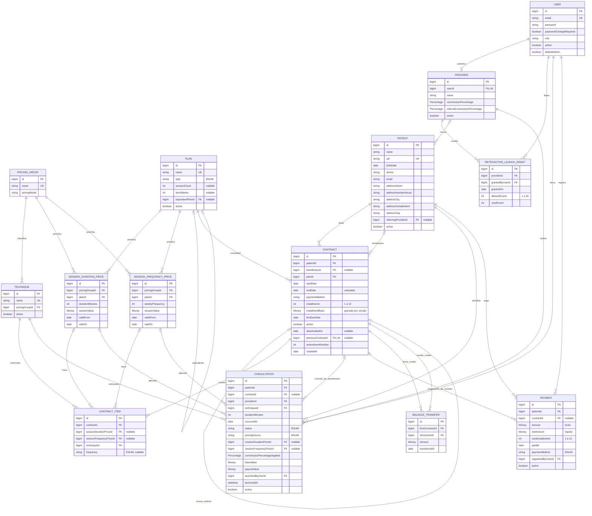

# Modelo de domínio

> Regras **vigentes**: o que está implementado no código. Consulte este arquivo
> antes de propor qualquer mudança de schema ou entidade.
>
> - O **porquê** das decisões principais (contexto e alternativas descartadas)
>   está nos [ADRs](adr/README.md), linkados em cada regra.
> - Feature em andamento, quando houver, fica em [`specs/`](specs/README.md).
> - O que ainda não existe (o estorno do crédito, o app do paciente, o agendamento) está no
>   [`roadmap.md`](roadmap.md).

## Índice <!-- omit from toc -->

- [Diagrama entidade-relacionamento](#diagrama-entidade-relacionamento)
- [`Patient`](#patient)
- [`Technique`](#technique)
- [`Plan`](#plan)
- [`PricingGroup`](#pricinggroup)
- [`SessionDurationPrice` (grupos `DURATION_BASED`)](#sessiondurationprice-grupos-duration_based)
- [`SessionFrequencyPrice` (grupos `FREQUENCY_BASED`)](#sessionfrequencyprice-grupos-frequency_based)
- [`Contract` e `ContractItem`](#contract-e-contractitem)
  - [`Contract` (cabeçalho)](#contract-cabeçalho)
  - [`ContractItem` (um por grupo de preço)](#contractitem-um-por-grupo-de-preço)
  - [Titular e beneficiário](#titular-e-beneficiário)
  - [Vigência e frequência](#vigência-e-frequência)
  - [Plano do item do Grupo](#plano-do-item-do-grupo)
  - [Vigente, vencimento e prorrogação](#vigente-vencimento-e-prorrogação)
  - [Status do contrato](#status-do-contrato)
  - [Valor e parcelas](#valor-e-parcelas)
  - [Versionamento (aditivos)](#versionamento-aditivos)
- [`User`](#user)
- [`Provider`](#provider)
  - [Liberação de lançamento retroativo](#liberação-de-lançamento-retroativo)
- [`Consultation`](#consultation)
  - [Status: só o que é cobrado e gera repasse](#status-só-o-que-é-cobrado-e-gera-repasse)
  - [Contrato do atendimento](#contrato-do-atendimento)
  - [Resolução de preço](#resolução-de-preço)
  - [Saldo de sessões](#saldo-de-sessões)
  - [Comissão](#comissão)
  - [Repasse](#repasse)
  - [Ciclo de vida](#ciclo-de-vida)
  - [Quem lança](#quem-lança)
  - [Rendimento](#rendimento)
  - [Leituras](#leituras)
- [`Payment`](#payment)
  - [Registro e inativação](#registro-e-inativação)
  - [Previsão de recebimento](#previsão-de-recebimento)
  - [Conta do contrato](#conta-do-contrato)
  - [Mensalidades do Grupo](#mensalidades-do-grupo)
  - [Situação das parcelas](#situação-das-parcelas)
  - [Conta do paciente](#conta-do-paciente)
  - [Crédito de contratos anteriores](#crédito-de-contratos-anteriores)
  - [Lista do Financeiro](#lista-do-financeiro)
  - [Numeração das sessões](#numeração-das-sessões)
  - [Leituras da conta](#leituras-da-conta)

## Diagrama entidade-relacionamento

Legenda: `addressStreet`/`addressNumberHouse`/`addressCity`/`addressComplement`/
`addressCep` em `Patient` são um Value Object embutido (`@Embeddable`), não uma
tabela própria (`cep`, não `zipCode` — é um conceito específico do endereçamento
brasileiro, não uma tradução literal de "zip code"). `pricingModel`, `type` (`Plan`),
`role`, `paymentMethod` (`Contract` e `Payment`), `frequency` (`ContractItem`), `status` e
`pricingSource` (`Consultation`) são ENUMs. `contractId` nulo em `Payment` é o pagamento do
avulso. `BalanceTransfer` é o crédito de um contrato aplicado em outro (ver "Crédito de contratos
anteriores" em `Payment`). `sessionDurationPriceId`/`sessionFrequencyPriceId` em
`ContractItem` e `Consultation` são nullable, em padrão "exclusive arc": sempre um
preenchido, nunca os dois. `Contract` +
`ContractItem` formam um agregado: o item só existe dentro do contrato (ver
`Contract e ContractItem`). `Money` e `Percentage` são Value Objects persistidos
como `DECIMAL` por `AttributeConverter` (ver `SessionDurationPrice` e `Provider`).
`UK` = coluna `unique`.

**Soft delete:** `Patient`, `Technique`, `Contract`, `User`, `Provider`, `Consultation` e `Payment`
nunca são removidos do banco; o `DELETE` só inativa (`active = false`). Inativar um registro
que **já está inativo** é rejeitado com 409 — a regra fica no `deactivate()` da
própria entidade, que conhece o próprio estado.

**Reativação:** `Patient`, `Provider`, `Technique` e `User` podem ser reativados com
`PATCH /api/{patients|providers|techniques|users}/{id}/activate` (204), espelhando o
inativar: reativar um registro **já ativo** → 409 (`activate()` com
`requireInactive()`). É o caminho de volta para quem foi inativado e volta à
clínica: registro inativo não entra em contrato nem em atendimento novo, e usuário
inativo não faz login. `Contract`, `Consultation` e `Payment` não têm reativação (contrato,
atendimento e pagamento se corrigem por aditivo, por novo lançamento e por novo registro).

**Unicidade de nome e CPF:** nome de `PricingGroup`, `Technique` e `Plan`, CPF de
`Patient` e e-mail de `User` são únicos. A garantia real é o `unique` da coluna; o
service checa antes (`existsBy...`) só para devolver um 409 com mensagem clara. A
collation padrão do MySQL ignora maiúsculas e acentos na comparação, então
"Essencial" e "essencial" contam como o mesmo nome.

**Registro inativo não entra em cadastro novo:** paciente, técnica, plano, usuário
e prestador inativos continuam no banco, mas não podem ser usados num cadastro
novo. Numa alteração, o que é **mantido** do estado anterior é aceito mesmo
inativo; o que é **novo** precisa ser válido.

---

## `Patient`

| Atributo | Tipo | Observação |
|---|---|---|
| `id` | Long | auto-increment |
| `name` | string | obrigatório |
| `cpf` | string, unique | obrigatório; só os 11 dígitos, sem pontuação |
| `birthDate` | date | obrigatório; não pode ser futura |
| `phone` | string, nullable | opcional; só os dígitos, até 20 (400 "O telefone deve ter no máximo 20 dígitos.") |
| `email` | string, nullable | opcional; formato validado quando informado |
| `address` | VO embutido (street, numberHouse, city, complement, cep), nullable | `@Embeddable`/`@Embedded`, imutável (sem setter); opcional |
| `referringProviderId` | FK → Provider, nullable | origem: prestador que trouxe o paciente; `null` = paciente da clínica |
| `active` | boolean | soft delete |

**Origem do paciente (`referringProviderId`):** define qual dos dois percentuais do
prestador vale nos atendimentos (ver `Provider`;
[ADR 0012](adr/0012-comissao-pela-origem-do-paciente.md)).
- **`null`** → paciente da clínica (já estava na clínica, ou chegou por ela).
- **preenchido** → paciente trazido por aquele prestador.
- **Pode ser alterada** (ex: corrigir um cadastro errado).
- Ao **atribuir** um prestador (novo ou diferente do atual), ele precisa existir
  (404) e estar ativo (400). Manter o mesmo prestador, mesmo que ele tenha sido
  inativado depois, é permitido.
- Fica no paciente, e não no contrato, porque a origem é do paciente: no contrato
  teria que ser preenchida de novo a cada renovação.

**Por que endereço é Value Object, não entidade própria:** não existe caso de uso
em que precisamos rastrear a identidade de um endereço ao longo do tempo — trocar
de endereço é substituição de valor, não edição de um registro com vida própria.

**Regras do endereço:** o endereço como um todo é opcional, mas quando informado
precisa estar completo — `street`, `numberHouse`, `city` e `cep` obrigatórios;
só `complement` é opcional. `cep` com exatamente 8 dígitos, sem hífen (mesmo
formato do CPF: só dígitos). `numberHouse` é texto livre para aceitar "S/N". A
regra fica no construtor do próprio `Address` (vale para qualquer caminho) e é
repetida no `AddressDTO` para os erros saírem junto com os demais campos.

**Atualização (`PUT`):** dados pessoais e de contato são substituídos pelo que vier
no request (`phone`/`email` nulos apagam o valor). O endereço é a exceção: `address`
nulo **mantém** o endereço atual; preenchido, substitui o atual por inteiro (é um
Value Object — não dá para mandar só o `cep`). *Consequência aceita: não existe
caminho para remover um endereço depois de cadastrado.* `referringProviderId`
segue a regra geral: nulo no `PUT` torna o paciente **da clínica** — o frontend
deve sempre reenviar a origem atual (formulário preenchido).

**Por que `Patient` não referencia `Contract`:** o relacionamento é sempre
unidirecional `Contract → Patient`. Uma coleção de contratos no `Patient` faria o
módulo `patient` depender do `contract`, criando ciclo
([ADR 0001](adr/0001-monolito-modular.md)).

---

## `Technique`

| Atributo | Tipo | Observação |
|---|---|---|
| `id` | Long | auto-increment |
| `name` | string, unique | |
| `pricingGroupId` | FK → PricingGroup | fixo após a criação |
| `active` | boolean | soft delete |

**Técnica não muda de grupo:** o grupo define a tabela de preço da técnica, e os
contratos já foram fechados com base nele. Reclassificar uma técnica é cadastrar
uma técnica nova no grupo certo e inativar a antiga
([ADR 0004](adr/0004-grupo-de-preco-e-duas-tabelas.md)).

**Sem preço nem duração:** técnicas do mesmo grupo de precificação compartilham o
mesmo valor, que mora no grupo
([ADR 0004](adr/0004-grupo-de-preco-e-duas-tabelas.md)).

**Duas listagens:**
- `GET /api/techniques` — só as **ativas**: telas de contrato e de lançamento, onde
  técnica inativa não pode entrar.
- `GET /api/techniques/all` — **todas**, com o campo `active`, por nome: tela de
  cadastro. Quando o prestador não encontra uma técnica (inativa), pede à clínica,
  que a encontra nessa listagem e a reativa (`PATCH /api/techniques/{id}/activate`).
  Paciente e prestador não precisam disso: a listagem deles já traz ativos e
  inativos.

---

## `Plan`

| Atributo | Tipo | Observação |
|---|---|---|
| `id` | Long | auto-increment |
| `name` | string, unique | |
| `type` | ENUM `PlanType` | `SINGLE_SESSION` \| `PACKAGE` \| `MONTHLY_FEE` (ver abaixo); fixo após a criação |
| `sessionCount` | int, nullable | quantidade de sessões do pacote; obrigatório em `SINGLE_SESSION`/`PACKAGE`, `null` em `MONTHLY_FEE` |
| `termWeeks` | int, nullable | prazo do plano em semanas; obrigatório em `MONTHLY_FEE`, `null` nos demais |
| `equivalentPlanId` | FK → Plan, nullable | de-para: o plano equivalente na outra família (ver "Equivalência de planos") |
| `active` | boolean | |

**Tipo do plano (`PlanType`):** diz o que o plano é, e as regras perguntam o tipo —
nunca o nome do plano ([ADR 0005](adr/0005-tipo-do-plano.md)).

| `PlanType` | O que é | `sessionCount` | `termWeeks` | Onde pode ser usado |
|---|---|---|---|---|
| `SINGLE_SESSION` | sessão avulsa (Avulso) | 1 | `null` | linha de preço por duração; **nunca em contrato** (é o preço de quem é atendido sem contrato) |
| `PACKAGE` | pacote de sessões (Essencial, Evolução...) | obrigatório | `null` | linha de preço por duração; item de grupo por duração |
| `MONTHLY_FEE` | mensalidade do Pilates em Grupo (Mensal, Trimestral...) | `null` | obrigatório | linha de preço por frequência; item do Grupo |

- **A coerência é invariante do plano** (400 na criação): `PACKAGE` exige
  `sessionCount`, `MONTHLY_FEE` exige `termWeeks`, `SINGLE_SESSION` tem exatamente 1
  sessão, e nenhum tipo aceita o campo do outro.
- **As regras de uso perguntam o tipo:** linha de preço por duração exige
  `PACKAGE` ou `SINGLE_SESSION`; por frequência exige `MONTHLY_FEE`; contrato
  recusa `SINGLE_SESSION`. Como o plano não sabe em qual grupo é usado (a ligação é
  a linha de preço), essas regras são validadas na criação da linha de preço e do
  contrato, não no próprio plano.
- **Um único plano `SINGLE_SESSION` ativo** (409 ao criar um segundo): é "o" preço
  de quem é atendido sem contrato, com uma linha em cada grupo por duração. Com
  dois, não haveria como saber qual preço avulso usar.

**Planos atuais da clínica:**

| Plano | `type` | `sessionCount` | `termWeeks` | Equivalente (de-para) | Usado em |
|---|---|---|---|---|---|
| Avulso | `SINGLE_SESSION` | 1 | `null` | — | grupos `DURATION_BASED`, sem contrato |
| Essencial | `PACKAGE` | 4 | `null` | Mensal | grupos `DURATION_BASED` |
| Evolução | `PACKAGE` | 12 | `null` | Trimestral | grupos `DURATION_BASED` |
| Evolução Familiar | `PACKAGE` | 12 | `null` | Trimestral | grupos `DURATION_BASED` |
| Transformação / Transformação Familiar | `PACKAGE` | 26 | `null` | Semestral / Semestral Familiar | grupos `DURATION_BASED` |
| Vitalidade / Vitalidade Familiar | `PACKAGE` | 52 | `null` | Anual / Anual Familiar | grupos `DURATION_BASED` |
| Mensal | `MONTHLY_FEE` | `null` | 4 | Essencial | Em Grupo (`FREQUENCY_BASED`) |
| Trimestral | `MONTHLY_FEE` | `null` | 13 | Evolução | Em Grupo (`FREQUENCY_BASED`) |
| Semestral / Semestral Familiar | `MONTHLY_FEE` | `null` | 26 | Transformação / Transformação Familiar | Em Grupo (`FREQUENCY_BASED`) |
| Anual / Anual Familiar | `MONTHLY_FEE` | `null` | 52 | Vitalidade / Vitalidade Familiar | Em Grupo (`FREQUENCY_BASED`) |

Valores de cada plano por grupo: catálogo no [`development.md`](development.md).

**Por que `sessionCount` é nullable:** no Pilates em Grupo o plano não é um
pacote de sessões, e sim um valor mensal definido pelo plano e pela frequência
semanal (ex: Mensal 1x/semana = 4 aulas no mês, 3x/semana = 12). Gravar um número
fixo seria um dado enganoso, que uma tela ou relatório poderia usar errado.

**Prazo dos planos do Grupo (`termWeeks`):** Mensal 4, Trimestral 13, Semestral 26,
Anual 52 semanas (Familiares iguais ao plano base). É a vigência de um contrato só
com Grupo (ver "Vigência e frequência" em `Contract`) e limita a escolha do plano
do item do Grupo num contrato misto (ver "Plano do item do Grupo"). Em semanas, a
mesma unidade dos prazos dos itens por duração
([ADR 0006](adr/0006-prazo-do-grupo-em-semanas.md)). Nos planos por duração fica
`null`: o prazo deles sai do cálculo sessões ÷ frequência, no contrato.

**Por que o Grupo mantém planos com nomes próprios:** é outro conceito de plano
(mensalidade por frequência, não pacote de sessões), por isso não compartilha os
planos dos grupos por duração.

**Equivalência de planos (de-para):** liga os planos dos grupos por duração aos
do Pilates em Grupo, **independente da frequência**
([ADR 0007](adr/0007-de-para-de-planos.md)):

| Plano por duração | Plano do Grupo |
|---|---|
| Essencial | Mensal |
| Evolução | Trimestral |
| Evolução Familiar | Trimestral (só nesse sentido: o Trimestral volta para o Evolução) |
| Transformação | Semestral |
| Transformação Familiar | Semestral Familiar |
| Vitalidade | Anual |
| Vitalidade Familiar | Anual Familiar |
| Avulso | sem equivalente — o Grupo exige contrato |

- `Plan.equivalentPlanId`, preenchido **nos dois lados** (cada plano aponta para o
  seu equivalente na outra família). Um lado só não basta por causa da assimetria
  do Evolução Familiar.
- Regra (400): o equivalente precisa ser da **outra família** (`PACKAGE` ⇄
  `MONTHLY_FEE`), estar ativo e não ser o próprio plano; `SINGLE_SESSION` não tem
  equivalente.
- Cadastro: como os dois planos precisam existir antes do vínculo, o de-para é
  definido depois da criação, num endpoint próprio
  (`PUT /api/plans/{id}/equivalent`).
- Usos:
  - sugerir o plano do item do Grupo num contrato misto (ver "Plano do item do
    Grupo" em `Contract`);
  - resolver o preço do atendimento fora do grupo contratado (caso 2 da "Resolução
    de preço" em `Consultation`), nos dois sentidos: paciente de pacote numa aula do
    Grupo (Evolução → Trimestral) e contrato de mensalidade numa sessão por duração
    que ele não cobre (Trimestral → Evolução). É por esse segundo sentido que o de-para
    está nos dois lados;
  - definir a linha do item por duração num contrato de mensalidade (Trimestral →
    Evolução; ver "Plano do item" em `ContractItem`).
- A regra mora no plano: `PlanEntity.planFor(PricingModel)` devolve o próprio plano
  se o tipo dele é precificado naquele modelo (os grupos por duração compartilham os
  planos), senão o equivalente (400 se não houver).

**Por que sem frequência nem desconto (e, nos planos por duração, sem prazo):** a
mesma quantidade de sessões pode ser consumida em ritmos diferentes — um
Vitalidade (52 sessões) a 2x/semana dura 26 semanas; a 1x/semana, 52. A
frequência é negociação e vive no item do contrato; o prazo é calculado a partir
dela (ver "Vigência e frequência" em `Contract`). A exceção é o Grupo, cujo prazo
é parte do produto (`termWeeks`). Desconto é sempre calculado em tempo de leitura
(ver a seção de preço abaixo), nunca armazenado.

---

## `PricingGroup`

| Atributo | Tipo | Observação |
|---|---|---|
| `id` | Long | auto-increment |
| `name` | string, unique | |
| `pricingModel` | ENUM: `DURATION_BASED` \| `FREQUENCY_BASED` | discriminador; fixo após a criação |

**Por que existe:** técnicas de mesmo grau de complexidade COFFITO compartilham
uma única tabela de preço. O grupo é quem carrega o preço; a técnica só aponta
para o grupo. Reajustar o valor do grupo atualiza automaticamente todas as
técnicas associadas ([ADR 0004](adr/0004-grupo-de-preco-e-duas-tabelas.md)).

**Grupos atuais da clínica:**

| Grupo | Técnicas | `pricingModel` | Tabela de preço |
|---|---|---|---|
| Individual Padrão | Liberação Miofascial, RPG, Massoterapia, Pilates Individual | `DURATION_BASED` | `SessionDurationPrice` |
| Individual Especializado | Quiropraxia, Reabilitação Vestibular | `DURATION_BASED` | `SessionDurationPrice` |
| Em Dupla | Pilates em Dupla | `DURATION_BASED` | `SessionDurationPrice` |
| Em Grupo | Pilates em Grupo | `FREQUENCY_BASED` | `SessionFrequencyPrice` |

**Por que esses nomes:** o grupo representa um conjunto de técnicas com o mesmo
preço, então o nome diz *por que* elas custam igual, e não repete o nome de uma
técnica (o que confundia grupo e técnica em telas e relatórios — ex: "Quiropraxia"
era tanto o grupo quanto uma de suas técnicas). Dois fatores definem o preço: o
**formato do atendimento** (individual, dupla, grupo) e, no individual, o **nível
de especialização** (padrão × especializado, ligado ao grau de complexidade
COFFITO). Uma técnica nova com o mesmo preço entra no grupo correspondente (ex:
um futuro "RPG em dupla" com o preço da dupla entraria em "Em Dupla").

Grupos com uma única técnica (Em Dupla, Em Grupo) são válidos: o grupo existe
porque carrega uma tabela de preço própria. Note que "Pilates" aparece em três
grupos diferentes — Pilates Individual é precificado no Individual Padrão, e só o
Pilates em Grupo é por frequência.

**Discriminador `pricingModel`:** a maioria dos grupos precifica por
`duração da sessão × plano` (`DURATION_BASED`). O Pilates em Grupo precifica por
`frequência semanal × plano` (`FREQUENCY_BASED`) — o preço por sessão é uma tabela
de desconto por volume publicada à parte, não uma multiplicação do valor unitário.
Por isso duas tabelas de preço separadas (abaixo).

**`pricingModel` nunca muda:** as linhas de preço do grupo já estão na tabela
correspondente a ele. Um grupo com outro modelo de preço é um grupo novo.

---

## `SessionDurationPrice` (grupos `DURATION_BASED`)

| Atributo | Tipo | Observação |
|---|---|---|
| `id` | Long | auto-increment |
| `pricingGroupId` | FK → PricingGroup | |
| `planId` | FK → Plan | |
| `durationMinutes` | int | eixo de duração |
| `sessionValue` | `Money` (VO) | coluna `DECIMAL(10,2)` via `MoneyConverter` |
| `validFrom` | date | |
| `validTo` | date, nullable | `null` = vigente; **exclusivo** (ver convenção abaixo) |

## `SessionFrequencyPrice` (grupos `FREQUENCY_BASED`)

| Atributo | Tipo | Observação |
|---|---|---|
| `id` | Long | auto-increment |
| `pricingGroupId` | FK → PricingGroup | |
| `planId` | FK → Plan | |
| `weeklyFrequency` | int | eixo de frequência |
| `sessionValue` | `Money` (VO) | coluna `DECIMAL(10,2)` via `MoneyConverter` |
| `validFrom` | date | |
| `validTo` | date, nullable | `null` = vigente; **exclusivo** (ver convenção abaixo) |

**Valor em dinheiro (`Money`):** `sessionValue` é o Value Object `Money`
(módulo `pricing`), não um `BigDecimal` solto. Regras do próprio `Money`:
obrigatório, nunca negativo, no máximo 2 casas decimais e escala sempre
normalizada em 2 (`220` vira `220.00`). Valor com mais de 2 casas (ex: `220.555`)
é **rejeitado (400), nunca arredondado**
([ADR 0002](adr/0002-value-object-de-um-valor.md)). Zero é um `Money` válido;
"maior que zero" é regra da linha de preço (`Money.isPositive()`), não do dinheiro
em si.

**Regra de unicidade:** só pode existir uma linha com `validTo IS NULL` por
combinação de `(pricingGroupId, durationMinutes, planId)` — ou
`(pricingGroupId, weeklyFrequency, planId)` na tabela de frequência. Checada no
código antes de criar e garantida pelo banco, inclusive contra duas gravações
simultâneas: coluna calculada `current_flag` + `UNIQUE` (migration V3; como funciona
em "Banco e schema", no [`development.md`](development.md)).

**Reajuste nunca é `UPDATE`.** Sempre: fecha a linha vigente (`validTo` = hoje) e
insere uma nova com `validFrom` = hoje. Preserva o histórico completo de preços e
garante que contratos antigos continuem apontando para o valor que estava vigente
na assinatura ([ADR 0003](adr/0003-preco-historizado.md)).

**Convenção de datas: `validTo` é exclusivo.** A vigência de uma linha de preço é
o intervalo semiaberto `[validFrom, validTo)`: a linha vale a partir de
`validFrom` (inclusive) até o dia **anterior** a `validTo`. Ex: `validFrom =
01/10`, `validTo = 15/10` → valeu de 01/10 a 14/10; em 15/10 já vale a linha nova.
- A linha antiga fecha e a nova abre na **mesma data**.
- Dois reajustes no mesmo dia geram uma linha com intervalo vazio
  (`[15/10, 15/10)`): ela foi substituída no mesmo dia e não vale em nenhum dia.
  Não é um estado inválido — se um contrato a travou nesse meio-tempo, continua
  com ela, como em qualquer reajuste. Por isso não há bloqueio de reajuste no
  mesmo dia (corrigir um valor digitado errado é só cadastrar de novo).
- Consulta "preço vigente na data X": `validFrom <= X AND (validTo IS NULL OR
  validTo > X)` — **`>`, nunca `>=`**.
- ⚠️ **Diferente do `endDate` de `Contract`, que é inclusivo** (o último dia
  ainda conta). O `endDate` é o "último dia" combinado com o paciente; o
  `validTo` é o momento de troca de preço. Atenção ao comparar os dois.

**Cadastro de valor (novo preço ou reajuste):** um único fluxo cobre os dois
casos — para a clínica, ambos significam "a partir de hoje, essa combinação custa
X". A clínica informa grupo, plano, eixo (duração ou frequência) e valor:
- **sem linha vigente** para a combinação → cria a linha com `validFrom` = hoje;
- **com linha vigente** → fecha a atual (`validTo` = hoje) e cria a nova com
  `validFrom` = hoje.

`validFrom` é sempre hoje, nunca vem do request: como vigente = `validTo` nulo,
uma linha com início futuro já contaria como vigente antes da hora.

Validações do cadastro: o `pricingModel` do grupo corresponde à tabela usada
(preço por duração só em grupo `DURATION_BASED`, por frequência só em
`FREQUENCY_BASED`); o plano está ativo; o **tipo do plano** corresponde à tabela
(duração: `SINGLE_SESSION` ou `PACKAGE`; frequência: `MONTHLY_FEE` — ver
`PlanType` em `Plan`); valor maior que zero.

**Status da linha de preço (`PriceStatus`):** resolvido pelo backend na leitura
(`statusOn(LocalDate.now())`) e retornado em `SessionPriceResponseDTO.status`, para a
tela não repetir a comparação de datas:
- `CURRENT` (**Vigente**): `validTo` nulo e dentro de 12 meses desde `validFrom`
  (`today <= validFrom + 12 meses`).
- `EXPIRED` (**Vencido**): `validTo` nulo e mais de 12 meses desde `validFrom`
  (`validFrom.plusMonths(12).isBefore(today)`). Sinaliza na tabela de preços que o
  valor está sem reajuste há mais de um ano e merece revisão; a linha continua aberta
  (`isCurrent() == true`), utilizável em contratos e lançamentos, e ao ser reajustada
  fecha normalmente (`validTo` = hoje) dando lugar à nova linha `CURRENT`.
- `CLOSED` (**Encerrado**): `validTo` preenchido (substituída por um reajuste).

**Percentual de desconto nunca é persistido.** É sempre calculado em tempo de
leitura: `1 − (valorDoPlano / valorDeReferência)`, onde a referência é o Avulso da
mesma técnica/grupo quando existir, ou o Mensal quando não existir Avulso (caso do
grupo Em Grupo). Guardar os dois campos (valor absoluto e percentual) gera risco de
dessincronia a cada reajuste.

---

## `Contract` e `ContractItem`

O contrato é um agregado em duas partes: o **cabeçalho** (`Contract`, raiz do
agregado), com o que vale para o contrato inteiro, e os **itens**
(`ContractItem`), um por grupo de preço contratado. Ex: um contrato Evolução com
RPG e Quiropraxia tem um item do Individual Padrão e um do Individual
Especializado ([ADR 0008](adr/0008-contrato-com-itens.md)).

**Como o agregado é implementado:**
- `ContractItem` é **entidade interna**: sem repositório nem service próprios, e o
  construtor de negócio não é público — só o `ContractEntity` cria itens. Os itens
  são salvos e removidos junto com o contrato (cascade), e `getItems()` devolve uma
  cópia somente leitura.
- O service carrega as entidades de cada item do request (técnica e linha de preço)
  e monta um **rascunho** (`ContractItemDraft`, não persistido); o contrato cria os
  itens a partir dos rascunhos, comparando cada um com o item do **mesmo grupo** na
  versão anterior (regra "o que é igual é aceito como está").
- Outros agregados referenciam só a raiz (`Contract`); o item é encontrado por
  contrato + grupo (`findItemOf`).
- Regras de cada camada: o item valida o que é dele (preço vigente ou mantido,
  técnica do grupo da linha e ativa ou mantida, frequência dentro do teto); o
  contrato valida o que envolve o conjunto (um item por grupo, itens compatíveis
  com o plano, cálculo do fim); o service valida o que depende do banco (um
  contrato vigente por titular, opções do plano do Grupo).

**Endpoints de apoio à tela** (nada é gravado; a regra fica no backend e o frontend
não a repete):
- `POST /api/contracts/preview` — na criação, com o plano, o início, os itens já escolhidos,
  as parcelas e o 1º vencimento (os dois opcionais): vigência em semanas, `endDate` calculado,
  plano do Grupo sugerido e opções, valor de cada item, total, parcelas e o cronograma (ver
  "Valor e parcelas"). Com o `patientId`, traz o crédito disponível do titular
  (`availableCredit`) e, com o `applyCredit`, o aplicado (`creditApplied`), já descontado do
  valor parcelado (ver "Crédito de contratos anteriores" em `Payment`).
- `POST /api/contracts/{id}/amendments/preview` — no aditivo, com os itens do formulário,
  o `endDate` (opcional, prorrogação), as parcelas e o 1º vencimento (opcionais): a mesma
  resposta da prévia da criação, calculada pela **nova** vigência, com o pago até agora e o 1º
  vencimento sugerido (ver "Versionamento (aditivos)").
- `GET /api/contracts/{id}/versions` — o histórico: a versão e as anteriores, da mais nova
  para a mais antiga.
- Nas duas prévias, a lista de itens pode vir **incompleta ou vazia** (o formulário em
  preenchimento: a tela manda só os itens com a linha escolhida).

### `Contract` (cabeçalho)

| Atributo | Tipo | Observação |
|---|---|---|
| `id` | Long | auto-increment |
| `patientId` | FK → Patient | titular, obrigatório; nunca muda (trocar o titular = contrato novo) |
| `beneficiaryId` | FK → Patient, nullable | Pilates em Dupla / plano Familiar |
| `planId` | FK → Plan | plano único do contrato (ex: Evolução); nunca `SINGLE_SESSION` (Avulso) |
| `startDate` | date | informado |
| `endDate` | date | **calculado pelo sistema**, inclusivo (ver "Vigência e frequência") |
| `paymentMethod` | ENUM | única para o contrato inteiro |
| `installments` | int | número de parcelas, de 1 até os meses do contrato (máximo 12; ver "Valor e parcelas") |
| `installmentBase` | Money | o valor parcelado da versão: o total (− o crédito aplicado), no cadastro; o total − o pago, no aditivo; gravado, nunca muda (ver "Valor e parcelas") |
| `firstDueDate` | date | 1º vencimento; os outros são ele + N meses (ver "Valor e parcelas") |
| `active` | boolean | soft delete |
| `deactivatedOn` | date, nullable | dia da inativação ou, na versão substituída, o `createdAt` da sucessora; depois dele nada vence (ver "Vigente, vencimento e prorrogação") |
| `previousContractId` | FK → Contract, nullable, unique | versão anterior (aditivo); null na primeira versão |
| `amendmentNumber` | int | 0 na versão original, o da anterior + 1 em cada aditivo; gravado, nunca muda (ver "Versionamento") |
| `createdAt` | date | dia em que a versão foi criada (cadastro ou aditivo), "hoje" no fuso da clínica; nunca muda |

### `ContractItem` (um por grupo de preço)

| Atributo | Tipo | Observação |
|---|---|---|
| `id` | Long | auto-increment |
| `contractId` | FK → Contract | |
| `sessionDurationPriceId` | FK → SessionDurationPrice, nullable | exclusive arc: linha de preço travada |
| `sessionFrequencyPriceId` | FK → SessionFrequencyPrice, nullable | exclusive arc: linha de preço travada |
| `techniqueId` | FK → Technique | só informativa (aparece no contrato impresso) |
| `frequency` | ENUM `SessionFrequency`, nullable | ritmo negociado; só em item de grupo por duração |

**Regras do item:**
- **Um item por grupo de preço** no mesmo contrato. O grupo não é coluna do item
  (vem da linha travada — derivável), então a regra é garantida pelo agregado
  (`Contract`), não por `unique` no banco.
- **Plano do item:** item de grupo por duração usa uma linha do **plano do
  contrato**, ou, num contrato de plano de mensalidade, do **pacote equivalente**
  pelo de-para (`PlanEntity.planFor`: Trimestral → Evolução; ver "Equivalência de
  planos" em `Plan`; sem equivalente, 400;
  [ADR 0040](adr/0040-item-por-duracao-em-contrato-de-mensalidade.md)). Item do Pilates em Grupo usa um plano do
  Grupo escolhido pela regra de "Plano do item do Grupo" (abaixo); num contrato de
  mensalidade, o próprio plano do contrato. Linha de outro plano: 400 "O preço do
  item precisa ser do plano X (equivalente do Y)." (ou "do plano do contrato").
- **Contrato de pacote precisa de pelo menos um item por duração.** Sem item por
  duração, um contrato de pacote não teria como calcular o fim (o pacote não tem
  `termWeeks`). Consequência no aditivo: remover todos os itens por duração de um
  contrato misto é recusado (400) — para ficar só no Grupo, contrato novo com plano
  de mensalidade.
- **Contrato de mensalidade precisa do item do Pilates em Grupo** (400, na criação e
  no aditivo): o plano define o contrato; para ficar só com itens por duração,
  contrato novo de pacote.
- **Técnica só informativa:** registra o que foi vendido (ex: "Liberação
  Miofascial e Quiropraxia" no contrato impresso), mas não restringe o
  atendimento — o paciente pode ser atendido em qualquer técnica do grupo do item.
  Precisa ser do grupo da linha de preço; técnica nova precisa estar ativa.
- **Frequência:** em item de grupo por duração é negociação (não afeta o preço) e
  define o prazo do item (ver "Vigência e frequência"). No item do Grupo fica
  nula: a frequência (1x/2x/3x por semana) é o eixo do preço e já está na linha
  travada.
- **Exclusive arc no item:** exatamente uma das duas FKs de preço preenchida,
  garantida no `ContractItemDraft`, no `ContractItemRequestDTO` e no banco
  (`CHECK chk_contract_item_one_price`, migration V2).

**Preço travado:** o item trava, na assinatura, a linha de preço vigente naquele
instante — mesmo que o catálogo seja reajustado depois, o contrato mantém o valor
combinado até o fim da vigência. O preço travado vale para **qualquer técnica do
grupo do item, na mesma duração da linha**. Fora disso (outra duração, outro
grupo), vale o preço atual (ver "Resolução de preço" em `Consultation`).

**A linha de preço é a fonte da verdade.** Tudo que a linha já contém é copiado
dela, nunca recebido do request: o grupo do item e, no Grupo, a frequência.
Receber esses dados separados criaria redundância — o request poderia mandar um
grupo ou frequência diferente do preço travado, e o item nasceria incoerente.
Pelo mesmo motivo, o item valida que a técnica pertence ao grupo da linha e o
contrato valida que a linha é do plano certo (ver "Plano do item"). Que o grupo da
linha usa a tabela de onde ela veio (`pricingModel`) não é revalidado no contrato:
a própria linha de preço garante isso na criação dela.

**Saldo de sessões por item:** cada item de grupo por duração tem as
`sessionCount` do plano da linha travada — contrato Evolução com RPG + Quiropraxia = 12
sessões do Individual Padrão **e** 12 do Individual Especializado. O item do Grupo tem um
saldo de **aulas**, só de controle: as aulas da vigência (ver "Valor e parcelas"), sem
mudar o que o paciente deve ([ADR 0045](adr/0045-pilates-em-grupo-com-duas-contas.md)). O
cálculo do saldo consome os atendimentos e por isso fica no módulo `consultation` (ver
"Saldo de sessões" em `Consultation`).

### Titular e beneficiário

**Sobre `beneficiaryId`:** cobre tanto o Pilates em Dupla (titular + acompanhante
compartilhando o mesmo saldo) quanto os planos Familiares (dois contratos
distintos, cada um com seu próprio titular e beneficiário — o grau de parentesco
entre os titulares é checado manualmente pela clínica na venda, o sistema não
guarda nem valida isso).

- **Beneficiário não é obrigatório, nem no Pilates em Dupla:** nada impede o
  paciente de contratar a dupla e usar sozinho. O sistema não exige nem proíbe
  beneficiário em nenhum plano.
- **O beneficiário é outro paciente** (400 "O beneficiário deve ser outro paciente.", na
  criação e no aditivo): o titular não pode ser beneficiário do próprio contrato.
- **Um contrato vigente como titular e um como beneficiário, no máximo:** ser
  beneficiário de um contrato não impede de ser titular de outro, mas o paciente
  não pode ser beneficiário de dois contratos vigentes (409 na criação e no aditivo,
  quando o beneficiário é novo na versão) — mesma regra do titular. Assim, um
  atendimento encontra no máximo dois contratos vinculados ao paciente (ver
  "Contrato do atendimento" em `Consultation`).

### Vigência e frequência

**O `endDate` é sempre calculado pelo sistema** ([ADR 0009](adr/0009-vigencia-calculada.md)).
O usuário informa o início e, em cada item, a linha de preço e a frequência; o
sistema calcula o fim: `endDate = startDate + prazo do contrato − 1 dia` (o
`endDate` é inclusivo). Ex: início 03/11/2026, prazo de 12 semanas → `endDate` =
25/01/2027.

**Frequência (`SessionFrequency`):** enum com os ritmos que a clínica oferece nos
grupos por duração. O cálculo do prazo mora no próprio enum (princípio 6 do
`architecture.md`); ritmo novo (ex: 6x/semana) = um valor novo no enum.

| Valor | Ritmo | Sessões por período |
|---|---|---|
| `MONTHLY` | 1x por mês | 1 a cada 4 semanas |
| `BIWEEKLY` | quinzenal | 1 a cada 2 semanas |
| `ONCE_A_WEEK` | 1x por semana | 1 por semana |
| `TWICE_A_WEEK` … `FIVE_TIMES_A_WEEK` | 2x a 5x por semana | 2 a 5 por semana |

**Prazo do item de grupo por duração = sessões do plano ÷ ritmo, em semanas**,
arredondado para cima, com **teto de 52 semanas** (❌ = passa do teto, não pode
ser vendido):

| Plano (sessões) | Mensal | Quinzenal | 1x/sem | 2x/sem | 3x/sem | 4x/sem | 5x/sem |
|---|---|---|---|---|---|---|---|
| Essencial (4) | 16 | 8 | 4 | 2 | 2 | 1 | 1 |
| Evolução (12) | 48 | 24 | 12 | 6 | 4 | 3 | 3 |
| Transformação (26) | ❌ 104 | 52 | 26 | 13 | 9 | 7 | 6 |
| Vitalidade (52) | ❌ 208 | ❌ 104 | 52 | 26 | 18 | 13 | 11 |

Os planos Familiares seguem o plano base (mesmo `sessionCount`).

- **Contado em semanas**, não em meses: uma unidade só para todas as comparações.
  Os prazos ficam um pouco menores que os "meses" da tabela comercial (Evolução
  quinzenal = 24 semanas, ~5,5 meses, não 6).
- **Semana quebrada arredonda para cima** (26 sessões a 3x/semana = 8,67 → 9
  semanas): o paciente nunca fica com menos tempo que o necessário.
- **Teto de 52 semanas:** reproduz as combinações que a tabela da clínica não
  vende (Transformação mensal, Vitalidade quinzenal e mensal) — pacote longo em
  ritmo lento não pode ser esticado.
- **Todas as combinações abaixo do teto são permitidas**, mesmo as que a clínica
  ainda não vendeu (ex: Essencial 5x/semana = 1 semana): nos grupos por duração a
  frequência não afeta o preço, então ritmo rápido só esgota o saldo antes.

**Vigência do contrato = o maior prazo entre os itens de grupo por duração.**
Itens mais rápidos só esgotam o saldo antes. Ex: Evolução com RPG semanal (12
semanas) e Quiropraxia quinzenal (24) → contrato de 24 semanas.
- **O item do Pilates em Grupo não entra no cálculo:** o Grupo é mensalidade,
  sem controle rigoroso de sessões realizadas. Ele **acompanha** a vigência do
  contrato e termina junto. Ex: Evolução 2x/semana (6 semanas) + Grupo = contrato
  de 6 semanas; para continuar no Grupo depois disso, renovação ou aditivo.
- **Contrato de plano de mensalidade:** a vigência vem do prazo do plano
  (`Plan.termWeeks`: Mensal 4, Trimestral 13, Semestral 26, Anual 52 — ver `Plan`)
  ou, se um item por duração passar disso, do prazo desse item (as sessões do pacote
  equivalente no ritmo do item). Ex: Trimestral (13 semanas) + RPG da Evolução
  quinzenal (24) → 24 semanas.

### Plano do item do Grupo

Num contrato misto, o plano do item do Grupo é **sugerido pelo de-para** a partir
do plano do contrato (ver `Plan`), e o usuário pode trocar por **qualquer plano do
Grupo até o primeiro cujo prazo cubra a vigência do contrato**
([ADR 0010](adr/0010-plano-do-item-do-grupo.md)):
- **pode trocar** porque a vigência pode passar do prazo do plano sugerido (ex:
  Evolução quinzenal = 24 semanas, de-para Trimestral = 13);
- **o plano só define o preço da aula:** a quantidade de aulas é a da vigência do contrato (ver
  "Valor e parcelas"), então um plano mais longo que a vigência não cobra mais aulas;
- **limite para cima** porque quanto mais longo o plano do Grupo, mais barata a
  aula;
- **sem limite para baixo:** plano mais curto é mais caro — favorece a clínica,
  fica a critério do admin.

| Contrato | Vigência (semanas) | Opções do Grupo | Sugestão (de-para) |
|---|---|---|---|
| Evolução quinzenal | 24 | Mensal, Trimestral, Semestral | Trimestral |
| Evolução semanal | 12 | Mensal, Trimestral | Trimestral |
| Evolução 2x/semana | 6 | Mensal, Trimestral | Trimestral |
| Essencial semanal | 4 | Mensal | Mensal |
| Essencial mensal | 16 | Mensal, Trimestral, Semestral | Mensal |

- **Sem restrição de família:** as opções são **todos** os planos de mensalidade
  até o primeiro que cubra a vigência, Familiares ou não. A sugestão do de-para já
  leva ao Familiar certo (Transformação Familiar → Semestral Familiar).
- A regra fica no backend: valida na criação e no aditivo e expõe as opções nas
  prévias (da criação e do aditivo); o frontend não repete a regra.

**Como as opções são montadas** (`ContractService`, depende do catálogo de planos):
- Só mensalidades **ativas**, do prazo mais curto ao mais longo.
- Entram todas até o prazo da primeira que cubra a vigência, **inclusive as de
  mesmo prazo** (vigência de 24 semanas → Mensal, Trimestral, Semestral **e**
  Semestral Familiar, as duas com 26).
- Se nenhuma cobrir a vigência (contrato prorrogado além de 52 semanas), **todas**
  valem.
- Contrato de mensalidade: a única opção é o próprio plano do contrato.
- A sugestão é o equivalente do plano do contrato (ou o próprio plano, se for de
  mensalidade), quando estiver entre as opções.
- **No aditivo**, a vigência usada é a da **nova** versão (início → novo fim, com a
  prorrogação e o item novo), a mesma da prévia do aditivo, e o plano do Grupo **só é
  revalidado se o item do Grupo for novo ou trocar de linha** — o que é igual à versão
  anterior é aceito como está.

### Vigente, vencimento e prorrogação

**"Ativo" × "vigente":** `active` é o soft delete; vigente é `active = true` **e**
`endDate >= hoje` (o último dia ainda conta — `endDate` é **inclusivo**,
diferente do `validTo` das linhas de preço, que é exclusivo). **Um paciente tem
apenas um contrato vigente como titular:** só um contrato vigente bloqueia a
criação de outro (409). Um contrato ativo porém vencido não bloqueia — por isso um
paciente pode ter, temporariamente, mais de um contrato ativo.

**A resposta do contrato traz `current`** (vigente hoje, `ContractEntity.isCurrentOn`) e o
**`status`** (abaixo), para a tela não repetir a regra. A versão substituída por aditivo tem
`active` falso, não aparece na listagem (só a versão atual de cada contrato; ver
"Versionamento") e traz `superseded` verdadeiro. Um contrato com início futuro já é vigente, como
na regra do 409 acima.

**Contrato terminado** continua ativo até o administrador decidir. A ação disponível é
**prorrogar** (aditivo com novo `endDate`, abaixo).

**Prorrogação:** o admin informa o novo fim **livremente**, desde que depois do
fim atual.

**Cancelamento com data** ([ADR 0047](adr/0047-vencimento-das-parcelas.md)): cancelar é inativar
o contrato à mão (`DELETE /api/contracts/{id}`; de novo → 409). Grava o `deactivatedOn` (hoje, no
fuso da clínica); o aditivo grava na versão substituída o `createdAt` da sucessora. Depois dessa
data nada vence: as parcelas não ficam atrasadas e o Grupo para de somar mensalidades (ver
`Payment`). O contrato cancelado continua na conta do paciente enquanto o saldo for diferente de
zero.

**Cadastros inativos:** paciente titular, beneficiário, plano e a técnica de cada
item precisam estar ativos para um contrato novo. No aditivo, o que é mantido da
versão anterior é aceito mesmo inativo (titular e plano são sempre copiados).

### Status do contrato

Calculado pelo backend na leitura (`ContractEntity.statusOn`), nunca gravado: depois do fim
depende do saldo da conta, que é do `billing` e chega pelo `ContractBalanceProvider`
([ADR 0051](adr/0051-status-pelo-saldo-e-credito-transferido.md)). Vem na resposta do contrato
(`status`), na lista do Financeiro e na conta do paciente (`contractStatus`).
- **Vigente** (`CURRENT`): ativo e na vigência (`endDate` hoje ou depois).
- **Encerrado** (`CLOSED`): ativo, passou do fim e o saldo é zero (nada a cobrar nem a devolver).
- **Vencido** (`EXPIRED`): ativo, passou do fim e tem pendência: saldo devedor ou credor.
- **Cancelado** (`CANCELED`): inativado à mão (ver "Cancelamento com data", acima).
- **Substituída** (`SUPERSEDED`): a versão que um aditivo substituiu; só no histórico.

O status muda sozinho: um pagamento ou uma transferência de crédito que zera o saldo leva o
vencido a encerrado. O saldo devedor de um contrato terminado se quita registrando um pagamento
nele (o pagamento em contrato terminado ou cancelado é aceito; ver `Payment`). **Sem N+1:** os
saldos dos contratos terminados são lidos de uma vez, para a lista inteira; os vigentes e os
cancelados não precisam do saldo.

### Valor e parcelas

Calculados pelo backend (`ContractItemValue`, `Installments`); a tela só mostra. Ver o
[ADR 0032](adr/0032-valor-e-parcelas-do-contrato.md).

- **Valor de cada item:** sessões × valor da sessão da linha travada. Item por duração: as
  sessões do plano (Evolução, RPG 60 min = 12 × R$ 167,00 = R$ 2.004,00). Item do Pilates em
  Grupo: as aulas que cabem na **vigência do contrato**, semanas do contrato × vezes por semana,
  ao valor da aula do plano escolhido ([ADR 0041](adr/0041-aulas-do-grupo-pela-vigencia.md)): o
  valor da aula é o que manda, o plano dá a condição. Ex: só Trimestral 2x = 13 × 2 = 26 ×
  R$ 65,81 = R$ 1.711,06; Evolução RPG 2x/semana (6 semanas) + Trimestral 2x = 6 × 2 = 12 ×
  R$ 65,81 = R$ 789,72. No aditivo, pela nova vigência (prorrogar aumenta as aulas, ao preço
  travado).
- **Total do contrato:** a soma dos itens, sem desconto.
- **Parcelas:** de 1 até os **meses do contrato**, no máximo 12, em qualquer forma de pagamento,
  sem juros. Meses pelas semanas da vigência (52 semanas = 12 meses), arredondados para o mais
  próximo: 4 semanas = 1, 12 e 13 = 3, 24 e 26 = 6, 52 = 12. Pelas semanas, e não pelo
  calendário: o mesmo prazo dá sempre o mesmo máximo, qualquer que seja o início.
- **Valor parcelado (`installmentBase`), gravado por versão**
  ([ADR 0048](adr/0048-valor-parcelado-gravado-por-versao.md)): o total, no cadastro (menos o
  crédito aplicado, ver "Crédito de contratos anteriores" em `Payment`); no aditivo, o total da
  nova versão − o pago da cadeia até então, no mínimo 0. Depois, não muda: um
  pagamento retroativo ou inativado muda só o saldo da conta, nunca o valor das parcelas
  assinadas. O total não é gravado: sai das linhas travadas nos itens, que não mudam.
- **Valor das parcelas:** o valor parcelado dividido pelas parcelas, com os centavos que sobram
  na primeira (R$ 1.711,06 em 3x = 1ª de R$ 570,36 + 2 × R$ 570,35). `installments` tem `CHECK`
  de 1 a 12 no banco; `installmentBase`, `CHECK >= 0`.
- **Na criação:** parcelas acima do máximo → 400 "O número de parcelas deve ser de 1 a N (meses
  do contrato).". **Nas prévias** (da criação e do aditivo), parcelas vazias ou acima do máximo
  valem o máximo, e a resposta diz as aplicadas (a tela não perde o resultado quando o plano muda
  para um mais curto).
- **As parcelas são o plano de pagamento, não a dívida:** a dívida é o consumo, comparado com os
  pagamentos (ver `Payment`; [ADR 0044](adr/0044-conta-do-paciente-pelo-consumo.md)).

**Vencimento** ([ADR 0047](adr/0047-vencimento-das-parcelas.md)):
- **O 1º vencimento (`firstDueDate`) é opcional no pedido.** Sem ele, o início do contrato (no
  cadastro) ou o sugerido (no aditivo, abaixo).
- **No cadastro:** do início do contrato até 1 mês depois (400 "O 1º vencimento deve ser entre o
  início do contrato e um mês depois.").
- **Cada vencimento sai do 1º:** o 1º vencimento + N meses (`plusMonths`), e não o anterior + 1
  mês. Nos dias 29 a 31, no mês mais curto a parcela vence no último dia: 31/01 → 28/02 (29/02 no
  ano bissexto) → 31/03.

**Parcelas no aditivo** ([ADR 0049](adr/0049-parcelas-do-aditivo-sobre-o-que-falta.md); as
parcelas continuam escolhidas em todo aditivo, [ADR 0037](adr/0037-parcelas-escolhidas-no-aditivo.md)):
- **Dividem o que falta pagar:** o `installmentBase` do aditivo (o total da nova versão − o
  pago). O pago vem do `billing` pelo `PaidAmountProvider`
  ([ADR 0050](adr/0050-paid-amount-provider.md)).
- **O pago que cobre o total:** o valor parcelado fica 0, e a versão grava 1 parcela de R$ 0,00 (já
  paga), qualquer que seja o número pedido; o que passar do total fica como saldo credor.
- **O máximo são os meses que faltam:** do novo 1º vencimento até o fim do contrato, no mínimo 1
  (`Installments.maxForPeriod`). Ex: contrato de 12 meses com aditivo no 10º mês: até 2 parcelas.
- **O 1º vencimento é a partir da data do aditivo** (400 "No aditivo, o 1º vencimento deve ser a
  partir da data do aditivo."). **O sugerido** (na prévia, e o padrão quando o pedido não traz): o
  dia de vencimento da versão no mês do aditivo; se a parcela desse mês já está paga, ou se o dia
  já passou, o mesmo dia no mês seguinte.
- **A resposta do contrato** traz `totalValue`, `installments`, `installmentBase`,
  `firstInstallmentValue`, `installmentValue`, `firstDueDate`, `deactivatedOn` e o cronograma
  (`installmentSchedule`: `number`, `dueDate` e `value` de cada parcela, sem a situação, que é do
  `billing`); cada item traz `sessionCount` e `totalValue`. A prévia do aditivo traz também o
  `paidSoFar`, o `installmentBase`, o `maxInstallments` e o `suggestedFirstDueDate`.

### Versionamento (aditivos)

O contrato nunca é editado no lugar. Cada alteração gera uma **nova versão** —
novo registro com `previousContractId` apontando para a versão atual, que é
inativada (`POST /api/contracts/{id}/amendments`). O contrato é um compromisso
assinado: cada versão será impressa para nova assinatura, e o histórico completo
fica preservado ([ADR 0011](adr/0011-contrato-versionado-por-aditivos.md)). Regras:
- O request traz o **estado completo** da nova versão (o frontend abre o
  formulário preenchido com a versão atual). Nova versão passa pelas mesmas
  regras da criação, exceto o fim (ver "O fim no aditivo").
- **Só a versão ativa recebe aditivo** (versão inativa → 409). Dois aditivos
  simultâneos sobre a mesma versão: o segundo é recusado (409), pela `UNIQUE` de
  `previous_contract_id` (uma versão tem no máximo uma sucessora).
- O **titular nunca muda** (é copiado): trocar o titular é um contrato novo.
- O **início nunca muda** (é copiado): o `startDate` é do acordo, não da versão.
- O **plano nunca muda** (é copiado): trocar o plano é encerrar o contrato e fazer
  outro. Um contrato de mensalidade que precise de item por duração não precisa
  trocar o plano: o item usa o pacote equivalente (ver "Plano do item" em
  `ContractItem`).
- **Itens podem ser incluídos e removidos.** Remover um item não muda o fim e não
  pode deixar o contrato sem itens (400). O histórico do item removido fica nas
  versões anteriores.
- **As parcelas são escolhidas em todo aditivo** e dividem o que falta pagar (ver "Parcelas no
  aditivo" em "Valor e parcelas").
- **Aditivo sem alteração é recusado** (400 "Nenhuma alteração no contrato."). Conta
  como alteração: item incluído ou removido; num item mantido, outra técnica, linha de
  preço ou frequência; outro beneficiário; outra forma de pagamento; `endDate` informado
  (prorrogação); e, nas parcelas, **outro dia de vencimento** ou **um número de parcelas
  diferente das que ainda faltam vencer** na versão anterior (contadas pela data, sem depender
  dos pagamentos; [ADR 0049](adr/0049-parcelas-do-aditivo-sobre-o-que-falta.md)). Ex: 3 parcelas
  no dia 10; um aditivo depois da 1ª, mantendo o dia 10 e as 2 que faltam, não é alteração. Uma
  versão idêntica só criaria um aditivo vazio no histórico.
- **O que for igual à versão anterior é aceito como está; o que for novo precisa
  ser válido.** Manter a mesma linha de preço é permitido mesmo após um reajuste
  (o contrato mantém o valor combinado) e mesmo que o de-para do plano tenha mudado
  depois; trocar de linha exige uma linha vigente, do plano certo. O mesmo vale para
  técnica e beneficiário inativos.
- Só a versão **ativa** pode ser alterada (409). Ativa porém vencida pode — é assim
  que se prorroga.
- `previousContractId` é `unique`: cada versão tem no máximo uma sucessora
  (impede duas alterações simultâneas da mesma versão).
- **Prévia do aditivo** (`POST /api/contracts/{id}/amendments/preview`): as contas do
  aditivo sem gravar e sem inativar a versão (o novo fim pela mesma conta do aditivo,
  `ContractEntity.calculateAmendedEndDate`). O pedido é próprio e só traz o que muda as
  contas (itens, `endDate`, parcelas e 1º vencimento, todos opcionais). Segue a regra do
  aditivo: só a versão ativa (409) ([ADR 0038](adr/0038-previa-do-aditivo.md)).

**Versões na leitura** ([ADR 0039](adr/0039-lista-pela-versao-atual.md)):
- **A listagem (`GET /api/contracts`) traz só a versão atual de cada contrato** (a que
  nenhum aditivo substituiu), incluindo a inativada; as anteriores ficam no
  histórico, `GET /api/contracts/{id}/versions` (a versão e as anteriores, da mais nova
  para a mais antiga).
- **`amendmentNumber` é gravado** (0 na original, o da anterior + 1): a lista não
  percorre a cadeia de versões (relação LAZY, uma consulta por passo) a cada leitura.
- **`createdAt` é gravado**: o dia em que cada versão foi criada (no aditivo, a data
  que calculou o fim).
- **`superseded`** (versão substituída por aditivo) é calculado, não gravado: na
  listagem é sempre falso; no `/versions`, todas menos a primeira (e a primeira, se um
  aditivo a substituiu); no `GET /{id}`, uma consulta pela sucessora.

**O fim no aditivo:**
- **Por padrão o aditivo mantém o `endDate` atual.** O request traz um `endDate`
  **opcional**, só para estender (prorrogação; precisa ser depois do fim atual).
- **Mudar a frequência não recalcula o fim.** Se precisar de mais prazo, o admin
  estende no mesmo aditivo.
- **Incluir um item de grupo por duração recalcula o fim:** novo fim = o maior
  entre o fim atual e (data do aditivo + prazo do item novo − 1 dia). O item novo
  começa a valer no aditivo, e o contrato nunca encolhe. Incluir um item do Grupo
  não muda o fim (o Grupo acompanha a vigência).

---

## `User`

| Atributo | Tipo | Observação |
|---|---|---|
| `id` | Long | auto-increment |
| `email` | string, unique | e-mail duplicado → 409 (na criação e na atualização); é o login |
| `password` | string | **hash BCrypt**, nunca a senha digitada; nunca devolvida nas respostas |
| `passwordChangeRequired` | boolean | senha provisória: o login não emite token até o próprio usuário definir a senha dele (ver "Senha") |
| `role` | ENUM: `ADMIN` \| `PROVIDER` | perfil, levado no token |
| `active` | boolean | soft delete; inativo não acessa o sistema |
| `defaultAdmin` | boolean | admin padrão (ver "Admin padrão"); nunca vem do request; vem na resposta, para a tela esconder as ações proibidas |

**Acesso ao sistema** (login e token: ver "Segurança" no
[`architecture.md`](architecture.md); [ADR 0023](adr/0023-autenticacao-jwt-resource-server.md)):
- Só usuário **ativo** faz login. Login recusado tem sempre a mesma mensagem (e-mail
  inexistente, senha errada ou inativo), para não revelar quais e-mails existem.
- **Inativar o usuário ou mudar o perfil dele corta o acesso na hora:** o token que ele
  já tinha deixa de valer na próxima requisição, e ele faz login de novo.
- **Perfis** ([ADR 0026](adr/0026-acesso-por-perfil-centralizado.md)): o `ADMIN` acessa
  tudo. O `PROVIDER` usa só as telas Lançamentos e Configurações, e na API acessa
  só `POST`, `GET` e `DELETE` de `/api/consultations` (só os próprios lançamentos; ver
  "Quem lança" e "Leituras" em `Consultation`), os apoios do lançamento
  (`launch-options`, `session-balance`, `patients`, `recent-patients`, `day-summary`),
  `GET /api/techniques` (ativas) e
  `GET`/`PUT /api/users/me`. Nos demais, 403 "Você não tem permissão para acessar este
  recurso.".
- Não há cadastro público: usuários são criados pelo `POST /api/users`.
- **Reativar o usuário** (`PATCH /api/users/{id}/activate`) devolve o acesso. Consequência
  aceita: um token emitido antes da inativação e ainda dentro das 8 horas volta a valer
  (mesmo usuário, mesmo perfil).

**Senha:**
- **Mínimo de 8 caracteres**, sem exigir maiúscula ou símbolo (o que protege é o tamanho, NIST SP 800-63B).
- **Senha provisória e troca obrigatória no primeiro acesso**
  ([ADR 0025](adr/0025-primeiro-acesso-com-senha-provisoria.md); estado guardado na coluna,
  [ADR 0029](adr/0029-senha-provisoria-por-coluna.md)): quando o administrador cria um
  usuário (`POST /api/users`) ou redefine a senha dele (`PUT /api/users/{id}` com senha
  preenchida), o hash BCrypt é gravado e o `passwordChangeRequired` fica `true`.
  - No login (`POST /api/auth/login`) com a senha provisória correta, o sistema não emite
    token e responde **403** "Primeiro acesso pendente. Defina sua nova senha para
    continuar." com `firstAccessRequired: true`. Senha errada ou usuário inativo: o 401 de
    sempre.
  - O próprio usuário define a senha em `POST /api/auth/first-access` (público:
    `email`, `provisionalPassword`, `newPassword`), que exige uma senha diferente da
    provisória (400 "A nova senha deve ser diferente da senha provisória."), desliga o
    `passwordChangeRequired` e já devolve o token. Provisória errada, usuário inativo ou
    sem pendência → 401.
  - **Redefinir a senha corta a sessão aberta:** o token do usuário deixa de valer na
    próxima requisição, como ao inativar.
- **Na alteração (`PUT`), a senha é opcional:** vazia ou ausente mantém a atual;
  preenchida, troca por uma nova senha provisória (mínimo de 8, exigindo redefinição no
  próximo login). Com hash, a senha atual não volta para o formulário, e exigir uma nova
  obrigaria o admin a inventar uma só para corrigir um e-mail. Por isso a alteração usa um
  DTO próprio (`UserUpdateRequestDTO`).
- A entidade recebe sempre o hash (`UserEntity(email, encodedPassword, role)`,
  `withProvisionalPassword`, `changePassword` para a senha definitiva,
  `changeToProvisionalPassword`); o tamanho mínimo só existe na senha digitada e fica nos
  DTOs. Quem faz o hash é o `UserService` (pela interface `PasswordEncoder`).

**Configurações do próprio usuário (`GET` / `PUT /api/users/me`, os dois perfis):** troca
do e-mail e, se informada, da senha (`email`, `newPassword` opcional, `currentPassword`
obrigatória). O usuário vem do token; o perfil nunca muda por aqui.
- Senha atual errada → **400** "Senha atual incorreta." (não 401: o front encerraria a
  sessão). A senha é conferida antes do e-mail, para o endpoint não revelar quais e-mails
  existem.
- A senha nova é definitiva (sem primeiro acesso). Trocar o e-mail não invalida o token
  (o validador confere o usuário pelo `userId`).

**Admin padrão** ([ADR 0027](adr/0027-admin-padrao-protegido.md)): na primeira subida (sem
admin padrão no banco), a aplicação cria um `ADMIN` com `ADMIN_EMAIL` e `ADMIN_PASSWORD`
(variáveis de ambiente), pelo `UserService`, com as mesmas regras do cadastro, a marca
`defaultAdmin` e **senha definitiva** (sem primeiro acesso).
- **Não pode ser inativado nem mudar de perfil** (409 "O administrador padrão não pode ser
  inativado." / "O perfil do administrador padrão não pode ser alterado."). Os outros
  usuários, sim. Assim sempre existe um admin ativo. Ele pode trocar o próprio e-mail e a
  senha (pelo `PUT` ou pelo `/me`).
- **As variáveis só valem na primeira subida:** depois, o banco é a fonte da verdade
  (trocar a senha no `.env` não muda nada). Valores inválidos impedem a aplicação de
  subir; sem as variáveis, ela sobe com um aviso no log e ninguém consegue logar.

**Por que soft delete também no usuário:** o usuário pode estar vinculado a um
prestador. Remover o registro quebraria esse histórico (ou seria barrado pela FK
do prestador), então a exclusão só inativa, como nos demais cadastros.

**Por que separado de `Provider`:** autenticação é preocupação genérica; dado de
negócio (percentual de repasse) é específico da clínica. Misturar os dois
acoplaria o módulo de login a regras que não são dele.

---

## `Provider`

| Atributo | Tipo | Observação |
|---|---|---|
| `id` | Long | auto-increment |
| `userId` | FK → User, unique | fixo após a criação |
| `name` | string | |
| `commissionPercentage` | `Percentage` (VO) | padrão: pacientes da clínica ou de outros prestadores; default **40%**; coluna `DECIMAL(5,2)` via `PercentageConverter` |
| `referralCommissionPercentage` | `Percentage` (VO) | pacientes que **ele trouxe**; default **45%**; nunca menor que o `commissionPercentage` |
| `active` | boolean | soft delete |

**Dois percentuais, pela origem do paciente**
([ADR 0012](adr/0012-comissao-pela-origem-do-paciente.md)): vale o
`referralCommissionPercentage` quando o prestador que atendeu trouxe o paciente
(`Patient.referringProviderId`), e o `commissionPercentage` nos demais casos
(paciente da clínica ou trazido por outro prestador). Nenhum dos dois varia por
técnica. A escolha é do próprio prestador:
`commissionPercentageFor(referringProvider)` recebe o prestador de origem (não o
paciente, porque o `provider` não depende do `patient`). Quem é a origem em cada
atendimento está em "Comissão", em `Consultation`.

**Padrão da clínica com exceção caso a caso:** os dois campos são opcionais no
cadastro; se não informados, o prestador nasce com o padrão da clínica — 40% e 45%,
constantes no `ProviderEntity`. Informados, valem os informados (ex: estagiário ou
prestador em treinamento com 30% e 35%). Na alteração (`PUT`), os dois são
obrigatórios. Mudar o padrão da clínica exige alterar as constantes; prestadores
já cadastrados mantêm o que foi combinado com eles.

**Invariante:** `referralCommissionPercentage >= commissionPercentage` — quem
trouxe o paciente nunca recebe menos que o padrão dele. Validado na entidade
(400), na criação e na alteração.

**Mudança de percentual:** `UPDATE` simples, sem historização própria — o
lançamento de atendimento grava o percentual aplicado como snapshot.

**Percentual (`Percentage`):** Value Object do módulo `provider`, no mesmo desenho
do `Money` — formato 0–100 (`35.00` = 35%), obrigatório, no máximo 2 casas
decimais (mais casas são **rejeitadas, nunca arredondadas**) e escala normalizada
em 2 ([ADR 0002](adr/0002-value-object-de-um-valor.md)). Fica no `provider` porque
a comissão é conceito do prestador. `applyTo(BigDecimal)` aplica o percentual a um
valor, arredondando para 2 casas com `HALF_UP` (ver "Repasse" em `Consultation`).

**Sobre o `User` vinculado:** todo prestador tem exatamente um usuário (1:1, fixo
após a criação; [ADR 0013](adr/0013-prestador-com-usuario.md), revisto no
[ADR 0031](adr/0031-prestador-com-usuario-revisto.md)). O usuário pode ter
`role` `PROVIDER` **ou `ADMIN`** — um administrador da clínica que também atende é
um prestador válido. Por ser fixo, a alteração do prestador (`PUT`) nem recebe
`userId`.

- **Usuário precisa estar ativo para criar o prestador.**
- **Inativar o usuário de um prestador ativo é permitido:** é assim que o
  administrador remove o acesso do prestador ao sistema. O prestador continua no
  banco.
- Um prestador que não está atendendo é inativado, sem desvincular o usuário.
- **Reativar o prestador também exige usuário ativo** (400 "O usuário está inativo.", a
  mesma regra da criação): o prestador usa o sistema em nome próprio, mesmo com o admin
  podendo lançar por ele ([ADR 0031](adr/0031-prestador-com-usuario-revisto.md)). Para
  reativar os dois, reativa-se primeiro o usuário (`PATCH /api/users/{id}/activate`).

### Liberação de lançamento retroativo

O prestador só lança atendimentos com a data de **hoje** (ver "Quem lança" em
`Consultation` e o [ADR 0033](adr/0033-lancamento-retroativo-com-liberacao.md)). Para lançar um atendimento esquecido, pede ao admin, que libera uma
**quantidade** de lançamentos retroativos (`RetroactiveLaunchGrant`):

| Atributo | Tipo | Observação |
|---|---|---|
| `id` | Long | auto-increment |
| `providerId` | FK → Provider | o prestador liberado (precisa estar ativo: 400 "O prestador está inativo.") |
| `grantedByUserId` | FK → User | o admin que liberou |
| `grantedOn` | date | o dia em que vale (o dia em que foi dada) |
| `allowedCount` | int | de 1 a 50 (400 fora disso; `CHECK` no banco) |
| `usedCount` | int | lançamentos já feitos com ela (nunca acima do `allowedCount`, `CHECK` no banco) |

- **Vale até 23:59 do dia em que foi dada** ou **até a quantidade acabar**, o que vier primeiro.
- Permite **qualquer data passada** (não futura).
- Cada lançamento retroativo do prestador **usa uma unidade**. **Desfazer o lançamento não a
  devolve.**
- **Liberar de novo no mesmo dia** cria outra liberação, que passa a valer (a anterior fica no
  histórico).
- **Concorrência:** o lançamento busca a liberação **trancando a linha** até o fim da transação
  (`PESSIMISTIC_WRITE`): dois lançamentos ao mesmo tempo não usam a mesma unidade, e o segundo
  recebe a regra normal (400) se o saldo acabou.
- `POST /api/providers/{id}/retroactive-grant` (`{ allowedCount }`, 201) e
  `GET /api/providers/{id}/retroactive-grant` (a de hoje com saldo, ou 204), só `ADMIN`.

---

## `Consultation`

Lançamento de um atendimento cobrado. O sistema descobre de qual contrato a sessão
sai, resolve o preço, debita o saldo de sessões do item e grava o repasse devido ao
prestador, sem fluxo de aprovação.

| Atributo | Tipo | Observação |
|---|---|---|
| `id` | Long | auto-increment |
| `patientId` | FK → Patient | **quem compareceu**: o titular ou o beneficiário de um contrato, ou um paciente sem contrato |
| `contractId` | FK → Contract, nullable | **contrato do atendimento**, escolhido entre os vinculados ao paciente (ver "Contrato do atendimento"): debita o item do grupo (caso 1) ou dá o plano do de-para (caso 2); `null` só no Avulso (caso 3). Referencia a raiz do agregado, nunca o `ContractItem` |
| `providerId` | FK → Provider | quem atendeu: o do login para o `PROVIDER`, explícito para o `ADMIN` (ver "Quem lança") |
| `techniqueId` | FK → Technique | técnica clinicamente executada |
| `durationMinutes` | int | obrigatório em todos os grupos; eixo do preço nos grupos por duração; no Pilates em Grupo só registra a duração da aula |
| `occurredAt` | date | data do atendimento; não pode ser futura; para o `PROVIDER`, hoje (retroativo só com liberação; ver "Quem lança"); referência da vigência do contrato |
| `status` | ENUM `ConsultationStatus` | `ATTENDED` \| `NO_SHOW` \| `CANCELED_LATE` (ver "Status") |
| `pricingSource` | ENUM `PricingSource` | `CONTRACT_ITEM` \| `EQUIVALENT_PLAN` \| `SINGLE_SESSION`: o caso do preço (ver "Resolução de preço"). Calculado pela entidade, nunca vem do request |
| `sessionDurationPriceId` | FK → SessionDurationPrice, nullable | exclusive arc: a linha **usada** (travada, atual ou do de-para) |
| `sessionFrequencyPriceId` | FK → SessionFrequencyPrice, nullable | exclusive arc |
| `commissionPercentageApplied` | `Percentage` (VO), `DECIMAL(5,2)` | snapshot do percentual (ver "Comissão") |
| `baseValue` | `Money` (VO), `DECIMAL(10,2)` | snapshot do valor da sessão (cópia do `sessionValue` da linha usada) |
| `payoutValue` | `Money` (VO), `DECIMAL(10,2)` | snapshot do **repasse** ao prestador (ver "Repasse"). *Payout* = valor pago a quem prestou o serviço (`commissionValue` se confundiria com o percentual) |
| `launchedByUserId` | FK → User | **quem lançou**: o usuário logado (pode ser diferente de quem atendeu, quando o admin lança por um prestador) |
| `launchedAt` | datetime | **data e hora do lançamento**, no fuso da clínica: o service passa o `now()` ao construtor (a entidade não o chama). É a referência do rendimento (ver "Rendimento"); num retroativo, difere da `occurredAt`. `DATETIME`, não `DATE`: guarda a ordem dos lançamentos do mesmo dia |
| `active` | boolean | soft delete: inativo não conta no saldo nem no repasse |

**Snapshots:** `baseValue`, `commissionPercentageApplied` e `payoutValue` são sempre
gravados, nunca derivados depois: são obrigação financeira consumada (princípio 5
do `architecture.md`). Um reajuste no catálogo ou uma mudança na comissão nunca
altera um atendimento já lançado.

**`patientId` e `contractId` separados:** quem compareceu e de quem sai a sessão
podem ser pessoas diferentes. O prestador lança quem atendeu; se for o beneficiário,
a sessão sai do contrato do titular.

**`techniqueId` próprio:** a linha de preço aponta para o grupo, não para a técnica;
o campo dá a granularidade de relatórios como "atendimentos de Quiropraxia no mês".

**`pricingSource` gravado, embora derivável:** o caso é um fato decidido no
lançamento; gravado, o saldo vira um `count` simples e os relatórios filtram pelo
campo ([ADR 0017](adr/0017-contrato-e-origem-do-preco-gravados.md)). Só
`CONTRACT_ITEM` debita o saldo (`PricingSource.debitsContractItem()`).

**Validações da entidade** (400): paciente, prestador e técnica ativos; `launchedAt`
obrigatório; `durationMinutes ≥ 1` e `status` obrigatório; `occurredAt` não futuro; exatamente
uma linha de preço, do grupo da técnica e, se for por duração, na duração do
atendimento; contrato informado ativo, cobrindo `occurredAt` e com o paciente como
titular ou beneficiário. Se o contrato cobre ou não o grupo da técnica define o
caso do preço, não a validade.

### Status: só o que é cobrado e gera repasse

| Status | Significado |
|---|---|
| `ATTENDED` | O atendimento aconteceu. |
| `NO_SHOW` | O paciente faltou sem nenhum aviso. |
| `CANCELED_LATE` | O paciente desmarcou **fora do prazo mínimo de 6h** de antecedência (ex: 3h, 15min antes). |

Os três são cobrados do paciente (num pacote, consomem uma sessão) e geram repasse
com o mesmo cálculo. O que não é cobrado (desmarcou dentro do prazo, cancelado pela
clínica) **não é lançado**; a regra das 6h é aplicada por quem lança
([ADR 0014](adr/0014-tres-status-cobrados.md)).

### Contrato do atendimento

O sistema procura os **contratos vinculados** ao paciente que compareceu: versões
**ativas** que cobrem a **data do atendimento** (`startDate ≤ occurredAt ≤
endDate`), com ele como **titular ou beneficiário**, cubram ou não o grupo da
técnica. São no máximo dois (um como titular, um como beneficiário; ver "Titular e
beneficiário" em `Contract`) ([ADR 0015](adr/0015-contrato-do-atendimento.md)).

- **Nenhum** → Avulso (caso 3, `contractId` nulo).
- **Um** → é esse.
- **Dois** → o usuário escolhe livremente, cubram ou não o grupo da técnica.
- Com contrato vinculado, `contractId` é **obrigatório** e precisa ser um dos
  vinculados (400): o atendimento nunca vira Avulso.
- O contrato escolhido tem item do grupo da técnica → caso 1; não tem → caso 2. A
  sessão sai sempre do contrato do titular; o beneficiário usa o plano como se fosse
  o titular.
- Consequência aceita: um item incluído por aditivo depois da data do atendimento
  também é elegível (a versão ativa cobre o dia e tem o item).

`GET /api/consultations/launch-options?patientId&techniqueId&occurredAt` lista as
**opções do lançamento** (nada é gravado): cada contrato vinculado ou, sem nenhum, o
Avulso (`contractId` nulo). Cada opção traz o titular, o caso que ela daria
(`pricingSource`), o saldo do item (quando por duração) e as **durações com preço**, pela
mesma resolução de preço do lançamento (ver "Resolução de preço"):

| Caso | Durações (`durationOptions`) | Sugerida |
|---|---|---|
| 1, por duração | as atuais do plano do contrato no grupo, mais a da linha travada | a travada |
| 1 ou 2, Pilates em Grupo | qualquer uma (`anyDurationAllowed`: só registra a aula) | 60 |
| 2, por duração | as atuais do plano do de-para | a única, se houver só uma |
| 3, por duração | as atuais do Avulso | a única, se houver só uma |

Sem preço (nenhuma duração, Pilates em Grupo sem contrato, de-para sem plano equivalente ou
sem o preço de 1x por semana), a opção vem com o motivo em `unavailableReason`, a mesma
mensagem que o lançamento daria. Com duas opções, o usuário escolhe.

### Resolução de preço

O sistema resolve a linha de preço; não há escolha manual
([ADR 0016](adr/0016-resolucao-de-preco-no-lancamento.md)). "Atual" = linha vigente
hoje (`validTo` nulo), mesmo em lançamento retroativo.

| Caso | `pricingSource` | Linha usada | Saldo |
|---|---|---|---|
| 1 — o contrato cobre o grupo, por duração, **mesma duração** da linha travada | `CONTRACT_ITEM` | travada do item (vale para qualquer técnica do grupo) | debita |
| 1 — por duração, **outra duração** | `CONTRACT_ITEM` | atual, plano do contrato, duração do atendimento | debita |
| 1 — Pilates em Grupo | `CONTRACT_ITEM` | travada do item | — (sem saldo) |
| 2 — o contrato não cobre o grupo, por duração | `EQUIVALENT_PLAN` | atual, `planFor` (o próprio plano; contrato de mensalidade → equivalente), duração do atendimento | não debita |
| 2 — Pilates em Grupo | `EQUIVALENT_PLAN` | atual, plano equivalente, **1x por semana** (aula experimental) | não debita |
| 3 — sem contrato, por duração | `SINGLE_SESSION` | atual do Avulso (único `SINGLE_SESSION` ativo), duração do atendimento | não debita |
| 3 — Pilates em Grupo | — | **400**: o Grupo exige contrato | — |

**Sem linha correspondente → 400**, com o plano, a técnica e a duração na mensagem
(ex: "Não há preço do plano Essencial para Quiropraxia 30 min."). Nunca se usa um
preço aproximado.

### Saldo de sessões

- **Por item de grupo por duração:** as sessões do item (`sessionCount` da linha travada: no
  contrato de mensalidade, a do pacote equivalente) − atendimentos **ativos** com
  `pricingSource = CONTRACT_ITEM`, `contractId` em **qualquer versão da cadeia**
  (`ContractEntity.getVersionChainIds()`) e linha do **grupo do item**. Todos os status contam.
- **Item do Pilates em Grupo: o saldo de aulas**, só de controle
  ([ADR 0045](adr/0045-pilates-em-grupo-com-duas-contas.md)): as aulas da vigência (semanas do
  contrato × vezes por semana; ver "Valor e parcelas" em `Contract`) − as aulas lançadas pelo item,
  na cadeia toda. Não muda o que o paciente deve (a mensalidade é que cobra; ver `Payment`) e
  **não tem o aviso do lançamento**: daria a entender que a aula será cobrada à parte.
- **Casos 2 e 3** não mexem em saldo.
- **Saldo esgotado:** o lançamento é aceito e o saldo fica **negativo**
  ([ADR 0018](adr/0018-saldo-esgotado-aceita-lancamento.md)). A resposta do
  lançamento traz `remainingSessions` (só no caso 1 por duração); negativo = aviso.
- O cálculo fica no `consultation` (o `contract` não pode depender dele).
  `GET /api/consultations/session-balance?contractId` devolve o saldo de cada item, o do Grupo
  marcado (`groupItem`, para a tela dizer "aulas"), para a tela do aditivo.

### Comissão

Pela origem (`Patient.referringProviderId`) do **titular do contrato** nos casos 1 e
2, mesmo quando quem compareceu foi o beneficiário; no caso 3, do **paciente
atendido**. O `ProviderEntity.commissionPercentageFor` devolve o
`referralCommissionPercentage` se o prestador que atendeu é a origem, senão o
`commissionPercentage`. Ex: a Ana (titular, trazida pela prestadora Bia) tem o João
como beneficiário; o João atendido pela Bia pelo contrato da Ana → 45%.

### Repasse

**Repasse = `baseValue` × percentual ÷ 100, arredondado para 2 casas com
`HALF_UP`** (35% de R$ 58,91 = R$ 20,6185 → R$ 20,62): o arredondamento de planilha,
que o prestador consegue conferir ([ADR 0019](adr/0019-repasse-com-half-up.md)).
`Percentage.applyTo(BigDecimal)` faz a conta; a entidade embrulha em `Money`.

### Ciclo de vida

**O lançamento nunca é editado** e não existe `PUT`
([ADR 0020](adr/0020-lancamento-imutavel.md)). Para corrigir: `DELETE
/api/consultations/{id}` (inativa; de novo → 409) e lançar de novo. Inativo não
conta no saldo nem no repasse.

**O `PROVIDER` só inativa os atendimentos de hoje** (`occurredAt` = hoje): outro dia → 400
"Só é possível desfazer lançamentos de hoje. Procure o administrador.". O `ADMIN` inativa
qualquer um.

### Quem lança

- **`PROVIDER` só lança para ele mesmo:** o prestador vem do vínculo do usuário logado;
  `providerId` opcional no request, e informado diferente do dele → **403** "Você só pode
  lançar atendimentos em seu próprio nome.".
- **`ADMIN` lança para qualquer prestador:** `providerId` obrigatório (400 "O prestador é
  obrigatório.").
- **`PROVIDER` sem prestador vinculado** (usuário criado antes do prestador) → **403** "Seu
  usuário não está vinculado a um prestador. Procure o administrador." (no lançamento e nas
  leituras).
- `launchedByUserId` grava o usuário logado.
- Prestador, paciente e técnica precisam estar **ativos** (400).
- **Data do atendimento:** o `PROVIDER` só lança com a data de **hoje** (o dia da clínica:
  ver a linha "Hoje" em "Padrão de construção", no
  [`architecture.md`](architecture.md#padrão-de-construção-todos-os-módulos-implementados-seguem)).
  O **lançamento retroativo** (data passada) usa uma unidade da liberação do admin (ver
  "Liberação de lançamento retroativo" em `Provider`); sem liberação com saldo → 400
  "Lançamento retroativo precisa de liberação do administrador.". O `ADMIN` lança qualquer data
  não futura, sem liberação.

### Rendimento

O quanto o prestador rendeu num período, a base do dashboard e do resumo do dia
([ADR 0042](adr/0042-rendimento-do-prestador.md)).

- **Rendimento = soma do `payoutValue`** dos atendimentos **ativos** com status `ATTENDED`,
  cuja **`launchedAt`** cai no período. Um retroativo lançado hoje, com o atendimento da semana
  passada, conta hoje: nada muda depois de lançado, e um período já visto não muda (só quando o
  admin desfaz um lançamento dele).
- **Faltas cobradas à parte:** o `NO_SHOW` e o `CANCELED_LATE` (`ConsultationStatus.isChargedAbsence()`)
  geram repasse com o mesmo cálculo ([ADR 0014](adr/0014-tres-status-cobrados.md)), mas ficam
  fora do rendimento; cada período traz a quantidade e o repasse delas, e o **repasse total**
  (rendimento + faltas cobradas). O backend soma; o front só mostra.
- **Períodos**, no fuso da clínica: **hoje**; a **semana** de segunda a domingo (ISO); o **mês**
  do calendário. Cada um volta com o `from` e o `to`, inclusivos, para a tela não calcular datas.
  O filtro por dia usa o intervalo `[início do dia, início do dia seguinte)`.
- **Quem vê:** o `PROVIDER`, só os próprios, qualquer que seja o `providerId` da URL (sem
  prestador vinculado → 403); o `ADMIN`, todos ou, com o `providerId`, só aquele (404 se não
  existir). Diferente do `day-summary`, aqui o `providerId` do admin é opcional.
- **Por prestador** (`byProvider`, só no `earnings` do admin sem `providerId`): todos os
  prestadores **ativos**, zerados quando não lançaram, mais os **inativos com lançamento** no
  período, por nome; a soma das linhas bate com o total.
- **A soma é no banco** (`ConsultationRepository.sumEarnings`, SQL nativo sobre a coluna
  `payout_value`, agrupado por prestador e status): uma consulta por período, e o service separa
  o rendimento das faltas (ver "Soma de dinheiro" em "Padrão de construção", no
  [`architecture.md`](architecture.md#padrão-de-construção-todos-os-módulos-implementados-seguem)).

### Leituras

- `GET /api/consultations?providerId&patientId&from&to&launchedFrom&launchedTo&status`:
  filtros opcionais, ativos e inativos, do mais recente para o mais antigo pela `occurredAt`.
  Dois períodos, inclusivos: `from`/`to` pela `occurredAt` (a tela de Lançamento) e
  `launchedFrom`/`launchedTo` pela `launchedAt` (a do rendimento, usada no dashboard).
  **Para o `PROVIDER`, o `providerId` é sempre o dele**, qualquer que seja o da URL.
- `GET /api/consultations/earnings-summary?providerId`: o rendimento de hoje, da semana e do
  mês (`today`, `week` e `month`, cada um com o `from`/`to`, a quantidade e o repasse dos
  realizados, as faltas cobradas e o repasse total). Ver "Rendimento".
- `GET /api/consultations/earnings?providerId&from&to`: o rendimento de um período qualquer
  (`from` depois do `to` → 400 "A data inicial do período não pode ser depois da data final."),
  com o `byProvider` para o admin sem prestador. Ver "Rendimento".
- `GET /api/consultations/{id}`. O lançamento de outro prestador responde **404**, com a
  mesma mensagem de um id inexistente (não revela que existe); o mesmo vale para a
  inativação (`DELETE`).
- `GET /api/consultations/patients` (apoio do lançamento, os dois perfis): só pacientes
  **ativos**, por nome, com `id`, `name` e `birthDate` (sem CPF, contato e endereço). O
  `PROVIDER` não acessa a listagem de pacientes (`GET /api/patients`).
- `GET /api/consultations/recent-patients?providerId` (apoio do lançamento): os **8**
  pacientes distintos mais recentes do prestador, cada um com a técnica e a duração do último
  atendimento **ativo** (paciente ou técnica inativos ficam de fora).
- `GET /api/consultations/day-summary?providerId` (apoio do lançamento): hoje, **pela regra do
  rendimento** (a mesma consulta do rendimento de hoje): a quantidade de atendimentos realizados
  ativos lançados hoje e o repasse deles, as faltas cobradas à parte e quantos lançamentos
  retroativos a liberação de hoje ainda permite. Assim, "hoje" tem um número só no Lançamento
  e no dashboard.
- No `recent-patients` e no `day-summary`, o `ADMIN` informa o `providerId` (sem ele, 400 "O
  prestador é obrigatório."); para o `PROVIDER`, é sempre o dele.

---

## `Payment`

O pagamento do paciente e a **conta**: o que ele usou comparado com o que pagou. Módulo
`billing`, acima do `consultation` no mapa de módulos: lê o contrato e os atendimentos, e nenhum
dos dois o conhece. **A dívida é o consumo; as parcelas do contrato são a referência** do que se
espera receber ([ADR 0044](adr/0044-conta-do-paciente-pelo-consumo.md)). A conta é calculada na
leitura, nunca gravada. Só o `ADMIN` acessa (registra, inativa e lê); o prestador não recebe pelo
sistema.

| Atributo | Tipo | Observação |
|---|---|---|
| `id` | Long | auto-increment |
| `patientId` | FK → Patient | o dono da conta: o titular do contrato, ou o paciente do avulso |
| `contractId` | FK → Contract, nullable | qualquer versão da cadeia (conta para a cadeia toda); nulo = pagamento do avulso |
| `amount` | Money | **bruto**, o que o paciente pagou; maior que zero, sem teto (`CHECK`) |
| `netAmount` | Money | **líquido**, o que a clínica recebe; de 0 ao bruto (`CHECK`) |
| `cardInstallments` | int | o "parcelado em" do cartão, de 1 a 12 (`CHECK`); maior que 1 só no crédito |
| `paidAt` | date | a data do pagamento; não futura (no fuso da clínica) |
| `paymentMethod` | ENUM `PaymentMethod` | a forma deste pagamento (a do contrato é só a referência do combinado) |
| `registeredByUserId` | FK → User | quem registrou (o usuário logado) |
| `active` | boolean | soft delete |

### Registro e inativação

**O pagamento é de valor livre** ([ADR 0046](adr/0046-pagamento-bruto-liquido-e-cartao-parcelado.md)):
não paga uma parcela, entra na conta. A tela sugere o valor (ver "Conta do contrato"), e o admin
pode mudar.
- **Bruto e líquido:** a conta do paciente usa o **bruto** (a taxa da maquininha é custo da
  clínica, não dívida do paciente); o líquido serve ao faturamento. A taxa (bruto − líquido) e o %
  dela são calculados, não gravados.
- **Validações** (`PaymentEntity`, 400): valor maior que zero ("O valor do pagamento deve ser
  maior que zero."); líquido de 0 ao bruto ("O valor líquido deve ser de R$ 0,00 até o valor
  pago."); "parcelado em" de 1 a 12 ("O cartão pode ser parcelado de 1 a 12 vezes.") e maior que 1
  só no crédito ("Só o cartão de crédito pode ser parcelado."); data não futura ("A data do
  pagamento não pode ser futura."); forma entre Pix, cartão de crédito, cartão de débito e dinheiro
  ("Forma de pagamento não aceita: use Pix, cartão de crédito, cartão de débito ou dinheiro.": o
  boleto entra com um gateway); o contrato do paciente como titular ("O contrato não pertence a
  este paciente."). Pagamento em contrato **cancelado ou terminado** é aceito: é assim que o
  paciente quita a dívida de um contrato que já terminou.
- **O cartão parcelado é um pagamento só:** uma passada na maquininha é uma transação, um
  registro, inativado de uma vez. Para o paciente, o bruto inteiro conta na data do pagamento.
- **Imutável:** sem `PUT`. Para corrigir, `DELETE /api/payments/{id}` (inativa; de novo → 409 "O
  pagamento já está inativo.") e registrar de novo, como o lançamento
  ([ADR 0020](adr/0020-lancamento-imutavel.md)). Inativar é **corrigir** um registro errado, não
  estornar: o pagamento inativado sai da conta.

### Previsão de recebimento

Calculada, não gravada (`Receivables`), para a prévia do pagamento e o faturamento: Pix, dinheiro
e débito, o líquido inteiro na data do pagamento; o crédito em N vezes, N partes do líquido, na
data + 1, + 2… meses (o dia como os vencimentos: no mês curto, o último dia), com os centavos na
primeira. Ex: crédito 3x, bruto R$ 1.670,00, líquido R$ 1.603,20 → taxa R$ 66,80 (4,0%) e 3 ×
R$ 534,40.

### Conta do contrato

A conta de um contrato (`ContractAccount`), pela versão atual, com as contas somadas pela **cadeia
de versões** (cada aditivo é uma versão nova):
- **Consumido:** os atendimentos **ativos** da cadeia × `baseValue`, nos três status (atendido,
  falta e desmarcação fora do prazo), no **caso 1 por duração** (o item do contrato) e no **caso 2**
  (de-para: a técnica fora do contrato, que grava o contrato de origem). As aulas do Grupo não somam
  (ver "Mensalidades do Grupo"). O atendimento do beneficiário soma na conta do **titular**.
- **Devido** = consumido + as mensalidades do Grupo vencidas. **Pago** = o bruto dos pagamentos
  ativos da cadeia + o crédito recebido de contratos anteriores − o crédito enviado a um contrato
  novo (ver "Crédito de contratos anteriores"). **Saldo = pago − devido:** positivo = saldo
  credor; negativo = devedor.
- **Itens:** por item da versão atual, o usado (os atendimentos do caso 1 pelo grupo do item, na
  cadeia toda), o contratado, o valor usado e o contratado (no Grupo, só as aulas, sem valor
  usado), e o **excesso** dos itens por duração: as sessões além das contratadas × o valor da sessão
  travada (cobradas, porque somam no consumido). O item incluído pelo aditivo vem marcado.
- **Avisos** (o tipo e os dados; a tela monta o texto): parcelas vencidas (a quantidade, o que
  falta delas e a mais antiga), sessões além do contratado (por técnica), contrato cancelado com
  saldo devedor.
- **Sugestões do pagamento** (só as que valem, sem repetir o mesmo valor): **a parcela em aberto**
  (o que falta da vencida mais antiga, ou da próxima, com o vencimento), **todas as parcelas em
  aberto** (o que falta do valor parcelado da versão) e **o saldo devedor** (devido − pago, quando
  maior que zero; ex: parcelas quitadas, mas 2 sessões além das contratadas, que as parcelas não
  cobrem).
- **Situação:** **atrasado** (alguma parcela vencida em aberto, mesmo com saldo credor: pagou parte,
  mas não a parcela combinada); senão, pelo saldo: **devendo**, **com crédito** ou **em dia**. O
  contrato que terminou nunca fica atrasado (as parcelas em aberto dele são "não cobradas", abaixo):
  vale só pelo saldo.

### Mensalidades do Grupo

O Pilates em Grupo tem duas contas, que não se afetam
([ADR 0045](adr/0045-pilates-em-grupo-com-duas-contas.md)): **o dinheiro**, as mensalidades
vencidas, e **as aulas**, só de controle (ver "Saldo de sessões" em `Consultation`).
- **A mensalidade:** o valor do item do Grupo ÷ os meses da versão (`Installments.maxFor`), com os
  centavos na primeira. Cada uma vence num vencimento do contrato (o 1º vencimento + N meses),
  **mesmo com menos parcelas que meses**: quem pagou à vista fica com saldo credor, abatido mês a
  mês. Ex: Trimestral 2x, R$ 1.711,06 → R$ 570,36 + 2 × R$ 570,35.
- **Vence até hoje:** soma a mensalidade com vencimento até hoje. Com aditivo, **cada versão conta as
  próprias**, as que vencem enquanto ela valeu (do `createdAt` dela ao `deactivatedOn`; a original,
  desde o início); o total da cadeia fica nos meses do contrato. Depois da inativação, nada mais
  vence.
- **No contrato misto**, o devido é o consumo dos itens por duração + as mensalidades vencidas.

### Situação das parcelas

As parcelas de cada versão (o cronograma do contrato, ver "Valor e parcelas" em `Contract`) com o
pago que vale para elas, **distribuído pela ordem de vencimento**
([ADR 0048](adr/0048-valor-parcelado-gravado-por-versao.md)):
- **O pago das parcelas da versão atual:** o pago da cadeia − o pago antes do aditivo (o total da
  versão − o `installmentBase`), **limitado entre 0 e o `installmentBase`**. Aqui o pago são os
  pagamentos + o crédito recebido, **sem tirar o crédito enviado**: transferir o crédito de um
  contrato terminado não desfaz as parcelas que ele pagou. Numa versão
  substituída, o que entrou enquanto ela valeu (o pago antes do aditivo seguinte − o pago antes
  dela), com o mesmo limite.
- **Situação de cada parcela, nesta ordem:** **paga** (o pago cobre o valor); **substituída pelo
  aditivo** (numa versão substituída, a que não foi paga: o aditivo parcelou de novo o que
  faltava); **cancelada** (vence a partir do `deactivatedOn`: nada vence depois da inativação);
  **não cobrada** (o contrato já terminou, `endDate` antes de hoje: a conta dele vale só pelo saldo;
  sem isso, quem terminou com crédito, por ter usado menos do que pagou, ficaria atrasado);
  **atrasada** (venceu antes de hoje); senão, a primeira é a **próxima** e as outras, **a vencer**.
- **Inativar um pagamento de antes do aditivo faz a dívida reaparecer na versão atual**
  (comportamento esperado): o `installmentBase` não muda, e o pago dela diminui.

### Conta do paciente

`PatientAccountSummary`: as contas do paciente juntas.
- **Os contratos na conta:** aqueles em que ele é **titular**, pela versão atual. O ativo
  (vigente, vencido ou encerrado) sempre; o cancelado, **só enquanto o saldo for diferente de
  zero** (a dívida, ou o crédito, não some). O ativo primeiro, depois do mais novo para o mais
  antigo.
- **Na tela, os encerrados ficam recolhidos** (continuam ligados ao paciente e na tela de
  Contratos): no Resumo, numa seção "Contratos encerrados (N)" no fim, aberta a um clique; nas abas
  Parcelas e Sessões, atrás da pílula "Encerrados (N)" (já abertos quando o escolhido é um
  encerrado ou não há outro), e as abas abrem no primeiro contrato não encerrado. Ficam fora do
  "Registrar pagamento": não há o que pagar.
- **O avulso** (`SingleSessionAccount`): os atendimentos ativos sem contrato do paciente (o
  caso 3: o atendimento entra como débito) e os pagamentos sem contrato. Sugestão: o **débito em
  aberto**; aviso: o avulso em aberto. Sem parcelas: nunca fica atrasado.
- **Contrato e avulso são contas separadas:** o crédito de uma não passa para a outra.
- **O beneficiário** vê na conta dele só o que é dele (o avulso e os contratos em que ele é
  titular): o atendimento dele pelo contrato do titular fica na conta do titular.

### Crédito de contratos anteriores

O saldo credor de um contrato que não está mais vigente pode ir para o contrato novo do mesmo
titular, como uma **transferência gravada** (`BalanceTransfer`,
[ADR 0051](adr/0051-status-pelo-saldo-e-credito-transferido.md)).
- **O crédito disponível:** a soma dos saldos credores dos contratos em que o paciente é
  **titular** e que não estão vigentes (vencidos ou cancelados). O avulso fica de fora: a clínica
  resolve com um pagamento de "Outro valor".
- **Aplicar no cadastro:** com crédito disponível, a tela pergunta (a caixa vem desmarcada;
  `applyCredit` no pedido). Aplicado, entra **o crédito inteiro** até o total do contrato novo, e
  o valor parcelado é o total − o crédito; com o crédito cobrindo o total, 1 parcela de R$ 0,00.
  A prévia mostra o disponível e o aplicado (ver "Endpoints de apoio à tela" em `Contract`).
- **De mais de um contrato:** do mais antigo para o mais novo (pelo início), cada um até o próprio
  crédito, até cobrir o total. **O que não cabe** continua como crédito no contrato antigo.
- **Uma transferência por contrato de origem** (`fromContractId`, `toContractId`, `amount` > 0,
  `transferredAt`; dois contratos diferentes do mesmo titular, 400 nos outros casos). Sai do saldo
  do antigo e entra no novo como pago; **não é faturamento** (não entrou dinheiro). O antigo, com o
  saldo zerado, fica encerrado.
- **Imutável:** cancelar o contrato novo não devolve o crédito ao antigo; ele fica no novo como
  saldo credor e volta a estar disponível para o próximo contrato.
- Na conta, cada contrato traz o crédito recebido e o enviado; no histórico de pagamentos, a
  transferência aparece como "Crédito aplicado", sem inativação.

### Lista do Financeiro

Uma linha por paciente com conta:
- **Quem entra:** o paciente com algum contrato na conta ou com avulso lançado ou pago, inclusive o
  paciente inativado com saldo.
- **O saldo** é a soma das contas; **a situação** é avaliada conta a conta, nesta prioridade:
  atrasado (alguma parcela vencida em aberto, em qualquer contrato) → devendo (alguma conta com
  saldo devedor) → com crédito (alguma com saldo credor) → em dia.
- **Próximo vencimento:** a parcela vencida mais antiga, entre os contratos (com a quantidade de
  vencidas e o que falta delas); sem vencida, a próxima a vencer.
- **Ordem:** os atrasados, da parcela vencida mais antiga para a mais recente; depois os devendo,
  do maior saldo devedor para o menor; depois os outros, por nome (palavra a palavra, com os
  acentos do português: "Ana Zélia" antes de "Anabela").
- **Sem N+1:** a lista inteira sai de no máximo 5 consultas, qualquer que seja o número de
  pacientes (todas as versões dos contratos com os itens, o consumo, os pagamentos, as
  transferências de crédito e os pacientes só do avulso), com as cadeias de versões montadas em
  memória e as somas em Java.
- Os filtros da tela são pelos campos da resposta (devendo = saldo negativo; atrasados =
  `hasOverdue`; com crédito = saldo positivo): um paciente pode estar em dois.

### Numeração das sessões

Os atendimentos de um contrato numerados ("7ª de 6"), pelo backend (`ContractSessions`):
- só os **ativos** (o inativado não é cobrado); inativar um antigo renumera os seguintes;
- **por item** (o grupo de preço), na cadeia de versões toda, pela data e, no mesmo dia, pela ordem
  do lançamento; o contratado é o do item na **versão atual**;
- acima do contratado: **além do contratado** (cobrada) ou, no Grupo, **além das aulas
  previstas** (sem valor a mais);
- o de-para: sem número, **fora do contrato**; o item que o aditivo removeu: as sessões continuam
  numeradas, sem o contratado, com **item removido no aditivo**.

### Leituras da conta

Todas do `ADMIN`, calculadas na leitura (nada é gravado):
- `GET /api/billing/accounts`: a lista do Financeiro, já na ordem.
- `GET /api/billing/patients/{id}/account`: cada contrato na conta (o status do contrato, o
  consumido, as mensalidades, o devido, o pago e o % do total, o crédito recebido e o enviado, o
  saldo, a situação, o resumo das parcelas, os itens, os avisos e as sugestões) e o avulso (nulo,
  sem atendimento nem pagamento sem contrato).
- `GET /api/billing/patients/{id}/transfers`: as transferências de crédito entre os contratos do
  paciente, da mais recente para a mais antiga, com os dois contratos (o plano e o aditivo), para
  o histórico de pagamentos.
- `GET /api/billing/contracts/{id}/installments`: as parcelas de cada versão, da mais nova para a
  mais antiga, com o pago, o que falta e a situação de cada uma, o valor parcelado e o pago antes
  do aditivo.
- `GET /api/billing/contracts/{id}/sessions`: os atendimentos ativos numerados e se o contrato tem
  beneficiário.
- Nas duas do contrato, **o `id` de qualquer versão leva à atual**.
- `GET /api/payments?patientId&contractId`: os pagamentos do paciente, ativos e inativos, do mais
  recente para o mais antigo, com o contrato (o plano e o aditivo) e a taxa.
- `POST /api/payments/preview`: a taxa e a previsão de recebimento, sem gravar, com as mesmas
  validações do registro.
